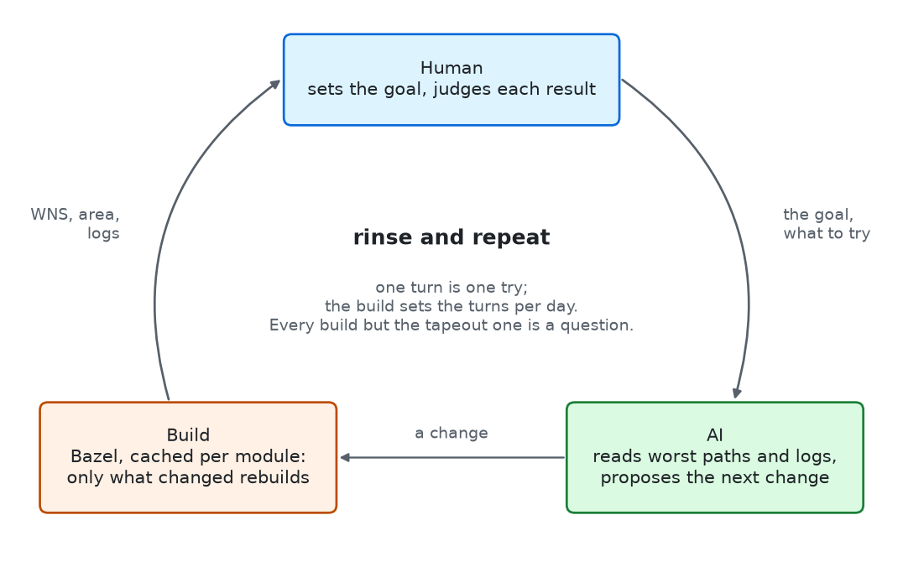
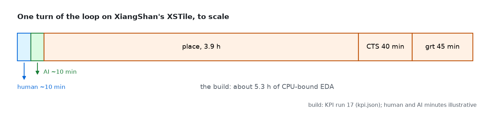
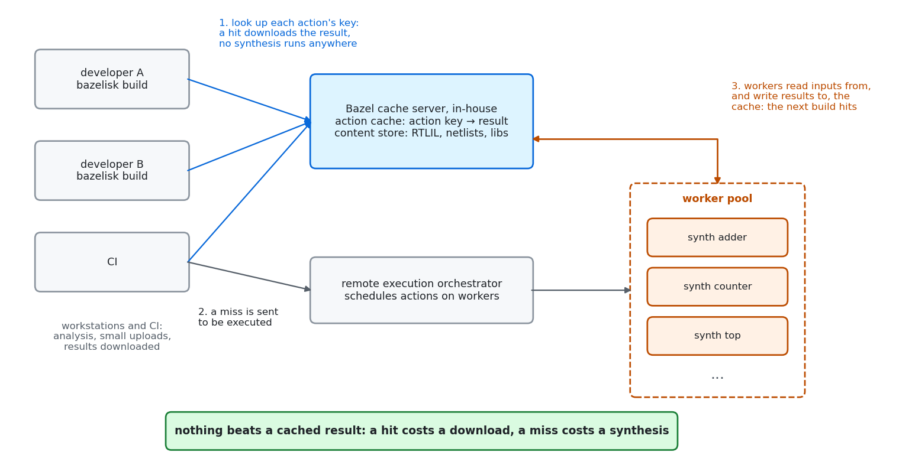
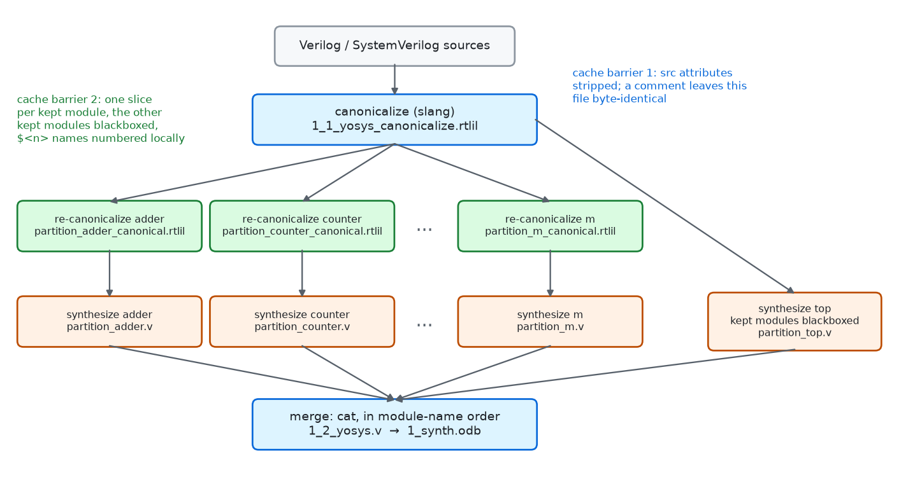
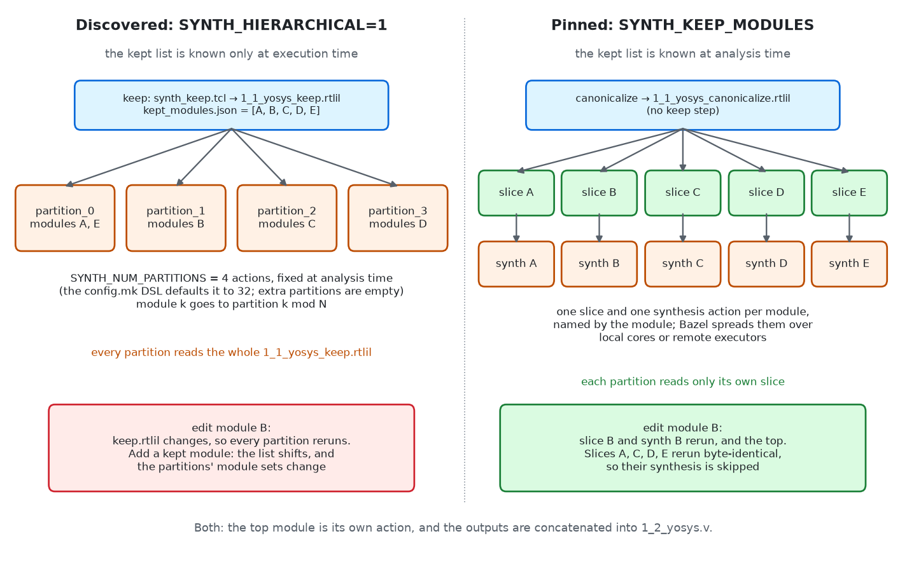

# Fine-grained cached and parallel synthesis

This page documents per-module cached and parallel synthesis in
bazel-orfs, from
[What do I have to do to get it?](#what-do-i-have-to-do-to-get-it) on.
The sections before that cover the context it sits in: generating
regular structures instead of synthesizing them, kept modules and QoR,
and the turnaround of a build and measure loop. Readers who want only
the mechanics can skip ahead.

## Where the speed comes from: caching, then parallelism

Synthesizing modules in parallel shortens a build somewhat. The larger
effect is elsewhere: splitting synthesis at its modules makes each
module's synthesis a **cacheable** unit of work, so that a module nobody
changed is not synthesized again on any machine that shares the cache.

An illustrative example makes the point. Say a design takes
12 hours to synthesize flat. A one-line change to a trivial module then
costs 12 hours, every time, on every machine, however many cores it
has; parallelism might bring that down to the time of the largest module.
With synthesis cached per module, the same change re-synthesizes that
one trivial module, in about a second, and every other module's netlist
comes back from the cache. Parallelism shortens the first build; caching
makes nearly every build after it nearly free.

## Before partitioning: generate the regular structures

Before tuning how synthesis is split, it pays to find what need not be
synthesized at all. Look for the **regular structures**
first: memories, register files, queues, CAMs. Written as RTL arrays,
each word is a row of flip-flops behind a read multiplexer, and
synthesis maps every one of them: tens of thousands of flops, read muxes
a few hundred inputs wide, and the longest synthesis partitions of a
design, before placement has to spread the result. On XiangShan these
structures were the longest synthesis partitions (table below), and
partitioning and caching do not reduce the work inside them. Generate
those structures directly instead:

- **Memories** become macros with `AUTO_MEMORIES=1`: ORFS finds the
  inferred memories and replaces each with a FakeRAM macro, its `.lib`
  and `.lef` generated in the flow (`test/auto_memories`).
- **Register files** are generated by OpenROAD's `generate_ram` from a
  spec, a `<Module>.regfile` file listed in `AUTO_MEMORIES_REGFILES`:
  read and write ports, words, bits, banks. The register file is a macro
  through synthesis and macro placement. `test/regfile` simulates the generated RAMs against their RTL
  models and `test/regfile_lec` checks them formally.
- **Arrays** that are not one RTL array but N copies of an entry selected
  by a broadcast index, a reorder buffer, a load or store queue, a CAM,
  are found and rewritten as one entry cell instanced per entry by the
  `generate_array` front end
  (`test/coremark_joule/designs/asap7/xiangshan/arrays/README.md`), so
  synthesis maps the entry once; `generate_array -spec` builds the
  register-file kind directly (carried patch 0156), and the other kinds
  are the plan in `ideas/structured-macros.md`. `test/array_toys`
  sweeps the kinds over depth and width to show where generating starts
  to pay.

### Surgery: give the structure a module

`AUTO_MEMORIES_REGFILES` replaces a **module**. A register file written
inline, an array inside a larger module, stays flip-flops, and is
synthesized with everything around it. So the first step is RTL
surgery: move the storage into a module of its own, with the same ports
and the same function, and name that module in the spec. Where the RTL
can be changed at its source, change it there; where it cannot,
`SYNTH_VERILOG_SURGERY` runs a script over the Verilog before
canonicalization. Either way the function is kept and checked, never
assumed (the `surgery` skill).

XiangShan, in `test/coremark_joule`, is the worked example, its surgery
carried as patches on the Chisel source in
`test/coremark_joule/xiangshan/patches/`:

| Patch | Before | After |
|---|---|---|
| `0002-xiangshan-ftq-queues-as-register-files` | the Ftq's four `Reg(Vec(64, ...))` queues inline: 53 kbit of flops behind 64:1 read muxes | four `RegVecFile` modules, `FtqEntryQueue`, `FtqMetaQueueRedirect`, `FtqMetaQueueResolve`, `FtqMetaQueueCommit` |
| `0005-xiangshan-rename-buffer-file` | the rename buffer, 352 entries of ~30 bits, twenty 352:1 read muxes: a 20-minute partition | `RenameBufferFile` |
| `0008-xiangshan-rob-entry-file` | the reorder buffer's enqueue-time payload in every entry cell | `RobEntryFile` |
| `0003-xiangshan-rob-entry-cell` | the Rob's per-entry logic unrolled 352 times in one 214 k-line module: 40 minutes in abc | one `RobEntryCell` module, mapped once |

Each new module gets a spec next to the design
(`test/coremark_joule/designs/asap7/xiangshan/FtqEntryQueue.regfile`,
`IntRegFile.regfile`, ...), and the flow that contains it lists the
specs. The Ftq's, from `xiangshan.bzl`:

```starlark
"sources": {
    "AUTO_MEMORIES_REGFILES": [
        "//test/coremark_joule/designs/asap7/xiangshan:FtqEntryQueue.regfile",
        "//test/coremark_joule/designs/asap7/xiangshan:FtqMetaQueueRedirect.regfile",
        "//test/coremark_joule/designs/asap7/xiangshan:FtqMetaQueueResolve.regfile",
        "//test/coremark_joule/designs/asap7/xiangshan:FtqMetaQueueCommit.regfile",
    ],
},
```

XiangShan's register files are generated rather than synthesized because
yosys does not finish them at that size. For a design whose RTL is
Verilog you do not own, ORFS's `asap7/tinyRocket-regfile` (carried patch
`patches/0099-orfs-tinyrocket-regfile.patch`) moves Rocket's inline
register file into `Rocket_rf` with a `SYNTH_VERILOG_SURGERY` script and
generates it from `Rocket_rf.regfile`; `0095` to `0098` generate the
register files of picorv32, ibex, swerv and cva6, the last two after
the same kind of surgery.

**Check that it was generated, not synthesized.** A spec that names no
module in the design, or a module surgery did not create, leaves the
storage as flops, and synthesis succeeds anyway. Count the flops in
`1_2_yosys.v`: the register file is one instance of its macro, with no
module body in the netlist, and the flop count drops by the size of the
array. tinyRocket, with and without its generated register file
(`//test/regfile/designs:RocketTile_tinyRocket_flops_600_synth` and
`..._netlist_600_synth`):

| Variant | `DFF` cells | `Rocket_rf` |
|---|---|---|
| flops, the design as ORFS has it | 3,826 | inline, as flops |
| netlist, generated by `generate_ram` | 2,834 | one macro instance |

992 fewer flops: 31 words of 32 bits, Rocket's integer register file.

Only once the regular structures are generated is it time to look at
how the rest of synthesis is broken up.

## Kept modules and QoR

A flat synthesis lets yosys optimize across the whole design, and it is
often assumed to give the best netlist. Keeping a module was observed
to give an equal or better result than flattening it into its parent,
both for the netlist and for the period after placement and repair.
The mechanism has not been isolated; one hypothesis is that some
optimizations do better on what they are handed when it is the size of
a module rather than of the whole design. A small, reproducible example
that shows the effect, with the flat and kept results side by side,
would make this easier to evaluate; there is none here yet.

Until there is, treat keeping a module as one more setting to try when
working on a design's worst paths: keep the modules they run through
(`SYNTH_KEEP_MODULES`) and compare against flat. With synthesis cached
per module, the comparison re-synthesizes only the modules whose
boundaries moved.

## Turnaround sets how many tries fit

Quality of results is reached within a finite budget of time and
compute. A design's period comes down one try at a time, around a loop.
A human sets the goal and judges each result. An AI reads the worst
paths and the logs and proposes the next change: a module to keep, a
surgery, a setting. The build turns the change into a number.



Every build but the last one, for tapeout, is run for information, so
that something can be changed, and the information is worth more the
sooner it comes. How cheaply it can be had changes as the design
tightens. Early on, a cheap signal, synthesis with wires assumed free or
a placement estimate, predicts the routed timing well enough, and each
change moves the number a little in a predictable direction. As the
design gets tighter the landscape gets cliffier: one setting can move
the period by nanoseconds, and only global route, with `repair_timing`
run to its end, gives a realistic number. There is no shortcut for
`repair_timing`; stopped early or skipped, it measures nothing about the
period it would have reached (the `repair-timing-grt` skill). Getting
accurate global-route timing quickly is the old problem, and it is
hardest exactly when the turns matter most.


The right panel is XiangShan's KPI table,
`test/coremark_joule/designs/asap7/xiangshan/README.md`; run 5 moved to
a newer XiangShan release.

The human and the AI take minutes per turn; the build can take hours.
The build sets how many turns fit in a day, so within a fixed schedule a
faster build allows more tries. Per-module caching shortens that step,
and flattening less may also change the result directly
([Kept modules and QoR](#kept-modules-and-qor)): which modules to keep
is worth trying both ways, and measuring.

### Where a turn spends its time

In the measured turn below, the build takes hours and the human and AI
steps take minutes, so the build sets the pace.



The build times are XiangShan's KPI run 17 (`kpi.json`); the human and
AI minutes are illustrative. A build that takes hours also leaves room
for AI work beside it on the same machine.

## When the dirty lane answers sooner

A hermetic build with caching and remote execution is the way to a
result that has to be right: every
dependency respected, every action keyed, the netlist the same on every
machine. But a turn of the loop is after information, not a result, and
sometimes the [dirty lane](dirty-lane.md) gets it sooner. Lay the stage
out in a plain tree with `bazelisk run //:dirty -- start <flow> <stage>`,
hack a script or a setting, re-run one step and ignore the dependencies
that a hermetic build would rebuild. Then throw the result away and keep
the information.

This works especially well in an AI loop. The AI can try one change
after another in the same tree in minutes, where each would otherwise
rebuild everything downstream of it. Once the answer is known, it goes
into the flow's BUILD file, a script or a carried patch and is built
hermetically. That build is the result.

## Where the compute goes (as of 2026-11)

These are observations for the flows in this repository, as of
2026-11; they will change as tools and hardware do. Throughput hardware
such as GPUs helps most on large, uniform, data-parallel work. In
global placement, the density and wirelength loop is that kind of work.
Timing-driven and routability-driven placement, with timing analysis
and repair inside the iterations, are mostly serial and branchy, and
run on the CPU in the current tools. The one measured number here is
swerv_wrapper's: 69% of the main thread's time in global placement is
timing analysis inside the timing-driven iterations
(`ideas/xiangshan-timing.md`). By Amdahl's law, speeding up only the
density loop is bounded by the share of time it has.


The split in the figure is made up to show the shape; XSTile's global
placement has not been profiled.

## What do I have to do to get it?

Nothing. A design that keeps hierarchy synthesizes per module and in
parallel by default; you would have to do something to turn it off.
`SYNTH_KEEP_MODULES` on any flow, or `SYNTH_HIERARCHICAL=1` on an ORFS
design read through the config.mk DSL (`design()`), is enough. A flat
synthesis is one module, so there is nothing to split. (One exception:
`orfs_flow` with `SYNTH_HIERARCHICAL=1` and no keep list runs ORFS's
serial hierarchical synthesis unless `SYNTH_NUM_PARTITIONS` is set; the
DSL sets it to 32.)

It helps to know how a long synthesis breaks down, because the same breakdown decides both the
quality of results and the turnaround:

- **Which modules are big.** Each partition writes its own log,
  `logs/.../1_2_yosys_partition_*.log`; the longest one sets the time of
  a miss. A partition that dwarfs the others is usually a regular
  structure that should be generated, or an unrolled loop that should be
  one module instanced N times (the Rob above).
- **Where the boundaries are.** A kept module is a hard boundary: yosys
  does not optimize across it, no constant propagates in, no logic merges
  between two modules. Keep too much and what crosses a boundary is not
  optimized; keep too little and one partition holds most of the design,
  which is slow and not always better
  ([Kept modules and QoR](#kept-modules-and-qor)).
  Which modules to keep is a design decision (the `macro-selection` and
  `surgery` skills), settled by trying it both ways.
- **What you edit.** The modules you change every day want to be small
  partitions of their own, so a change re-synthesizes seconds of work,
  not minutes; the top wants to be thin, because it is synthesized again
  on every change (see the walkthrough).

Then pin the list (`SYNTH_KEEP_MODULES`), so every partition is cached
per module ([below](#discovered-modules-on-a-static-build-graph)):

```starlark
orfs_flow(
    name = "top",
    arguments = {
        "SYNTH_KEEP_MODULES": "adder counter",
    },
    ...
)
```

`docs/customize.md` says how to capture the list ORFS would discover.
`kept_macros` (`orfs_flow`'s docstring) scopes each partition's macro
inputs to the macros its modules instantiate, so a partition does not
wait for the place and route of a macro it does not contain.

**Expectations to manage:**

- **Slang only.** `orfs_flow` synthesizes with slang
  (`SYNTH_HDL_FRONTEND=slang`, the default) and refuses another frontend
  without a stated reason. Per-module synthesis resolves kept modules by
  the names slang gives them, `Foo$Top.path.to.inst` for a uniquified
  instance among them, and is not built or tested for yosys's own
  Verilog frontend. On XiangShan's flat core slang canonicalizes in one
  minute where yosys's Verilog frontend took seven.
- **Only synthesis gets faster.** When `1_2_yosys.v` changes at all, by
  one cell in one module, floorplan and every stage after it rebuild.
- **Cosmetic edits**: see [Surprises](#surprises).
- **Repeatability follows the partitioning.** `SYNTH_NUM_PARTITIONS` is
  a fixed number, never the core count, so that the action graph, and
  with it the netlist, is the same on every machine.

XiangShan's flows pin their kept lists, one with sixteen modules
(`Frontend`, `Backend`, `MemBlock`, ...) in sixteen partitions. A flat
against partitioned synthesis time for XiangShan has not been measured.

## Remote execution and caching



Remote execution and a shared cache are part of a company's IT
infrastructure, not of a project: no `BUILD` file, `MODULE.bazel` or
flow argument changes to use them. The configuration, the cache and
executor endpoints and their credentials, normally goes into each
engineer's `~/.bazelrc`, and every Bazel workspace on that machine uses
it, bazel-orfs and its designs among them. The walkthrough below ran
this way.

A typical setup for the shortest synthesis turnaround:

- **A Bazel cache server, shared in-house** by every engineer and by CI:
  an action cache (action key to result) and a content store (the RTLIL,
  netlists and libraries themselves).
- **A remote execution orchestrator with a pool of workers**, in the
  same location as the cache server: workers read every input from the
  cache and write every result back to it, so they want the bandwidth of
  the same building, not of the internet.
- **Remote engineers reach both over a VPN.** What crosses the VPN is
  small: action keys, the inputs that are new, and the outputs that were
  asked for. A slice holds one module, so a partition's upload is one
  module, not the design.

Each build first looks up every action's key in the cache. A hit
downloads the result and no synthesis runs anywhere; only a miss goes to
the orchestrator, which runs it on a worker, and the worker writes the
result back for the next build, whoever runs it.

**A shared cache hit is the cheapest outcome.** A hit costs downloading
a netlist; a miss costs a synthesis. Parallelism makes the
misses fast; the shared cache makes most of them hits.

- **Every partition is a hermetic action.** Its inputs are its RTLIL
  slice (or the keep checkpoint), the scripts, the platform's Liberty and
  LEF files, and, with `kept_macros`, only the macros its modules
  contain. Nothing reads a path outside the action, so any worker can
  run it.
- **Width beyond one machine.** A design with sixty pinned kept modules
  has sixty synthesis actions ready at once, and runs them on as many
  workers as the pool gives, each holding one module rather than the
  design.
- **One engineer's edit costs everyone else one action.** A partition
  another machine synthesized is a cache hit here. This is why
  `SYNTH_NUM_PARTITIONS` is static: a graph that differs between machines
  shares no keys.

An action on a remote worker cannot be watched while it runs; the
`dirty-lane` skill runs a stage locally for that.

## How synthesis is broken up



With a pinned `SYNTH_KEEP_MODULES`:

1. **Canonicalize.** ORFS's `synth_canonicalize.tcl` reads the
   Verilog and SystemVerilog through slang and writes the elaborated
   design as `1_1_yosys_canonicalize.rtlil`. bazel-orfs runs it with
   `SYNTH_REPEATABLE_BUILD=1` unless a design says 0, which strips the
   `src` attributes, the file name and line number every RTLIL object
   carries.
2. **Re-canonicalize, one action per kept module.**
   `synth_canonicalize_module.tcl` reads the canonical RTLIL, keeps only
   the module's own hierarchy (`hierarchy -top`), blackboxes the other
   kept modules inside it, and writes
   `partition_<module>_canonical.rtlil`. The slice holds nothing outside
   the module.
3. **Synthesize, one action per kept module.** `synth_partition.sh`
   runs ORFS's `synth.tcl` on the slice and writes `partition_<module>.v`.
4. **Synthesize the top.** The top module is synthesized from the whole
   canonical RTLIL with every kept module blackboxed, into
   `partition_top.v`.
5. **Merge.** `cat` concatenates the partitions, sorted by module name
   so that reordering `SYNTH_KEEP_MODULES` changes nothing, and then the
   top, into `1_2_yosys.v`; the SDC is copied and `1_synth.odb` is
   written as for a serial synthesis. From here on nothing knows the
   netlist was synthesized in pieces.

## Discovered modules on a static build graph



Discovery, `SYNTH_HIERARCHICAL=1` without a keep list, lets yosys choose
the kept modules: `synth_keep.tcl` runs yosys's coarse synthesis and
`keep_hierarchy -min_cost $SYNTH_MINIMUM_KEEP_SIZE`, writes
`1_1_yosys_keep.rtlil`, and `rtlil_kept_modules.py` writes the list to
`kept_modules.json`. That list exists only once an action has run.

Bazel, though, fixes its whole action graph at analysis time, before any
action runs: it cannot add one action per module for modules it has not
been told about. The way round is a static number of executors.
`SYNTH_NUM_PARTITIONS` (*N*) partition actions are declared up front,
each knowing only its own number *i*. At execution time each one reads
`kept_modules.json` and takes the modules whose position *k* in the list
satisfies *k* mod *N* = *i*:

```
kept_modules.json = [A, B, C, D, E]          N = 4

partition_0:  A, E      k = 0, 4
partition_1:  B         k = 1
partition_2:  C         k = 2
partition_3:  D         k = 3
```

A partition synthesizes its modules **in series**, one after another in
the same action, each from the keep checkpoint with every other kept
module blackboxed, and concatenates them into `partition_<i>.v`. A
partition whose number no module maps to writes an empty netlist. The
graph is the same on every machine and for every list, so the remote
cache works across machines; what it gives up:

- **No per-module cache.** Every partition reads the whole
  `1_1_yosys_keep.rtlil`, so an edit to one module re-runs every
  partition: the walkthrough's discovered edit re-ran both.
- **Shifting assignments.** Adding or removing a kept module moves every
  module after it to another partition.
- **Balance by position, not size.** Two large modules can land in the
  same partition and run back to back while other executors sit idle.
  With *N* larger than the module count (the DSL's 32), each module gets
  a partition of its own and the series is one module long.

A pinned list is known at analysis time, so the graph has one slice
action and one synthesis action per module, each named by its module.
A partition's key holds neither the rest of the list nor its position in
it (`test/partition_key_test.bzl`): adding a module to the list adds two
actions, and the others keep their keys. Discovery is the way in, a
design that needs nothing from you; pinning is what makes it cache per
module.

## Canonicalization is what makes it incremental

Bazel re-runs an action when the digest of one of its inputs changes,
and skips it when every input is byte-identical to a run it has seen,
whatever produced those bytes. An action that re-runs and writes the same
bytes as before stops the rebuild there. Per-module synthesis has two
such barriers, and both are canonicalizations:

- **`1_1_yosys_canonicalize.rtlil`** stops edits that do not change the
  elaborated design: comments, blank lines, formatting, a moved
  declaration. With `src` stripped, the RTLIL holds no line numbers, so
  slang's elaboration of the edited file is byte-identical.
- **`partition_<module>_canonical.rtlil`** stops edits to *other*
  modules. A change to `adder` changes the global RTLIL, so every slice
  action re-runs, but `counter`'s slice comes out byte-identical and
  `counter`'s synthesis, the expensive action, is skipped.

### Module names that do not move

A generator that deduplicates modules, Chisel and firtool among them,
names the survivors of one desired name `Queue`, `Queue_1`, `Queue_2`, ...
in elaboration order. One instance added anywhere renumbers every later
`Queue_<n>`: the renumbered modules, every module that instantiates one,
their slices and partitions, and every keep list and report that names
them change, though the hardware did not.

`SYNTH_STABLE_MODULE_NAMES=1` names the modules of such a family by
where they sit instead, `<desired name>__<parent>__<first instance>`,
before canonicalization (`stable_module_names.py`). Names are computed
top-down, a module that several parents instantiate is cloned per
parent, and a name past 100 characters hashes its parent. Adding an
instance then changes the module it is added to and adds one module;
`test/stable_module_names` holds such an edit. Uncontested names, the
macros in `deps`, and the names `SYNTH_STABLE_MODULE_NAMES_EXCLUDE`
matches keep theirs. `SYNTH_STABLE_MODULE_NAMES_GROUPS` gives the desired
names exactly, as `{module: desired name}`; without it `X` and `X_<n>`
are taken to be one family. `module_names.json` (output group
`module_names`) lists every new name. A `SYNTH_KEEP_MODULES` name the
output does not have fails the step, and so does a `SYNTH_RETIME_MODULES`
pattern that matched a renamed module and matches none of the output.

### Caching needs a deliberate POLA violation

The principle of least astonishment says a tool's output should tell you
where it came from: the file and line of every cell, the build date, the
tool's version. Caching needs the opposite. A cache key is a digest of
bytes, so anything in an output that changes when the design does not,
a line number, an absolute path, a date, a counter, makes every
downstream action miss. Everything of that kind has to be stripped, and
the flow sets the options to make sure it is:

- `src` attributes (file and line) are stripped at canonicalization
  (`SYNTH_REPEATABLE_BUILD=1`) and again in every slice; the slice
  action forces `SYNTH_REPEATABLE_BUILD=1` even for a design that sets
  0, a byte-stable slice being its only purpose.
- `area` and `capacitance` attributes that a macro's Liberty file puts on
  its blackbox are stripped from the slices. They drift with every place
  and route of the macro, by picoseconds and nanometres; `synth.tcl`
  reads the Liberty file itself.
- yosys's private names, `$procmux$1234`, numbered from one counter
  across the whole design, are renumbered within their module
  (`rename -src`, through a marker name so a renamed cell cannot replace
  one slang already called `$2`, YosysHQ/yosys#6380), and the `autoidx`
  line, that counter's value, is dropped.
- The same goes for every stage: OpenSTA's `write_sdc` stamps the date
  into the `.sdc` it writes, so ORFS writes it with `-no_timestamp`.

Bazel's own conventions point the same way: a build is unstamped by
default, so no git hash or build date reaches an output unless a target
asks for `--stamp`, and Bazel's archive rules write fixed timestamps.
OpenROAD follows the idiomatic split: its development builds carry
cache-safe placeholders, and its release builds (`--config=release`,
which sets `--stamp`) write the git version and date into the binary as
the last step, after everything that is cached.

## Surprises

- **Bazel downloads only what you asked for.** With remote execution or a
  remote cache, Bazel downloads the outputs of the targets named on the
  command line and nothing else (`--remote_download_outputs=toplevel`,
  the default). Build `<design>_grt` from a warm cache and
  `bazel-bin` holds global route's results, but not floorplan's: those
  were never needed locally and stay in the cache. Build the stage you
  want to look at by name, and it is a download.
- **A local rebuild need not match the cache.** When the input digests
  are the same, the netlist comes from the cache, produced by yosys on
  whichever machine ran it first. Running the same action again locally
  is not guaranteed to write identical bytes ([Appendix](#appendix-yosys-and-determinism)):
  a local and a cached netlist of the same RTL can differ, and both are
  valid.
- **A comment is usually free, not guaranteed free.** It costs one
  action in the walkthrough. Whether the canonical RTLIL stays
  byte-identical depends on slang and yosys producing the same bytes
  from equivalent input; when a cosmetic edit rebuilds more than
  expected, ask Bazel why, action by action (`--explain`, the execution
  log, the `cache-miss` skill), and compare the two RTLIL files that
  differed. Never clean the cache.
- **The top re-runs on every change.** It reads the whole canonical
  RTLIL and has no slice of its own.

## Walkthrough: one `.v` file, two edits

`//test:kept_modules_synth` synthesizes `test/rtl/kept_modules_top.v`,
three modules, with `SYNTH_KEEP_MODULES = "adder counter"`:

```verilog
module adder(input [7:0] a, input [7:0] b, output [8:0] sum);
  assign sum = a + b;
endmodule

module counter(input clk, input reset, output [7:0] count);
  ...
endmodule

module kept_modules_top(...);
  counter u_counter(...);
  adder u_adder(...);
endmodule
```

Each build below ran with remote execution and
`--execution_log_json_file`, which lists every action Bazel executed
(an action whose inputs are unchanged is not executed and not listed).

**Build it once.** Every action runs, or is a remote cache hit.

**Edit 1: a comment.** Two comment lines at the top of the file, which
move every line below them:

```verilog
// A comment added for the parallel-synthesis walkthrough,
// two lines long, so every line below it moves down by two.
```

| Action | Ran? |
|---|---|
| canonicalize, `1_1_yosys_canonicalize.rtlil` | yes, 2.8 s, output byte-identical |
| re-canonicalize `adder`, `counter` | no |
| synthesize `adder`, `counter`, top | no |
| merge, `1_synth.odb` | no |

One action; the build took 5 s. The canonical RTLIL came out
byte-identical, so the rebuild stopped at the first barrier and nothing
downstream of it, floorplan included, saw a change.

**Edit 2: one module's logic.** `assign sum = a + b;` becomes
`assign sum = a - b;`:

| Action | Ran? |
|---|---|
| canonicalize | yes, 2.8 s |
| re-canonicalize `adder` | yes, 1.9 s, new slice |
| re-canonicalize `counter` | yes, 1.9 s, output byte-identical |
| synthesize `adder` | yes, 3.4 s |
| synthesize `counter` | **no**: its slice was unchanged |
| synthesize top | yes, 3.3 s: it reads the whole canonical RTLIL |
| merge, `1_synth.odb` | yes |

Seven actions, all on remote workers; the build took 16 s. `counter`
was not synthesized again. The top was: it reads the global canonical
RTLIL, which changed, and has no slice of its own. A large design wants
its top to be thin for that reason.

**The same edit, discovered.** `//test:discovered_modules_synth` is the
same design with `SYNTH_HIERARCHICAL=1` and two partitions. One edit to
`adder`'s logic re-ran canonicalize, keep, `kept_modules.json`, **both**
partitions, the top and the merge: eight actions. Without a per-module
slice there is no second barrier.

To reproduce this: build the target, make the edit, and build again with
`--execution_log_json_file=tmp/exec.json`.

## Reference

| Variable | Effect |
|---|---|
| `SYNTH_KEEP_MODULES` | Pinned kept modules. One slice and one partition per module, unless `SYNTH_NUM_PARTITIONS` groups them. A name missing from the design fails synthesis. |
| `SYNTH_HIERARCHICAL` | `1` with no `SYNTH_KEEP_MODULES`: discover the kept modules at build time. |
| `SYNTH_MINIMUM_KEEP_SIZE` | Discovery threshold, estimated gate equivalents; smaller modules are flattened into their parent. |
| `SYNTH_NUM_PARTITIONS` | Number of partition actions. Discovery through `orfs_flow` is serial without it; the DSL sets 32; pinned defaults to one per module. |
| `SYNTH_REPEATABLE_BUILD` | `1` (bazel-orfs's default) strips `src` at canonicalization. Always `1` in the slice actions. |
| `AUTO_MEMORIES` | `1`: inferred memories become FakeRAM macros. |
| `AUTO_MEMORIES_REGFILES` | `<Module>.regfile` specs: those modules are generated by `generate_ram`, not synthesized. |
| `SYNTH_STABLE_MODULE_NAMES` | `1`: name the modules of a deduplicated family by their path before canonicalization. |
| `SYNTH_STABLE_MODULE_NAMES_GROUPS` | `{module: desired name}` JSON; without it `X` and `X_<n>` are one family. |
| `SYNTH_STABLE_MODULE_NAMES_EXCLUDE` | fnmatch patterns of module names that keep their names. |
| `SYNTH_VERILOG_SURGERY` | A script run over the Verilog before canonicalization, for surgery on RTL you cannot change at its source. |

| File | Written by |
|---|---|
| `1_0_stable_module_names.sv`, `module_names.json` | `stable_module_names.py` (`SYNTH_STABLE_MODULE_NAMES=1`) |
| `1_1_yosys_canonicalize.rtlil` | canonicalize (slang) |
| `1_1_yosys_keep.rtlil`, `kept_modules.json` | `synth_keep.tcl`, `rtlil_kept_modules.py` (discovery only) |
| `partition_<module>_canonical.rtlil`, `.name` | `synth_canonicalize_module.tcl` (pinned only) |
| `partition_<module>.v`, `partition_<i>.v`, `partition_top.v` | `synth_partition.sh` running `synth.tcl` |
| `1_2_yosys.v` | the merge, `cat` |

The code is in `_yosys_parallel_synth` in `private/rules.bzl`, with
`synth_keep.tcl`, `synth_canonicalize_module.tcl`, `synth_partition.sh`
and `parallel_synth.mk` at the repository root. The tests are in
`test/BUILD`: `kept_modules_synth`, `discovered_modules_synth`,
`nested_kept_synth`, the `dsl_*_synth_test`s, and
`test/partition_key_test.bzl`. The diagrams are drawn by
`bazelisk run //docs/images:parallel_synthesis_diagrams`.

## Appendix: yosys and determinism

The situation has improved enormously, and is still worth keeping an eye
on. Per-module caching depends on yosys and slang writing the same bytes
from the same input, and on cosmetic edits not reaching the bytes at all.
A few years ago neither held reliably; today both hold in every case the
walkthrough covers, and the issues that remain are known and narrow.

Fixed, each one a source of spurious rebuilds removed:

- YosysHQ/yosys#3184, fixed 2022: output varied with the script's name,
  the path yosys was run from, or another yosys running alongside.
- YosysHQ/yosys#5780, fixed 2026-04: the netlist depended on the order
  of objects in the design, and differed between runs.
- YosysHQ/yosys#6170, fixed 2026-09: `abc -dff` with more than one
  thread gave a different netlist on every run of the same input.
- YosysHQ/yosys#6380, fixed 2026-10: `rename -src` replaced an object
  whose name it reused; the slice script works around it on yosys
  versions before the fix.

Still open, and why they matter less here:

- YosysHQ/yosys#3713: comment-only or blank lines at the top of a
  Verilog file change the synthesis result. Line numbers reach a netlist
  through `src` attributes and the names derived from them; stripping
  `src` at canonicalization, as bazel-orfs does, removes the path seen
  there.
- YosysHQ/yosys#5205: the same script gives different results on Linux
  and macOS. A cache shared between the two misses; workers and engineers
  on one operating system do not see it.

A difference that comes from yosys rather than from the RTL is worth a
yosys issue, with the two RTLIL files that differed.
