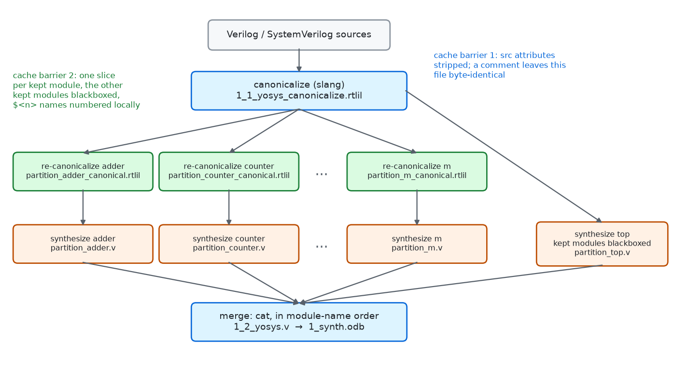
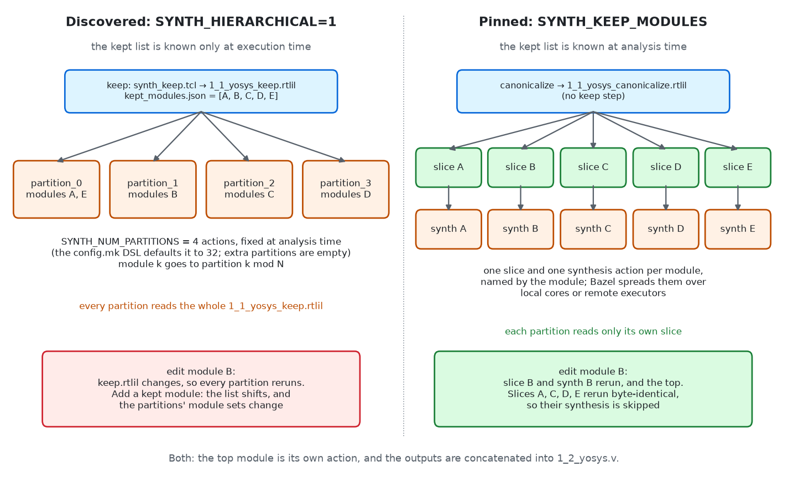
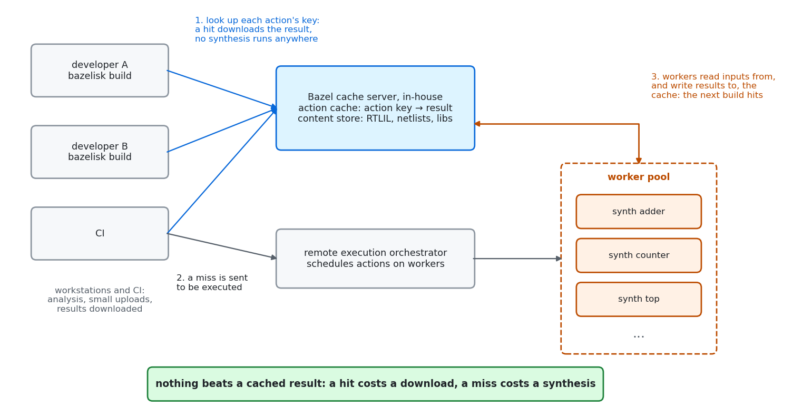

# Parallel synthesis

Synthesis of a large design is a single yosys process by default: one
canonicalization, one `synth`, one netlist, one core. bazel-orfs can
split the design at its kept modules instead, synthesize each in its own
Bazel action, and concatenate the netlists at the end. The actions run
side by side on local cores or on Bazel remote executors, and an edit to
one module re-synthesizes that module, not the design.

This page says what that buys and what it does not, then follows the
flow through RTLIL, then follows one `.v` file through two edits.

## What it is for, and what not to expect

**Use it** on a design whose synthesis takes long enough to wait for, and
that you edit and rebuild: a core of a few million cells, a tile, an
accelerator with a handful of large blocks. Two things change:

- **Wall time.** The kept modules synthesize in parallel. The longest
  kept module, plus canonicalization, the top and the merge, sets the
  time, not the sum.
- **Incremental builds.** A change to one module re-synthesizes that
  module and the top. The other modules are Bazel cache hits, locally or
  from a remote cache another machine filled.

**Manage the expectations:**

- **Slang only.** `orfs_flow` synthesizes with slang
  (`SYNTH_HDL_FRONTEND=slang`, the default) and refuses another frontend
  without a stated reason. Parallel synthesis resolves kept modules by
  the names slang gives them, `Foo$Top.path.to.inst` for a uniquified
  instance among them, and is not built or tested for yosys's own
  Verilog frontend.
- **A kept module is a hard boundary.** yosys does not optimize across
  it: no constant propagates in, no logic merges between two modules, no
  retiming crosses. The netlist differs from a flat synthesis of the same
  RTL, and its quality can be worse; which modules to keep is a design
  decision (the `macro-selection` and `surgery` skills), not a speed
  knob.
- **Only synthesis gets faster.** When `1_2_yosys.v` changes at all, by
  one cell in one module, floorplan and every stage after it rebuild.
  Parallel synthesis does nothing for placement or routing.
- **No guarantee that a comment is free.** In the walkthrough below a
  comment rebuilds one action and nothing else, and that is the usual
  outcome. It is not a guarantee: yosys is sensitive to the exact form of
  its input, and a cosmetic edit can still change a netlist
  ([below](#yosys-and-cosmetic-edits)).
- **Repeatability follows the partitioning.** Set `SYNTH_NUM_PARTITIONS`
  to a fixed number, never to the core count, so that the action graph,
  and with it the netlist, is the same on every machine. A pinned list
  defaults to one partition per module, and the config.mk DSL
  (`design()`) to 32 in discovery.

XiangShan in `test/coremark_joule` is the large user: its flows pin
their kept lists, one with sixteen modules (`Frontend`, `Backend`,
`MemBlock`, ...) in sixteen partitions. Slang matters there too: the flat
core took seven minutes to canonicalize on yosys's Verilog frontend and
one on slang. A flat against partitioned synthesis time for XiangShan
has not been measured.

## Turn it on

Either name the kept modules (**pinned**):

```starlark
orfs_flow(
    name = "top",
    arguments = {
        "SYNTH_KEEP_MODULES": "adder counter",
    },
    ...
)
```

or let synthesis choose them (**discovered**):

```starlark
orfs_flow(
    name = "top",
    arguments = {
        "SYNTH_HIERARCHICAL": "1",
        "SYNTH_MINIMUM_KEEP_SIZE": "10000",
        "SYNTH_NUM_PARTITIONS": "8",
    },
    ...
)
```

A pinned list gets one partition per module unless `SYNTH_NUM_PARTITIONS`
says otherwise. Discovery is parallel only with `SYNTH_NUM_PARTITIONS`
set: without it, `orfs_flow` runs ORFS's serial hierarchical synthesis.
The config.mk DSL (`design()`, `docs/orfs-design-builds.md`) sets it to
32 when it is not given. `docs/customize.md` says how to capture the list ORFS would
discover and pin it.

`kept_macros` (see `orfs_flow`'s docstring) scopes each partition's
macro inputs to the macros its modules instantiate, so a partition does
not wait for the place and route of a macro it does not contain.

## The flow, through RTLIL



With a pinned `SYNTH_KEEP_MODULES`:

1. **Canonicalize.** ORFS's `synth_canonicalize.tcl` reads the
   Verilog and SystemVerilog through slang and writes the elaborated
   design as `1_1_yosys_canonicalize.rtlil`. bazel-orfs runs it with
   `SYNTH_REPEATABLE_BUILD=1` unless a design says 0, which strips the
   `src` attributes, the file name and line number every RTLIL object
   carries.
2. **Re-canonicalize, one action per kept module.**
   `synth_canonicalize_module.tcl` reads the canonical RTLIL, keeps only
   the module's own hierarchy (`hierarchy -top`), blackboxes the other
   kept modules inside it, and writes
   `partition_<module>_canonical.rtlil`. The slice holds nothing outside
   the module.
3. **Synthesize, one action per kept module.** `synth_partition.sh`
   runs ORFS's `synth.tcl` on the slice and writes `partition_<module>.v`.
4. **Synthesize the top.** The top module is synthesized from the whole
   canonical RTLIL with every kept module blackboxed, into
   `partition_top.v`.
5. **Merge.** `cat` concatenates the partitions, sorted by module name
   so that reordering `SYNTH_KEEP_MODULES` changes nothing, and then the
   top, into `1_2_yosys.v`; the SDC is copied and `1_synth.odb` is written as
   for a serial synthesis. From here on nothing knows the netlist was
   synthesized in pieces.

Discovery adds a step after canonicalization: `synth_keep.tcl` runs
yosys's coarse synthesis and `keep_hierarchy -min_cost
$SYNTH_MINIMUM_KEEP_SIZE`, writes `1_1_yosys_keep.rtlil`, and
`rtlil_kept_modules.py` lists the kept modules in `kept_modules.json`.
There is no per-module slice in that mode, for the reason the next
section shows.

### Static partitions, discovered or pinned



Bazel fixes its action graph at analysis time, before any action runs.
A discovered keep list exists only after the keep action has run, so the
graph cannot have one action per kept module. It has
`SYNTH_NUM_PARTITIONS` actions instead, a static number of executors:
partition *i* reads `kept_modules.json` and synthesizes every module *k*
with *k* mod *N* = *i*, from the whole `1_1_yosys_keep.rtlil` with the
other kept modules blackboxed. A partition with no module writes an empty
netlist. Every partition reads the whole keep checkpoint, so any change
to it re-runs every partition, and adding or removing a kept module
shifts the list and with it every partition's set of modules.

A pinned list is known at analysis time. The graph has one slice action
and one synthesis action per module, each named by its module, and the
partition's key holds neither the rest of the list nor its position in
it (`test/partition_key_test.bzl`). Adding a module to the list adds two
actions; the others keep their keys.

## Canonicalization is what makes it incremental

Bazel re-runs an action when the digest of one of its inputs changes,
and skips it when every input is byte-identical to a run it has seen,
whatever produced those bytes. An action that re-runs and writes the same
bytes as before stops the rebuild there. Parallel synthesis has two such
barriers, and both are canonicalizations:

- **`1_1_yosys_canonicalize.rtlil`** stops edits that do not change the
  elaborated design: comments, blank lines, formatting, a moved
  declaration. With `src` stripped, the RTLIL holds no line numbers, so
  slang's elaboration of the edited file is byte-identical.
- **`partition_<module>_canonical.rtlil`** stops edits to *other*
  modules. A change to `adder` changes the global RTLIL, so every slice
  action re-runs, but `counter`'s slice comes out byte-identical and
  `counter`'s synthesis, the expensive action, is skipped.

The second barrier needs more than `hierarchy -top`. Before
`synth_canonicalize_module.tcl` writes a slice it removes everything in
it that depends on the rest of the design:

- `src` attributes, stripped again: a slice must not depend on whether
  the design stripped them.
- `area` and `capacitance` attributes that a macro's Liberty file puts on
  its blackbox. They drift with every place and route of the macro, by
  picoseconds and nanometres; `synth.tcl` reads the Liberty file itself,
  so the copies in the RTLIL are not needed.
- Private names. yosys numbers its internal objects, `$procmux$1234`,
  from one counter across the whole design, so a cell added in one module
  renumbers every other. `rename -src` numbers them within their own
  module instead; the slice script routes it through a marker name, so a
  renamed cell cannot replace one slang already called `$2`
  (YosysHQ/yosys#6380).
- The `autoidx` line, the value of that whole-design counter.

The slice action forces `SYNTH_REPEATABLE_BUILD=1` even for a design
that sets 0: a byte-stable slice is the action's only purpose.

## Walkthrough: one `.v` file, two edits

`//test:kept_modules_synth` synthesizes `test/rtl/kept_modules_top.v`,
three modules, with `SYNTH_KEEP_MODULES = "adder counter"`:

```verilog
module adder(input [7:0] a, input [7:0] b, output [8:0] sum);
  assign sum = a + b;
endmodule

module counter(input clk, input reset, output [7:0] count);
  ...
endmodule

module kept_modules_top(...);
  counter u_counter(...);
  adder u_adder(...);
endmodule
```

Each build below ran with remote execution and
`--execution_log_json_file`, which lists every action Bazel executed
(an action whose inputs are unchanged is not executed and not listed).

**Build it once.** Every action runs, or is a remote cache hit.

**Edit 1: a comment.** Two comment lines at the top of the file, which
move every line below them:

```verilog
// A comment added for the parallel-synthesis walkthrough,
// two lines long, so every line below it moves down by two.
```

| Action | Ran? |
|---|---|
| canonicalize, `1_1_yosys_canonicalize.rtlil` | yes, 2.8 s, output byte-identical |
| re-canonicalize `adder`, `counter` | no |
| synthesize `adder`, `counter`, top | no |
| merge, `1_synth.odb` | no |

One action; the build took 5 s. The canonical RTLIL came out
byte-identical, so the rebuild stopped at the first barrier and nothing
downstream of it, floorplan included, saw a change.

**Edit 2: one module's logic.** `assign sum = a + b;` becomes
`assign sum = a - b;`:

| Action | Ran? |
|---|---|
| canonicalize | yes, 2.8 s |
| re-canonicalize `adder` | yes, 1.9 s, new slice |
| re-canonicalize `counter` | yes, 1.9 s, output byte-identical |
| synthesize `adder` | yes, 3.4 s |
| synthesize `counter` | **no**: its slice was unchanged |
| synthesize top | yes, 3.3 s: it reads the whole canonical RTLIL |
| merge, `1_synth.odb` | yes |

Seven actions, all on remote executors; the build took 16 s. `counter`
was not synthesized again. The top was: it reads the global canonical
RTLIL, which changed, and has no slice of its own. A large design wants
its top to be thin for that reason.

**The same edit, discovered.** `//test:discovered_modules_synth` is the
same design with `SYNTH_HIERARCHICAL=1` and two partitions. One edit to
`adder`'s logic re-ran canonicalize, keep, `kept_modules.json`, **both**
partitions, the top and the merge: eight actions. Without a per-module
slice there is no second barrier.

To reproduce this: build the target, make the edit, and build again with
`--execution_log_json_file=tmp/exec.json`.

## Yosys and cosmetic edits

The walkthrough shows the usual outcome, not a promise. Whether a
cosmetic edit leaves the canonical RTLIL byte-identical depends on
yosys and slang producing the same bytes from equivalent input, and
yosys has a history of being sensitive to its input, and to how it is
run, in ways that do not change the design:

- YosysHQ/yosys#3713, open: comment-only header lines or blank lines at
  the top of a Verilog file change the synthesis result. Line numbers
  reach the netlist through `src` attributes and the names derived from
  them; stripping `src` at canonicalization, as bazel-orfs does, removes
  the path seen there.
- YosysHQ/yosys#5205, open: the same script gives different results on
  Linux and macOS. A remote cache shared between the two will miss.

Others have been fixed, and the trend is toward determinism:

- YosysHQ/yosys#3184, fixed 2022: output varied with the script's name,
  the path yosys was run from, or another yosys running alongside.
- YosysHQ/yosys#5780, fixed 2026-04: the netlist depended on the order
  of objects in the design, and differed between runs.
- YosysHQ/yosys#6170, fixed 2026-09: `abc -dff` with more than one
  thread gave a different netlist on every run of the same input.
- YosysHQ/yosys#6380, fixed 2026-10: `rename -src` replaced an object
  whose name it reused, which the slice script works around and which is
  why the private-name renumbering above takes the detour it does.

When a cosmetic edit does rebuild more than you expected, ask Bazel why,
action by action (`--explain`, the execution log, the `cache-miss`
skill), and compare the two RTLIL files that differed; never clean the
cache. A difference that comes from yosys rather than from the RTL is
worth a yosys issue.

## Remote execution

Parallel synthesis is built for Bazel remote execution, and needs
nothing beyond a remote execution configuration in `.bazelrc`; the
walkthrough above ran on remote executors.



A typical setup for the shortest synthesis turnaround is a Bazel cache
server shared in-house by every developer and by CI, next to a remote
execution orchestrator with a pool of workers. Each build first looks up
every action's key in the cache. A hit downloads the result and no
synthesis runs anywhere; only a miss goes to the orchestrator, which
runs it on a worker, and the worker writes the result back to the cache
for the next build, whoever runs it.

**Nothing beats sharing a cached result.** No partitioning, no number of
cores and no faster yosys comes close to a cache hit: a hit costs a
download of a netlist, a miss costs a synthesis. Parallel synthesis
makes the misses fast; the shared cache makes most of them hits. The
canonicalization barriers above exist so that one person's edit leaves
everyone else's partitions hits.

- **Every partition is a hermetic action.** Its inputs are its RTLIL
  slice (or the keep checkpoint), the scripts, the platform's Liberty and
  LEF files, and, with `kept_macros`, only the macros its modules
  contain. Nothing reads a path outside the action, so an executor
  anywhere can run it.
- **Width beyond one machine.** A design with sixty pinned kept modules
  has sixty synthesis actions ready at once; with remote execution they
  run on as many executors as the cluster gives, each holding one module
  rather than the design.
- **The remote cache is shared.** A partition another machine
  synthesized is a cache hit here, and a colleague's edit to one module
  costs everyone else one action. This is why `SYNTH_NUM_PARTITIONS` is
  static rather than the core count: a graph that differs between
  machines shares no keys.
- **Small inputs, small uploads.** A slice holds one module, so an
  executor downloads that module, not the design.

The usual limits apply: an action on a remote executor cannot be watched
while it runs (the `dirty-lane` skill runs a stage locally for that), and
a cache shared across operating systems will miss when yosys's output
differs between them (YosysHQ/yosys#5205).

## Reference

| Variable | Effect |
|---|---|
| `SYNTH_KEEP_MODULES` | Pinned kept modules. One slice and one partition per module, unless `SYNTH_NUM_PARTITIONS` groups them. A name missing from the design fails synthesis. |
| `SYNTH_HIERARCHICAL` | `1` with no `SYNTH_KEEP_MODULES`: discover the kept modules at build time. |
| `SYNTH_MINIMUM_KEEP_SIZE` | Discovery threshold, estimated gate equivalents; smaller modules are flattened into their parent. |
| `SYNTH_NUM_PARTITIONS` | Number of partition actions. Discovery is serial without it; pinned defaults to one per module. |
| `SYNTH_REPEATABLE_BUILD` | `1` (bazel-orfs's default) strips `src` at canonicalization. Always `1` in the slice actions. |

| File | Written by |
|---|---|
| `1_1_yosys_canonicalize.rtlil` | canonicalize (slang) |
| `1_1_yosys_keep.rtlil`, `kept_modules.json` | `synth_keep.tcl`, `rtlil_kept_modules.py` (discovery only) |
| `partition_<module>_canonical.rtlil`, `.name` | `synth_canonicalize_module.tcl` (pinned only) |
| `partition_<module>.v`, `partition_<i>.v`, `partition_top.v` | `synth_partition.sh` running `synth.tcl` |
| `1_2_yosys.v` | the merge, `cat` |

The code is in `_yosys_parallel_synth` in `private/rules.bzl`, with
`synth_keep.tcl`, `synth_canonicalize_module.tcl`, `synth_partition.sh`
and `parallel_synth.mk` at the repository root. The tests are in
`test/BUILD`: `kept_modules_synth`, `discovered_modules_synth`,
`nested_kept_synth`, the `dsl_*_synth_test`s, and
`test/partition_key_test.bzl`.
