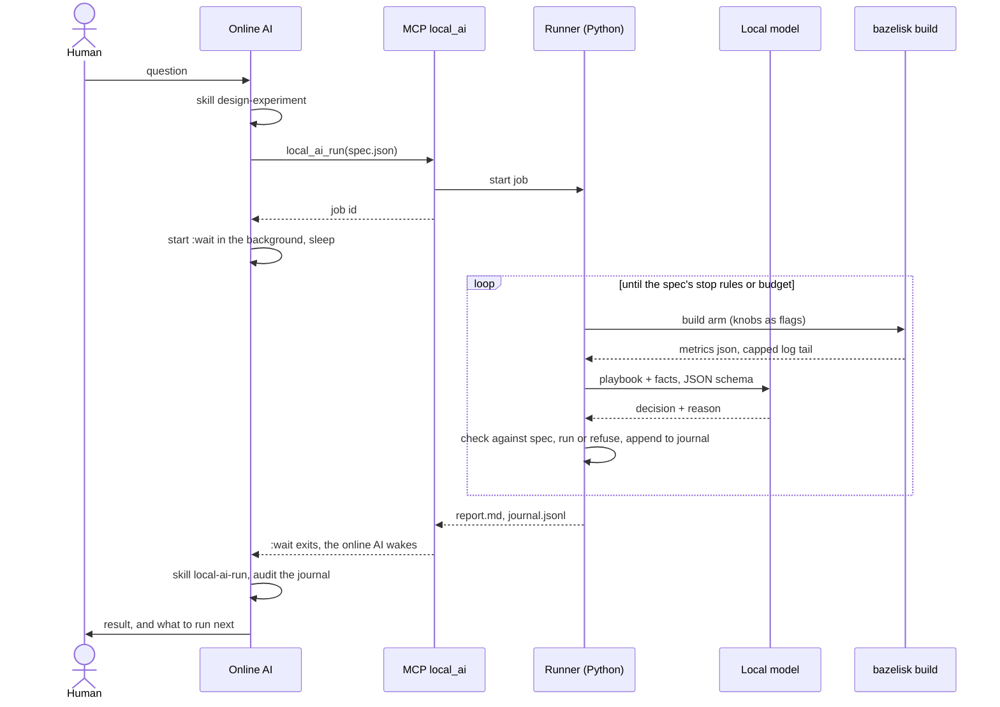
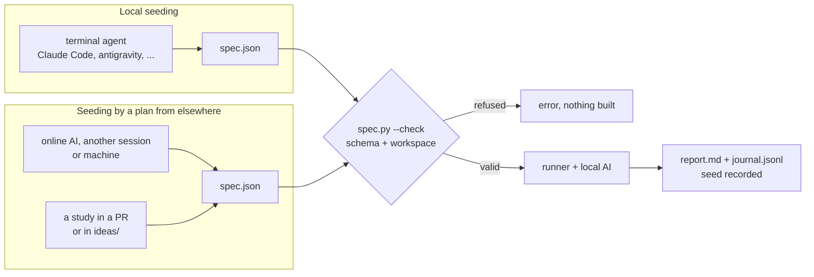
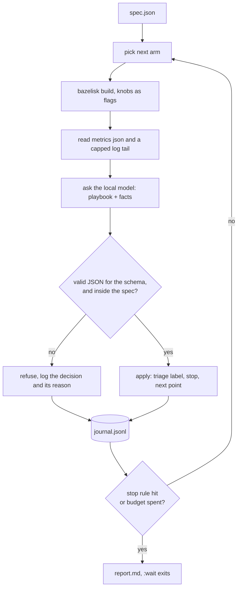
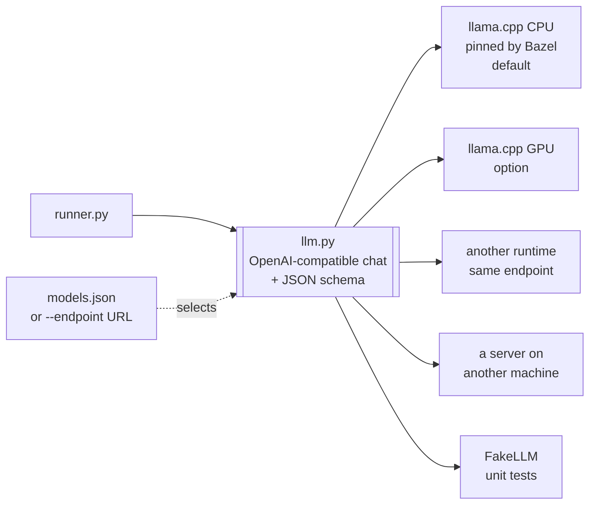

# An online AI designs the experiment, a local AI runs it

Status: **proposed, not built.** A design for review: the tools, skills and
phases below are a plan, and nothing in it has been measured yet.

## Problem

EDA experiments take hours: a sweep over a placement knob on a small asap7
design is an afternoon, one arm on a large design is a night. Most of that
wall time the cores are idle, because stages are single-threaded or wait on
one another. Today the agent that designed the experiment has two choices,
and both are bad:

- **It waits.** The online AI polls the run, reads logs into its context and
  pays for every hour it sits there, for decisions that come once an hour.
- **It hands off to a script.** A script runs the arms but cannot react: it
  cannot tell an out-of-memory kill from a router error, cannot stop a run
  that is doomed (`no-doomed-baselines`), and cannot pick the next point of
  a bisection from what the last one showed. The run comes back the next
  morning with a failed arm, and an hour of a capable AI goes into finding
  out why.

## Idea

Split the work. The **online AI** (Claude Code, or whichever agent the user
has) designs the experiment and writes it down as a spec. A **local AI**,
started by Bazel on the same machine, runs the spec on the idle cores next
to the builds and makes the small judgment calls. The online AI goes to
sleep and is woken when the job ends, to read a short report.

### The overlap

The whole idea rests on EDA being slow: a local model that takes a minute to
answer is fast next to a stage that takes an hour, and it answers on cores
the stage is not using.

```mermaid
gantt
    title One experiment, three arms, overlapped
    dateFormat HH:mm
    axisFormat %H:%M
    section Online AI
    Design the experiment, write the spec :done, d1, 09:00, 20m
    Asleep, not billed                    :      s1, after d1, 340m
    Read report, audit, decide next       :done, r1, after s1, 20m
    section EDA (most cores)
    Arm 1 (density 0.6)                   :active, a1, 09:20, 100m
    Arm 2 (density 0.7)                   :active, a2, after a1, 120m
    Arm 3 (density 0.65)                  :active, a3, after a2, 110m
    section Local AI (idle cores, nice 19)
    Triage arm 1                          :crit, t1, after a1, 5m
    Watch arm 2, it is on track           :crit, w2, 10:40, 5m
    Pick next point, bisect               :crit, n2, after a2, 5m
    Triage arm 3, write report            :crit, t3, after a3, 10m
```

### The handoff

### Seeding: where the spec comes from

The runner does not care who wrote the spec. A job is seeded in one of two
ways, and both end in the same `spec.json` and the same runner:

- **Local seeding.** Someone works in a bazel-orfs workspace from a terminal
  agent on the same machine (Claude Code, antigravity, or any agent of that
  kind), designs the experiment with it, and has it write `spec.json`. The
  agent then submits it through the MCP server, or the person runs it
  directly: `bazelisk run //tools/local_ai:runner -- spec.json`.
- **Seeding by a plan from elsewhere.** The spec was designed somewhere
  else: an online AI in another session or on another machine, a teammate,
  a study written up in a pull request or in `ideas/`. The file is brought
  to the machine with the idle cores and run there, with no agent attached
  at all if need be; the report waits in `tmp/local-ai/jobs/<id>/` for
  whoever picks it up.

A spec is self-contained so that it travels: repo-relative targets, the
bazel-orfs commit it was written against, knobs with their ranges, the
budget. A spec from elsewhere is input, not instructions: `spec.py --check`
validates it against the schema and the workspace (every target exists,
every knob is one the flow accepts, the commit matches or the mismatch is
stated) before the first build, and it cannot carry a shell command, only
targets and knob values. The journal records where each job was seeded
from.

### What the local model decides, and nothing else

1. **Triage**: which failure a run hit (out of memory, timeout, a GPL, GRT or
   DRT error, a known message ID, a crash), from a capped log tail.
2. **Early stop**: whether a running arm is doomed, from its log progress
   against the time the spec predicts (`no-doomed-baselines`).
3. **Next point**: within the search the spec allows (a grid, a list, a
   bisection, a grid refined around the best point).
4. **Summary**: the report the online AI reads on waking.

Everything mechanical is deterministic Python: building, parsing metrics,
counting the budget. The local model has no shell, no git, no network, and
never publishes anything; the confidentiality purge stays with the online
AI and the human. Every decision is a JSON object, grammar-constrained to a
schema and then checked against the spec. A knob outside its range, a
target the spec does not list, or a run past the budget is refused by the
runner, logged and counted, and never executed. A small model gets things
wrong; the fence makes a wrong decision cost one refused line in the
journal, not a night of machine time.

### Bring your own AI: dependency injection

The runner depends on one interface: an OpenAI-compatible chat endpoint
that can constrain its output to a JSON schema. Whatever local AI the user
has is injected behind it, by name from a registry (`models.json`) or as a
bare `--endpoint` URL. Nothing in the runner, the MCP server or the skills
knows which one it is talking to.

- **Default: CPU only.** A pinned, prebuilt llama.cpp `llama-server` (MIT)
  and a pinned GGUF model under Apache-2.0 or MIT, both downloaded by
  Bazel with a sha256 like any other archive. No GPU, no driver, no
  toolchain on the host: Bazelisk stays the only thing a user installs.
- **Options, as registry entries:** a GPU build of llama.cpp, another
  runtime that serves the same endpoint, a bigger model on a bigger
  machine, a server elsewhere on the network.
- **Tests:** a `FakeLLM` with canned replies, so CI never downloads weights.

### Fair to the builds

The local model must never make an experiment slower or kill it. It runs at
`nice 19`, so EDA always gets the cores first, inside a `systemd-run --user`
scope with `MemoryMax` set to its registry entry's `ram_gb`. On a
16-core, 30 GB workstation memory, not CPU, is what EDA runs out of, so
`orfs_schedule` subtracts the running server's `ram_gb` from its budget
when it packs waves (`scale-to-memory`). The server exits after a set
number of idle minutes.

### Tools (`tools/local_ai/`)

| File / target | What it does |
|---|---|
| `models.json` | Registry of local AIs: `name → {runtime, weights, args, ram_gb, ctx}`, a default named in the file |
| `MODULE.bazel` (dev dependency) | The default entry's runtime (`http_archive`) and weights (`http_file`), sha256-pinned, kept in the repository cache |
| `:server` | `bazelisk run //tools/local_ai:server [-- --model NAME]`: starts an entry under `nice 19` and `MemoryMax`, writes `tmp/local-ai/server.json` (name, endpoint, pid, `ram_gb`), exits when idle. An entry with only an endpoint is checked and recorded, not started |
| `spec.py`, `spec_schema.json` | The experiment spec: question, null result, targets, knobs and ranges, controls, search kind, predicted time per arm, stop rules, budget (runs, hours, GB, `--jobs`), optional model; `--check` validates |
| `runner.py`, `:runner` | The job loop in the diagram above; `tmp/local-ai/jobs/<id>/journal.jsonl` and `report.md`; resumable from the journal |
| `llm.py` | The one backend interface, standard library only, plus `FakeLLM` |
| `mcp_server.py` | MCP tools `local_ai_run`, `local_ai_status`, `local_ai_report`, `local_ai_cancel`, `local_ai_models`; standard library, Python 3.6, replies capped, the same shape as `tools/odb_debug/mcp_server.py`; registered in `.mcp.json` |
| `:wait` | `bazelisk run //tools/local_ai:wait -- <job>`, started in the background by the online AI, which is re-invoked when it exits: no polling |
| `playbooks/*.md` | The local model's own skills, at most a page each so they fit a small context: triage, early stop, next point, summary, distilled from `no-doomed-baselines`, `repair-timing-grt`, `openroad-debug` and `dogfooding`; the runner puts the relevant one in each prompt |
| `bakeoff.py`, `bakeoff/*.json` | Questions with known answers built from real failure logs, scored per registry entry; run whenever a local AI is added |

Readers of metrics come from what exists (`tools/endpoint_band`,
`tools/headroom`), and a multi-macro arm builds through `orfs_schedule`.

### Skills

| Skill | Who reads it | What it says |
|---|---|---|
| `design-experiment` | online AI | Turn a question into a spec: the question and its null result, controls and a negative control, repeats and 2σ (`study-pr`), a predicted time per arm (`fixed-turnaround`, `no-paint-drying`), and what stays with the online AI: anything that edits code or a carried patch, a design decision, anything that publishes. The same skill serves both seedings: written locally, or written elsewhere to be carried to the machine that runs it |
| `local-ai-run` | online AI | Start the server, submit, start `:wait` in the background, do other work; on waking read the report and audit the journal: every refused decision, every early stop, the triage behind each stop checked against the log. When not to delegate: a one-arm build, anything that needs a code edit mid-run |
| `local-ai-add` | online AI | Wire up another local AI: pin it, read the licence from its model card, measure its `ram_gb`, add the registry entry, run the bake-off, and change the default only if it scores better |
| `playbooks/` | local model | See the tools table; not Claude skills |

### Phases, one pull request each

| # | Work | Gate |
|---|---|---|
| 0 | Bake-off on CPU, no Bazel yet: GGUF Q4_K_M candidates under Apache-2.0 or MIT, licence read from each model card first. Qwen3.5-9B (front-runner in recent 8 GB guides, about 5.6 GB), Ministral 3 8B (function calling and JSON output), Granite 4.x 8B (tool use), and a model around 4B as the low-memory option. Measure resident memory, tokens per second at `nice 19` while an asap7 flow runs, the flow's wall time with and without the server, and the bake-off score | the human picks the default |
| 1 | `models.json`, the pins, `:server` | serves; memory within `ram_gb`; idle exit works |
| 2 | `spec`, `llm` with `FakeLLM`, `runner`, journal, `bakeoff.py` | unit tests pass with `FakeLLM`, out-of-spec decisions refused |
| 3 | `mcp_server`, `:wait`, the scheduler reservation, the three skills, the playbooks | one online → local → online round trip on a mock flow, seeded locally; and one spec written in another checkout, carried over and run with `:runner` and no agent attached |
| 4 | Dogfood: a `PLACE_DENSITY` bisection on a small asap7 design, run once by the local AI and once by a plain script on the same spec | same answer; the report counts the decisions where the model added something (early stops, triage) and says so plainly if it added nothing: a null is reported as a null |
| 5 | Export the skills and tools to consumers through `@bazel-orfs//:agent` | the human's call |

### Open decisions

1. May the local AI **launch builds** from the targets the spec lists, or
   only advise, with the online AI launching? Launching is what lets the
   online AI sleep, so this entry assumes it.
2. **Dev-only** in bazel-orfs first, or exported to consumers from phase 1?

## Impact

Not measured. What phase 4 measures: the online AI's tokens and wall time
per experiment against waiting on the run itself; machine hours saved by
early stops; failed arms that came back triaged instead of as a bare exit
code; and the cost to the builds, which should be within noise.

## Effort

Medium. The bake-off is small (a day, mostly unattended). The tools are a few
hundred lines of standard-library Python on patterns that exist here already
(`tools/odb_debug`'s MCP server and daemon file, `orfs_schedule`'s memory
budget). The skills and playbooks are writing, and the playbooks will be
rewritten after the bake-off shows what a small model gets wrong.
