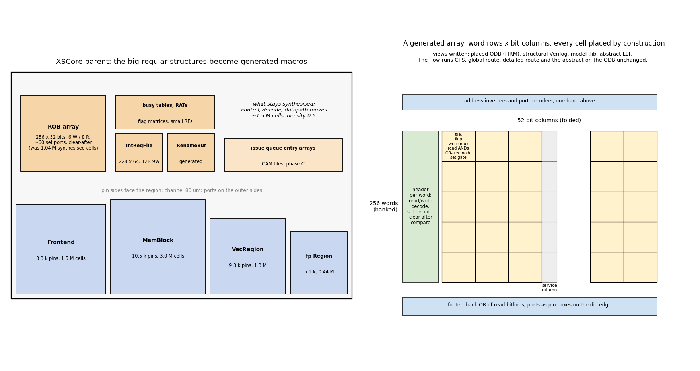

# The big regular structures become generated macros

*Plan, 2026-09-21, for the record in PR #1055.*

*2026-10-06: STRUCTURED_MEMORIES and STRUCTURED_PLACEMENT (ORFS patches
0071, 0078, 0082, 0084) are replaced by AUTO_MEMORIES_REGFILES (ORFS patch
0089 on OpenROAD patch 0010): a register file is a macro through
synthesis and macro placement and dissolves into its cells after it.*

*2026-10-27: `tools/structured_gen` was retired on 2026-10-15 (278cb810);
`generate_ram` with the carried ram patches builds the register files,
and the sections below that name structured_gen describe what it did.
Next is `generate_array`: one spec of row select, cell op and reduction,
`generate_ram` its simplest front end, every structure LEC-checked. It
is taken breadth first, every rung through synthesis, then placement,
then global route.*

## Why

Take 21's placed parent, read through odb-debug: 3.85 M cells in a
1.2 x 1.1 mm blob between the four hardened blocks, bins up to 87 %, and
the 18 densest bins owned half by the reorder buffer, a quarter by
dispatch's tables and a quarter by the memory-control tables. The ROB is
256 copies of `RobEntryCell(idx[8:0], in[3618:0]) -> entry[51:0]`: every
entry receives the same 3 619-bit bus and decodes locally, 926 000
broadcast pin-bits and 4 000 cells to hold 52 bits of state. Yosys cannot
share that decode across entries, global placement cannot spread it, CTS
drops its buffers into it, and the legaliser after CTS ran five hours
(negotiation) and past two (diamond) re-seating it.

These are not jobs for general synthesis and placement. A real core of
this class has its reorder buffer, register files, rename and busy tables
and issue-queue arrays as compiled structures. The literature has said so
since the reorder buffer was invented: Smith and Pleszkun (IEEE TC 1988),
Sohi's RUU (1990), the R10000 active list (Yeager, IEEE Micro 1996) are
circular buffers with decoded, indexed updates; Palacharla, Jouppi and
Smith (ISCA 1997) give the wire-delay reason the issue window and the
register file are the structures that set the clock; Rixner et al. (HPCA
2000) and Zyuban and Kogge (ISLPED 1998) the port-count scaling that
makes a many-ported file a macro everywhere.

`tools/structured_gen` already builds XiangShan's six register files that
way: a C++ generator linked against OpenROAD's own database, a `key
value` spec naming the RTL module and its ports, and out come a placed
ODB (every cell FIRM, by construction), a structural Verilog netlist, a
model Liberty and an abstract LEF; the flow runs CTS, global route,
detailed route and the abstract on the ODB unchanged, and swaps the macro
in for the RTL module by name.

## The plan

1. **Generator: entry arrays.** Two new port kinds in the spec and two
   gates in the tile: `set <valid> <idx> <bit>`, a writeback channel that
   decodes a 9-bit index once in the header and sets one flag bit in that
   word; `clear_after <valid> <idx>`, the redirect, one 9-bit comparator
   per word. The 52-bit entry is the word, the six enqueue channels are
   the write ports, commit and walk the read ports. Tiling, decoders,
   banking and views are reused as they are.
2. **RTL: the ROB's array as a module.** A Chisel patch in the XiangShan
   fork extracts the entry array from `Rob` into a module with the
   generator's port shape (payload write ports, flag set ports,
   clear-after, read ports), leaving pointers, commit and exception logic
   in RTL. The update rules per field come from `Rob.scala`; the
   generated array reproduces them exactly.
3. **Correctness: one-off equivalence.** The generated netlist and the
   extracted RTL module have the same state bits (one flop per entry
   bit, same reset), so the check is combinational equivalence under a
   register correspondence: a logic equivalence check between the RTL
   module and the generated structural Verilog, run once per generator or
   RTL change, plus the study's CoreMark simulation as the end-to-end
   check.
4. **Flow: the macros in the parent.** `STRUCTURED_MEMORIES` in the
   planned parent for the ROB array, `IntRegFile` and `RenameBufferFile`
   (the plan variant had dropped them; they are flops in the blob today).
   The parent's plan re-derived from its measured cells (about 1.5 M
   after the arrays leave) at density 0.5, with the partner pin segments
   and an 80 um channel floor.
5. **Then the next arrays, by the same measure**, cell area and port
   shape: dispatch's busy tables and rename tables (flag matrices and
   small register files), the memory-control tables, the LSQ's queue
   payloads inside MemBlock, and, as a third tile kind, the issue-queue
   entries' CAM match.

## What it costs and returns

| step | effort | returns |
|---|---|---|
| 1 generator ports | a day | ROB array as a macro: 1.04 M cells out of the parent, the broadcast gone |
| 2 Chisel patch | half a day, plus the read of `Rob.scala` | the module the flow swaps by name |
| 3 equivalence | hours once the netlists exist | the correctness argument, reusable per change |
| 4 parent take | one flow day | the first global route of a parent whose clock tree is small and even |
| 5 next arrays | one to two days each | the parent shrinks toward control and muxes |

## Rules

- A structure goes to the generator when it is regular (words x bits,
  ports), large (100 k cells or more), and flop-dense; the tangled
  control logic stays synthesised.
- The RTL patch extracts, it does not redesign: the same state, the same
  update rules, a module boundary where the generator's ports are.
- Every generated macro is equivalence-checked against the module it
  replaces before a take uses it.

## Progress

- **2026-09-21, step 1 and 2 as one patch.** The ROB's entry payload did
  not need a new generator: the fields written once at enqueue are a
  plain multi-port register file, so XiangShan patch 0008 extracts them
  into `RobEntryFile`, a `utils.RegVecFile` (8 write ports at the allocate
  pointers, 16 read ports for the eight banks' two lines, 352 x 21 bits),
  and `RobEntryFile.regfile` hands it to `structured_gen` as it stands.
  The cell keeps its read-modify-write state and a shared bus of a few
  dozen bits per enqueue port instead of the whole uop. The planned
  flows now harden the generated register files of every module they
  keep (the parent: `IntRegFile`, `RenameBufferFile`, `RobEntryFile`;
  Frontend: the Ftq queues), and the plan's macro placement marks the
  planned blocks FIRM and lets `rtl_macro_placer` place the parent's own
  macros around them. Take 22 runs it. The `set` and `clear_after` ports
  of the plan's step 1 are still wanted, for the flag matrices (the ROB's
  remaining state, the busy tables) in step 5.
- **2026-09-21, placed netlists.** A macro is right only for a terminal
  block at an edge with a narrow, registered interface; an array in the
  middle of the logic as a macro costs the parent its cross-boundary
  placement, clock tree and routing and a wall of pins to route around.
  ORFS patch 0078 adds `mode netlist` to a STRUCTURED_MEMORIES spec: the
  module stays blackboxed in synthesis (no abc on it), the generator's
  structural netlist is linked when the design loads, and at floorplan
  its placed cells are dropped FIRM onto the parent's rows where
  `STRUCTURED_PLACEMENT` says, site- and row-snapped with the row
  orientation matched; tapcell, global placement and the legaliser treat
  them as fixed, the clock tree and the router as ordinary cells. Proven
  on `test/structured_netlist` (a 16 x 8 two-port file inside a parent:
  1 440 cells FIRM at the planned corner, parent cells placed around).
  The planner emits `netlists.txt`, the parent's arrays in a row along
  the top of its logic region. The table's macro/netlist column is now:
  the four planned blocks are macros; every generated array is a placed
  netlist inside its block or the parent.

## Generator depth backlog (2026-09-21)

What take 23's first synthesis on slang still spent ABC time on, per
module, and whether a generator should own it. Two thirds of every
session below is one single-threaded ABC call.

| module | synth | what ABC chews | generator |
|---|---|---|---|
| Rob | 995 s | 6 417 nine-bit pointer compares, 352-wide and/or trees, 16 x 352-way one-hot muxes over the 352 `RobEntryCell` (30 bits each); the 21-bit file is generated (xiangshan-timing.md entry 9) | flag matrix for the cells' state; pointer-window read (eight consecutive entries at a rotating pointer); fork patch 0009 shares the decode |
| Region_1 (fp) | 727 s, 8.4 GB | `DataPath_1`, `BypassNetwork_6` wide muxes; four fp issue queues | bypass network as a generated mux tile; issue queues as CAM tile plus payload |
| PhysicalStoreQueue | > 5 min | 64 `SqEntryCell` x 249 bits (vaddr 50, paddrHigh 36, data 128, mask); `ForwardModule` 3 086 lines and no registers, the store-to-load compare of a query address against all 64 entries with byte masks; `DeqModule` window read | payload file + address CAM + window read; the RTL keeps the pointers |
| SqForwardPipe | 447 s | the age-ordered 64-entry x 16-byte forward select over 685 register bits | the same CAM and priority tile |
| LoadQueueReplay | 430 s | per-entry replay state and selection | flag matrix + payload file |
| MissQueue, L2TLBWrapper | 227 s each | entry match, TLB compare | CAM tile |
| Rename | 217 s | RAT with snapshots | snapshot-copy file |
| Region (int) | 185 s | `DataPath`, `BypassNetwork` over the generated IntRegFile | bypass mux tile |
| SSIT | 176 s | a table | plain extraction |
| IBuffer, Sbuffer | not reached (15 k and 39 k lines) | instruction buffer; store buffer with masked writes | plain extraction; masked-write port |
| VecRegionModule's four IQs | not reached (26 k lines each) | vector issue queues | CAM tile + payload |
| Bpu 547 s+, Ifu 328 s, DecodeStage 180 s, NewCSR 179 s, DCacheWrapper 241 s, Tage 208 s | | predictor, fetch and predecode, decoders, CSRs, cache control, table logic around blackboxed SRAMs | nothing for it: real logic |

**Identical cells synthesised once per instance.** Under slang's
`--keep-hierarchy` every instance of `RobEntryCell` is its own module,
`RobEntryCell$...robEntryCells_N`, and because `RobEntryCell` is a kept
module all 352 copies keep their hierarchy inside Rob's partition, where
`abc` runs on each one in turn ("Extracting gate netlist of module
RobEntryCell$...robEntryCells_225 ... 226 ... 227"): the same 2 683-cell
module through ABC 352 times. That is a large share of Rob's 995 s, and
the same happens to every per-entry cell that is a kept module
(`SqEntryCell` x 64 in the store queue). A generated entry array is the
fix that removes the synthesis entirely; until a cell is generated, the
flow should synthesise one elaboration of an identical, parameterless
cell and instantiate it 352 times, which neither slang nor yosys does
today (yosys has `uniquify`, not its inverse).

The store queue is the clearest case for going deeper: one payload file
with 64 entries, one address CAM feeding the forward select, one window
read, and the RTL keeps only the pointers, the way Rob should end up.
Order of work is execution optimisation only; all of the "generator"
rows are wanted before the parent is asked to route.

## Correctness: kepler-formal, wired in bazel

yosys equivalence (eqy) does not scale to a 224 x 64 file with 21 ports
and is not the tool. The check per generated structure is kepler-formal
(github keplertech/kepler-formal), LEC on Verilog with a liberty library,
which requires the same sequential boundaries and the same names for
sequential instances and top terminals in both designs. So
`structured_gen` names its flops after the RTL registers it replaces,
bit by bit, and the check runs per module against the RTL side mapped
to the same liberty cells. Wire it up here in bazel, as a dev dependency
on the latest upstream (the tool is being fixed rapidly; never pin an old
release or a local checkout). Not started.

## yosys's memory passes on per-entry-updated arrays (2026-10-27)

An array whose every entry is updated in place (a counter, a flag, a
ROB entry), written as an unpacked array, becomes a `$mem_v2` with one
write port per entry, and `opt_mem_priority` orders every pair of them:
on `test/array_toys`'s counter, `memory -nomap` took 1.0 s at 64 x 8,
7.5 s at 128 x 8 and 74 s at 256 x 8, 96 % of it in that pass. Written
as a packed vector the same counter is one `$dff` per word and no
memory. So structures are recognised on the packed form, and a rewrite
of packed register vectors to unpacked arrays ahead of yosys is not
used. Ports at distinct constant addresses never collide; a yosys fix
that skips them is a carried-patch candidate.

## The front end: entries found and extracted (2026-10-28)

`test/coremark_joule/designs/asap7/xiangshan/arrays` finds a module's
entries and makes them one cell, instanced per entry, with no
per-design code: yosys JSON after `proc` (`proc_json.py`); entries are
word i of arrays of equal length (`entries.py`); each entry's private
cone is walked to a structural signature, with constants, shared-bit
references and comparison forms (x == K, x != K over up to 12 bits of
one net) decided across entries (the same, affine in the entry, or
affine in a bank's number or the entry's place in its bank); duplicate
cells are merged; arrays whose structure differs between entries stay
inline. `extract.py` writes the template entry as `<Module>Entry`
and decodes index comparisons once in the parent. `check.py` proves
each extraction: registers and blackboxes as cut points, a yosys
miter, ABC `iprove`, a negative control (one register's D-mux swapped)
that must differ, and the decode-once lemma `(1 << x)[i] == (x == i)`.

| Block | Entries | Coverage | Read side | To global route | Period (ps) |
|---|---|---|---|---|---|
| Rob | 352 | 81% | no | 23.5 min (surgered + hand generator: ~33) | 1,913.9 (1,712.8) |
| LoadQueueReplay | 120 | 87% | yes | ~9.5 min (PR: 28.9) | 1,469.7 ³ |
| PhysicalStoreQueue | 64 | 85% | yes | 8.6 min (decode_once: 27.2), top 137 s | 1,905.1 |
| VirtualStoreQueue | 128 | 96% | no | ≤ 6 min ¹ (PR: 6.6) | 1,485.0 |
| LoadQueueRAR | 96 | 87% | no | ≤ 6 min ¹ (PR: 4.5) | 997.7 ³ |
| TLBFA / TLBFA_1 | 48 | 99% / 98% | yes | ≤ 6 min ¹ | 285.9 / 349.5 |
| LoadQueueRAW | 56 | 69% | yes, the common part | below the 70% gate | |
| Uncache | 16 | 92% | yes | 4.0 min ² (PR: 3.4) | 1,255.7 |
| VirtualLoadQueue | 120 | 96% (7% without thresholds) | no | 3.2 min ² (PR: 3.2) | 963.9 |

All extracted from the surgered core XSTile's flows read. ¹ The four
side by side in under 6 min. ² Alone, from the Bazel profile: synthesis
76 s (the top 61 s), floorplan through global route 114 s (grt 63 s);
the extraction itself 22 s more. Single run. Uncache: synthesis 90 s
(the top 77 s), floorplan through global route 149 s (place 55 s, grt
78 s); slower than the carve. ³ Each gained one array with firtool's
vector names (LoadQueueRAR's REG, LoadQueueReplay's
l2HintLastBeatUnblock); on slang and the fold, side by side, single
runs: LoadQueueRAR 969.8 ps (was 961.1), synthesis 75 s, floorplan
through global route 152 s; LoadQueueReplay 1,435.1 ps (was 1,289.9),
synthesis 313 s, floorplan through global route 521 s.

Every extraction is proven twice, with the index kept and decoded, each
with its negative control (`<top>_check_test`, `<top>_control_test`). The Rob's decoded
form, 80 comparisons in eight per-bank decoders, proves directly in
97 min (5,839 s) on the current extraction.
Every flow is the block's
with setup repair off (XSTile's ~2,000 ps), no pin access, and
floorplan's repair_timing skipped.

What is not covered yet:

- **The read side** is in the cell where entries agree on it: each
  entry's cone from its registers to the reductions across entries
  (PhysicalStoreQueue's forwarding compares: its top's synthesis 978 s
  to 137 s). Where the read cones differ between entries, the part of
  them every entry has, by signature, goes in the cell
  (`Entries._common_read`): LoadQueueRAW's priority select within each
  bank of eight reads entry j's select bit through j inverters of its
  own, and the two select bits are common. LoadQueueRAR's and the Rob's
  read cones have no common part that follows one rule; they stay in the
  parent.
- **Firtool's vector names and per-port arrays** (2026-10-29): a vector
  of registers is `x`, `x_1`, `x_2`, ..., word 0 without a number, and an
  array of k·N words may be k arrays of the group of N
  (`entries.plan`, word p·N + i or i·k + p). Uncache's 42 % was not its
  read side, which every entry agreed on, but its per-entry pipeline
  registers: `f1_fwdDataCandidates_r` (16 words, word 0 unnumbered) and
  `f1_ptagMatches_r` (48 words: 16 entries by three load ports); with
  them, 92 %.
- **Threshold compares** are covered (2026-10-29): VirtualLoadQueue's
  `entryHitBound` is `x >= i + 1` and `x < i + 1`, which firtool folds
  differently for each i (`x > 2`, `|x[6:2]`, `x[6]` alone, `x == 0`).
  `entries.py` reads them as GE/LT forms on a net where some entry has a
  threshold that is no `x == K`, a lone top bit through a buffer it puts
  in front of it; `extract.py` decodes `x >= i + o` once as bit
  `i + o - 1` of `(1 << x) - 1`. Tried only where the plain reading
  leaves entries off the rule: PhysicalStoreQueue's dequeue pointer is
  compared both with the entry's number and against a threshold, and
  read as thresholds its entries 0 and 63 (`x == 0` is `x < 1`) fell
  off; the six blocks above extract byte-identically.

### What the flow alone buys (2026-10-28)

`flow_only/` builds Bpu and VecRegionModule from their RTL as it is,
with the knobs above (setup repair at and after CTS off, floorplan's
repair off, no pin access, route-0 global route) and the die from
utilization rather than the carve's plan. Side by side, 39.1 min to
global route; floorplan through global route took 15.2 min (Bpu) and
27.2 min (VecRegionModule), CTS 2.3 and 3.0 min against the carve's 15.0
and 21.2. With setup repair off the periods were 3,495.9 ps (Bpu) and
2,355.3 ps (VecRegionModule), over XSTile's ~2,000 ps. With repair at CTS
and global route aimed at 2,000 ps instead of the SDC's 473
(`SETUP_SLACK_MARGIN` 473 - 2,000), side by side in 38 min:
VecRegionModule 2,012.4 ps, Bpu 3,175.5 ps. Repair does not close Bpu.

**Bpu closes; the 3,175.5 ps was the probe's parasitics (2026-10-30).**
The qor probe times every stage on placement parasitics. On the routes'
parasitics, which global route's own repair works on, Bpu's grt is
1,953.8 ps, with every reg2reg endpoint inside 2,000 ps. The flow's own
report at the end of global route (FLW-0008) says 1,856.1 ps, and
odb-debug on the same ODB 1,883.2. Re-measured on main (efbb1085) in a
14 GB scope (it ran out of 8 GB in CTS):

| stage | synth s | floorplan s | place s | CTS s | grt s | total min | period, placement RC ps | period, grt RC ps | stdcells | area µm² |
|---|--:|--:|--:|--:|--:|--:|--:|--:|--:|--:|
| Bpu | 41.1 ¹ | 73.5 | 696.5 | 967.4 | 454.6 | 37.2 | 3,224.0 | 1,953.8 | 650,823 | 85,401.2 |

¹ Only the top's last step: the partitions came from the remote cache.
CTS's 967 s is repair_timing (854 s, ending at RSZ-0062 on the 473 ps
clock with its margin aimed at 2,000).

Logic or placement, the repair-headroom bounds, at grt on the routes'
parasitics (odb-debug): period 1,883.2 ps, every wire at zero 1,184.3
(`floor_wire`): a third of the period is wire. At place, before any
repair, on placement parasitics: 3,338.1 ps, zero wire 1,357.1, the
one-flop-loop floor at zero wire 610.8 (`abtb/io_meta_entries_1_hit`).
The worst path at place runs from a CSR enable register through
ittage, sc and tage into a tage table's write buffer. It crosses the
block through 18 wire and load-slew buffers, 19 to 119 ps each and 1,145 ps in all. The
logic alone (1,357 ps) fits 2,000 ps, and on the routes' parasitics
repair already brings the block inside it. The full `headroom` table
and `floor_cycles_nowire` did not answer within 30 minutes on 736 k
instances at grt.

What this does to the arrays' verdicts (period at grt, placement RC ->
routes' RC, ps; B against A): LoadQueueRAR 949.9 -> 863.5 against
902.0 -> 781.3 (+10.5 %, past the 10 %); VirtualLoadQueue 1,011.7 ->
972.6 against 962.5 -> 857.6 (+13.4 %); Uncache 1,332.8 -> 1,171.3
against 1,020.3 -> 916.0; VirtualStoreQueue 926.0 -> 910.4 against
1,014.1 -> 944.7; TLBFA 311.8 -> 320.6 against 439.0 -> 397.0;
TLBFA_1 292.2 -> 282.3 against 460.8 -> 456.2; PhysicalStoreQueue B
1,905.1 -> 1,567.7 (A, and LoadQueueReplay's arms, not re-run: they
were not in the remote cache, 40 minutes each). Wires cost the
extraction more than the RTL arm on RAR and VirtualLoadQueue. Which
parasitics the inventory's verdicts use is open.

## QoR inventory (2026-10-29)

Every extraction against the module as it is: arrays
`<Block>_grt_qor` (B, the extraction) and `<Block>_rtl_grt_qor` (A,
the same proc JSON written back as Verilog: no entry cell, nothing
folded), every other flow setting shared by construction. Single runs
on one machine, each pair side by side; PhysicalStoreQueue and
LoadQueueReplay alone with their pair in a 10 GB memory scope (swap in
use), so compare seconds within a row, not across rows. Synthesis is
canonicalisation, synthesis and the synth ODB from the Bazel profile
(the entry cell's partition runs beside the top); floorplan through
global route is the tool time in the stages' logs. Cells and area are
the standard cells at global route (CORE masters, no tap or fill), what
setup repair would have added included (it is off here; CTS buffers and
place's repair_design are in).

| Block | Arm | synth s | floorplan s | place s | CTS s | grt s | total min | period at grt, routes' RC ps | period at grt, placement RC ps | stdcells | stdcell area µm² |
|---|---|---:|---:|---:|---:|---:|---:|---:|---:|---:|---:|
| PhysicalStoreQueue ⁴ | A: RTL | 1,909.2 | 26.1 | 327.9 | 30.9 | 156.9 | 40.85 | 1,453.0 | 1,582.9 | 252,148 | 32,126.6 |
| | B: extracted ¹⁰ | 251.5 | 19.6 | 247.9 | 30.1 | 115.4 | 11.08 | 1,666.4 | 2,058.0 | 247,502 | 30,545.7 |
| LoadQueueReplay | A: RTL | 1,504.8 | 49.5 | 496.1 | 33.4 | 160.0 | 37.40 | 1,198.4 | 1,664.5 | 368,658 | 45,109.3 |
| | B: extracted | 432.4 | 35.8 | 549.4 | 49.5 | 274.7 | 22.36 | 1,201.8 | 1,435.1 | 389,527 | 45,759.1 |
| VirtualStoreQueue ⁴ | A: RTL | 260.4 | 5.5 | 58.7 | 7.5 | 30.3 | 6.04 | 944.7 | 1,014.1 | 62,041 | 7,605.0 |
| | B: extracted ⁹ | 102.8 | 3 | 63 | 7 | 36 | 3.53 | 910.4 | 926.0 | 63,871 | 7,884.8 |
| LoadQueueRAR | A: RTL | 266.8 | 6.0 | 58.7 | 5.0 | 58.8 | 6.59 | 781.3 | 902.0 | 53,430 | 7,024.2 |
| | B: extracted ⁹ | 85.8 | 11.5 | 70.0 | 6.3 | 106.4 | 4.67 | 863.5 | 949.9 | 67,093 | 8,222.8 |
| TLBFA | A: RTL | 75.6 | 6.4 | 46.9 | 4.6 | 28.0 | 2.69 | 397.0 | 439.0 | 47,411 | 6,578.3 |
| | B: extracted ⁹ | 34.3 | 6.6 | 49.0 | 4.8 | 36.9 | 2.19 | 320.6 | 311.8 | 49,653 | 6,592.5 |
| TLBFA_1 ⁴ | A: RTL | 166.0 | 16.6 | 136.2 | 7.0 | 31.4 | 5.95 | 456.2 | 460.8 | 83,636 | 10,707.2 |
| | B: extracted ⁹ | 44.2 | 10.5 | 81.6 | 11.4 | 36.0 | 3.06 | 282.3 | 292.2 | 98,120 | 11,689.7 |
| VirtualLoadQueue | A: RTL | 173.5 | 5.1 | 34.9 | 3.2 | 94.9 | 5.19 | 857.6 | 962.5 | 38,203 | 4,267.1 |
| | B: extracted ⁹ | 83.9 | 5.0 | 41.4 | 4.2 | 70.4 | 3.41 | 972.6 | 1,011.7 | 42,144 | 4,914.7 |
| Uncache ⁵ | A: RTL | 115.1 | 13.3 | 49.0 | 5.4 | 17.2 | 3.33 | 916.0 | 1,020.3 | 56,458 | 7,449.8 |
| | B: extracted ⁹ | 81.8 | 6.6 | 68.4 | 5.4 | 84.0 | 4.10 | 1,171.3 | 1,332.8 | 70,686 | 8,524.5 |
| Rob ⁶ ¹⁰ | A: RTL | 1,641.8 | 474.3 | 1,150.7 | 44.6 | 173.0 | 58.07 | 1,379.9 | 2,197.3 | 340,217 | 40,759.2 |
| | B: extracted | 508.3 | 260.2 | 2,182.6 | 41.1 | 163.6 | 52.60 | 1,212.3 | 2,239.7 | 414,852 | 46,916.3 |

⁴ On yosys's frontend in both arms (`YOSYS_FRONTEND`). ⁵ The study
extraction (`--firtool-vectors`, off by default; #1430), its RTL arm
built with the same settings. ⁶ `rob_array:RobEntries_rtl_grt_qor`
against `rob_array:RobEntries_grt_qor`: the Rob's own flow (timing- and
routability-driven global placement, its register files macros), the
arms one after the other, alone on the machine. ⁷ Re-measured
2026-10-30 with each decoder's enable decoded with it (B alone, A as
above). Before, 3.31 min and 1,485.0 ps: entry i is freed where
`deqPtrVec_k == i && retireCarryVec_k`, the carry a serial AND over the
eight retire slots, and the front end decoded the comparison but left
the `&&` in the cell, so each `retireCarryVec_k` reached 128 cells
through its own buffer tree and the next link of the carry read it
from inside that tree (rc2 to rc5 in 276 ps, then 221 ps of tree into
the cell). Now `retireCarryVec_k << deqPtrVec_k` in the block, one wire
into each cell; the worst path is the read of the entry at the dequeue
pointer, as in A. The five other blocks with a decoder's enable
(LoadQueueRAR 2, TLBFA 1, TLBFA_1 1, Uncache 1, VirtualLoadQueue 3)
re-run, B alone, period at grt (ps, before → after), cells, area:
LoadQueueRAR 961.1 → 1,052.0, 66,957, 8,201.6; TLBFA 272.0 → 306.7,
49,723, 6,611.6; TLBFA_1 349.5 → 308.5, 98,172, 11,705.8; Uncache
1,255.7 → 1,418.5, 70,604, 8,466.4; VirtualLoadQueue 963.9 → 1,036.0,
42,576, 4,955.9. Against their RTL arms, VirtualLoadQueue stays inside the 10 % (+7.6 %) and LoadQueueRAR leaves it (+16.6 %, 961.1 before): it moves from dominates to trades. B's times for these five are the earlier ones, not re-measured;
TLBFA_1's gain and the two losses are ABC's mapping of the cell, not the
decoder, which is on none of the worst paths: TLBFA's (it meets the
473 ps clock, nothing in the flow works on it) is the valid bit's flush
compare inside one cell, 7 levels and 305 ps against 6 and 270;
Uncache's is the entry's write select, inside the cell OR4-OR3-OR4-AND2
against OR4-NAND2, 247 ps against 187 from the shared fanout-32 net to
the data register. That reading was wrong for LoadQueueRAR (⁹).
⁹ Re-measured 2026-10-30 with the enable after the decode,
`(1 << x) & {en}`, in place of `en << x` (B alone, six blocks side by
side; times are the earlier ones: the cell is byte-identical and a
side-by-side Uncache pair, the one block whose global route moved,
took 259 s against 248 s from synthesis to global route, a tie).
LoadQueueRAR's worst path with `en << x` was the decoder: from the
free list's head pointer through the read of the allocated slot, into
the decoder, whose last level, an AO32x1 at fanout 12 driving 33.6 fF
(slew 187 ps), reached the cell at 1,039.9 ps; yosys's shifter carries
the enable through all seven stages. With the AND after the decode the
same path reaches the cell at 911.9 ps through an AND3x1 (13.9 fF), and
the period is 949.9 ps. Left in the cell, as before the enable was
decoded, LoadQueueRAR comes out at 901.1 ps (61,948 cells, 7,806.0
µm²) but VirtualStoreQueue's serial carry fans out to 128 cells again
(1,485.0 ps, ⁷). Period at grt (ps, `en << x` → `(1 << x) & {en}`):
LoadQueueRAR 1,052.0 → 949.9, VirtualStoreQueue 961.3 → 926.0,
TLBFA_1 308.5 → 292.2, Uncache 1,418.5 → 1,332.8, VirtualLoadQueue
1,036.0 → 1,011.7, TLBFA 306.7 → 311.8 (+1.7 %; it meets its 473 ps
clock). ¹¹ Re-scored 2026-10-31 on the
period at global route on the routes' own parasitics (the probe's
`period_grt_ps`, what global route's repair sees), as the verdicts now
use; the placement-parasitics period stays beside it for the record.
The B arms and the A arms whose ODBs were in the remote cache were
re-probed; PhysicalStoreQueue's A (alone in a 10 GB scope, beside a
one-core proof: 33.03 min, synthesis 1,536 s, the period on placement
parasitics 1,582.9 as before) and both LoadQueueReplay arms were re-run.
LoadQueueReplay's B on main is 1,435.1 ps on placement parasitics
(389,527 cells), not the 1,289.9 above it, and the Rob's arms are this
week's runs (A's synthesis beside B's placement in one 17 GB scope);
their seconds are those runs'. The other seconds are the earlier ones.
Moved: PhysicalStoreQueue trades -> dominates (B over A: 322 ps on the placement
estimate, 115 on the routes); the Rob trades -> dominates (main's B, before the
ordered comparisons were decoded); LoadQueueRAR and VirtualLoadQueue
dominates -> trades (the reasons in the table). ¹⁰ Re-measured 2026-10-31 with the index's
ordered comparisons decoded once (`i > x`, `i < x` and their `>=`, `<=`,
each a threshold on the operand). The Rob kept two of them in its cell:
its pointer against the entry's number, `$gt` and `$lt` with the index as
an input of every cell. Each cell mapped them as 48 cells of comparator
and the 9 index bits reached 33 pins tied per instance: 13,048 tie cells
in the Rob against 1,434 in its RTL arm. Now the cell has no index port,
the ties are 1,433, and the cells 414,852 against 430,964 (-3.7 %). On the
Rob (side by side with nothing else; A's synthesis ran beside B's
placement): before, 60.07 min and 2,029.8 ps (1,251.6 on the routes'
parasitics); after, 52.60 min and 2,239.7 ps (1,212.3). Global route took
164 s against 855 (grt wirelength 5.96 against 6.26 m, its runtime 79
against 764 s): global placement ran 27 routability passes against 17
and ended at a weighted congestion of 1.031 against 1.041. Floorplan's
repair_timing took 221 s against 117 (132 resizes against 686; why it is
slower per move was not examined). The period on placement parasitics
went up 10.3 %, on the routes' parasitics down 3.1 %.
PhysicalStoreQueue had two too (its dequeue pointer against the entry):
2,058.0 ps against 1,905.1 (1,666.4 against 1,567.7 on the routes'
parasitics, +6.3 %), 9,009 cells fewer, time a tie (11.1 against 10.4
min). The cell ends 88 ps earlier on its worst path (835.5 against
923.3 ps arrival), but the select in the block, which now reads the
decoded threshold, takes 1,041 ps against 855: one more AND level and a
fourth BUFx2 stage (37 to 48 fF each) on the select's fanout.
⁸ PhysicalStoreQueue's
broadcast is inherent (the forwarding query compared in all 64 cells),
and placement already sees one netlist (OPENROAD_HIERARCHICAL 0), so
the study arm `PhysicalStoreQueue_flat` flattens before synthesis
instead (SYNTH_HIERARCHICAL 0, the comparisons still decoded once):
1,630.2 ps, 244,238 cells, 31,195.8 µm², 35.67 min (synthesis 1,529 s,
floorplan 35, place 377, CTS 41, global route 158). Against A (40.85 min,
1,582.9 ps) a tie within the resolution; against the kept cell
(17.92 min this run, 1,905.1 ps) 14 % better period for twice the time.
The query no longer reaches 64 cells through two BUFx2 levels of fanout
32 (220 ps slew, 225 ps), and the compare's output is not an AND5x1
mapped without its 22 fF load (149 ps slew): arrival 1,643 ps against
1,778. To win, the cell would have to keep its single synthesis and
still be mapped against what drives and loads it.

| Block | A total min | B total min | A period ps | B period ps | verdict | placement RC A / B ps, verdict before ¹¹ | reason for a loss, measured |
|---|---:|---:|---:|---:|---|---|---|
| PhysicalStoreQueue | 40.85 | 11.08 | 1,453.0 | 1,666.4 | trades ⁸ ¹⁰ ¹¹ | 1,582.9 / 2,058.0, trades | period +14.7 %: the select in the block now reads the decoded threshold, 1,041 ps against 855: one more AND level and a fourth BUFx2 stage on its fanout; before the ordered comparisons were decoded (¹⁰) it dominated at +7.9 % |
| LoadQueueReplay | 37.40 | 22.36 | 1,198.4 | 1,201.8 | dominates ¹¹ | 1,664.5 / 1,435.1, dominates | period +0.3 % |
| VirtualStoreQueue | 6.04 | 3.53 | 944.7 | 910.4 | dominates ⁷ ⁹ | 1,014.1 / 926.0, dominates | |
| LoadQueueRAR | 6.59 | 4.67 | 781.3 | 863.5 | trades ¹¹ | 902.0 / 949.9, dominates | period +10.5 %: on the same path (the free list's head pointer, the read of the allocated slot, the write decoder, the entry's registers), 992.6 ps arrival against 898.0: the slot read's buffers are five BUFx2 in B against BUFx6f, INVx3 and BUFx3 in A (+56 ps to the read's output), and inside the cell the decoded write select reaches its 20 loads through two BUFx2 stages (178.5 ps from the cell's pin to D, against 119.5 from A's last select gate) |
| TLBFA | 2.69 | 2.19 | 397.0 | 320.6 | dominates ⁹ | 439.0 / 311.8, dominates | |
| TLBFA_1 | 5.95 | 3.06 | 456.2 | 282.3 | dominates ⁹ | 460.8 / 292.2, dominates | |
| VirtualLoadQueue | 5.19 | 3.41 | 857.6 | 972.6 | trades ¹¹ | 962.5 / 1,011.7, dominates | period +13.4 %: on the same path (the load write-back pointer, its reduction, each entry's allocated bit), 1,061.8 ps arrival against 954.5: B's top maps the reduction as 17 single-fanout levels after the pointer's decode (377 to 780 ps) against A's 9 (453 to 726), and its result reaches the 120 kept cells through repair_design's BUFx2 at fanout 26, 32 and 32 (180 ps) against two ABC buffers at fanout 10 (83 ps) |
| Rob | 58.07 | 52.60 | 1,379.9 | 1,212.3 | dominates ¹⁰ ¹¹ | 2,197.3 / 2,239.7, dominates | |
| Uncache | 3.33 | 4.10 | 916.0 | 1,171.3 ⁹ | study only | 1,020.3 / 1,332.8, study only | period +27.9 %, time +23 %: 27 % more cells: the 435-bit read side mapped inside the kept entry cell, nothing optimised across its boundary; global route 84 against 17 s. With the read side in the block (`Uncache_noread`, below) 1,062.2 ps (1,198.0 on placement RC), 3.33 min: still a loss |

The verdict: B dominates when it is no worse on both, a time within
15 % or a period within 10 % counting as no worse (the flow is
deterministic, but one register per entry moved into LoadQueueReplay's
cell moved its period 11 %: placement, the same gates on the worst
path); it trades when it is better on one and worse on the other;
otherwise it loses and stays a study. Every extraction cuts synthesis
(PhysicalStoreQueue 1,909 to 327 s). The Rob trades the other way:
14 % better period, but its 352 kept cells add 27 % cells and its
placement and route take longer than synthesis saves.
PhysicalStoreQueue loses period where a shared operand is broadcast
into every entry cell. VirtualStoreQueue did too until the decoder's
enable was decoded with it (⁷). To win there, the broadcast has to stop
being one net into N kept cells: the comparison against it decoded once
in the block where it can be, or the cell's boundary placed so the
buffer tree is the compare's own.

### PhysicalStoreQueue: the broadcast's buffers and repair_design's slew target (2026-10-30)

Where the extraction loses period, measured on both arms at global route
(odb-debug, the qor probe's parasitics). The worst path is the same in
both: a load's query address register, its compare against every store
entry, the select of the forwarded entry, the select's register.

| part of the path | A: RTL | B: extracted |
|---|--:|--:|
| query register to the compare (the broadcast) | 220 ps, ABC's own tree, 5 levels at fanout 10 | 400 ps, repair_design's BUFx2 at fanout 32, 83 and 78 fF, slew 287 ps, the XOR behind it 120 ps |
| the compare | 251 ps, one cone (XOR, OR5, AO21, AOI211, AO32) | 330 ps, an AND tree ending in an AND5x1 driving 28.5 fF |
| the select in the block | 807 ps | 1,090 ps |

The broadcast is the mechanism: synthesis leaves a net into 64 kept
cells unbuffered (ABC sees one primary output), so placement's
repair_design finds 800 fanout violations against 1 in A and fixes them
with BUFx2 trees that meet the 320 ps slew limit and no more.

Tried, off by default: SLEW_MARGIN 40 on both arms (`PhysicalStoreQueue_slew`,
`PhysicalStoreQueue_rtl_slew`), repair_design aiming at 60 % of the slew
limit. Single runs, B arms side by side with each other's conditions
(the base built at the start of the session, alone), A slew alone; seconds
from the Bazel profile (synthesis) and the stage logs:

| arm | synth s | floorplan s | place s | CTS s | grt s | total min | period at grt ps | stdcells | stdcell area µm² |
|---|--:|--:|--:|--:|--:|--:|--:|--:|--:|
| B | 222 | 18.6 | 234.3 | 34.3 | 117.0 | 10.4 | 1,905.1 | 256,511 | 31,409.7 |
| B slew | 222 | 18.4 | 261.3 | 58.6 | 115.4 | 11.3 | 1,613.2 | 265,061 | 33,829.7 |
| A (inventory) | 1,909.2 | 26.1 | 327.9 | 30.9 | 156.9 | 40.85 | 1,582.9 | 252,148 | 32,126.6 |
| A slew | 1,263.9 | 17.8 | 413.3 | 131.4 | 126.6 | 32.6 | 1,424.3 | 261,988 | 34,796.2 |

B slew against B dominates (period -15.3 %, time +8.8 %, a tie); A
slew gains 10.0 % on A (its time is not comparable: A's row ran in a
10 GB scope with swap, A slew alone in 8 GB). B slew against A slew
still trades: period +13.3 % (it was +20.4 %), time -65 %. Why the
slew arms cost what they cost, measured: repair_design inserted 14,195
buffers in 5,486 nets against 5,631 in 2,101 (B; A slew 12,292), which
are the cells and area; CTS's time is its detailed placement after the
tree, 39 s against 16 (A slew 113 s), legalising around them. On B
slew's worst path the broadcast takes 236 ps against 400, the compare
355, and the select in the block 946 against A slew's 807: the select
over the cells' outputs is what is left between B and A.

Tried and dead: telling the entry cell's synthesis its output load
(ABC_LOAD_IN_FF 22 fF, the select's load on the compare): the result was
byte-identical, 1,905.1 ps and 256,511 cells. asap7's `config.mk`
assigns `ABC_LOAD_IN_FF = 3.898` with `=`, not `?=`, so a flow cannot
set it; that lever needs an ORFS change, and it would apply to every
module's outputs, not the cell's alone.

### Uncache: the read side left in the block, a study (2026-10-31)

`Uncache_noread` (extract.py `--no-read`, off by default) extracts the
same 16 entries and 6,592 register bits, but leaves every read side in
the block: the cell is 169 cells against 193, 403 outputs against 619.
Single runs on main (4ec930df), each in an 8 GB scope; seconds from the
Bazel profile (synthesis: canonicalisation, the top and the synth ODB)
and the stage logs; A and B are the inventory's rows:

| arm | synth s | floorplan s | place s | CTS s | grt s | total min | period, routes' RC ps | period, placement RC ps | stdcells | area µm² |
|---|--:|--:|--:|--:|--:|--:|--:|--:|--:|--:|
| A: RTL | 115.1 | 13.3 | 49.0 | 5.4 | 17.2 | 3.33 | 916.0 | 1,020.3 | 56,458 | 7,449.8 |
| B: read side in the cell | 81.8 | 6.6 | 68.4 | 5.4 | 84.0 | 4.10 | 1,171.3 | 1,332.8 | 70,686 | 8,524.5 |
| B: read side in the block | 102.2 | 7.5 | 62.5 | 5.8 | 21.7 | 3.33 | 1,062.2 | 1,198.0 | 68,710 | 8,309.3 |

Against B it dominates (period -9.3 %, global route 22 against 84 s).
Against A it loses: period +16.0 % at the same 3.33 min, 21.7 % more
cells. Why, measured on the worst path at grt (routes' RC): the same
path in both (a control register, the address compare, the write
select, an entry's register), 1,178.0 ps arrival against 1,038.4. The
write select reaches the 16 kept cells as one net of fanout 32 from an
AO21x1 (75 ps), then each cell buffers it again inside (BUFx2 at fanout
10, 47 ps); A's ABC drives the same select through BUFx4f and BUFx6f
stages. What is missing to win is the broadcast's buffering into kept
cells, the mechanism PhysicalStoreQueue and VirtualLoadQueue lose to as
well.

### Two findings without a lever (2026-10-31)

- **generate_ram's 16-word 2r4w block** (0170's tests): its detailed
  route takes over 20 minutes only in a fastbuild binary. Measured with
  the flows' optimized openroad, `-threads 1` as OpenROAD's
  regression_test.sh runs: generate_ram 93 s (8 words: 56 s); detailed
  route 85 s of it, pin access 7 s, five iterations at 624, 147, 109, 5
  and 0 violations (123 of 147 on M2, where global route uses 62 % of
  the capacity against 16 % on M3). The fastbuild binary took 1,017 s.
  A global-route adjustment on M2 (0.3, 0.5) gave 122 and 81 s against
  85: noise.
- **The Rob's check after #1454 and #1463**: on the extraction with the
  ordered comparisons decoded (arrays/rob-cells), `arrays:regress
  --direct` passed every step: the index-kept proof, its control, the
  decoded Verilog read back, and the decoded form proven directly
  (about three hours for the last).

### The toys (2026-10-29)

`test/array_toys`, the generated arm against yosys's, depth 32. Dirty
lanes from synthesis through global route on one machine, each kind's
two arms side by side stage by stage; seconds are the step logs summed,
period is 300 ps minus the worst slack at global route (the flow's own
report at the end of global route, on the routes' parasitics: the
measure the XiangShan verdicts now use too), cells and area
the standard cells without taps. Single runs; agematrix is 32 entries
(a 32 x 32 age matrix and 32 valid bits). Verdict as above.

| Kind | Size | Generator | gen total s | yosys total s | gen period ps | yosys period ps | gen stdcells | yosys stdcells | verdict | reason for a loss, measured |
|---|---|---|---:|---:|---:|---:|---:|---:|---|---|
| counter | 32x8 | structgen | 25 | 60 | 295 | 344 | 2,847 | 2,600 | dominates | |
| counter | 32x128 | structgen | 492 | 599 | 347 | 481 | 46,054 | 39,474 | dominates | arms in different pairs |
| agematrix | 32 | structgen | 59 | 64 | 266 | 299 | 5,678 | 4,934 | dominates | |
| flags | 32x128 | structgen | 505 | 656 | 496 | 394 | 60,435 | 30,769 | trades | `head_q` to array flop: a 5-level OR2 thermometer prefix and the flush-window select fanned out to 128 bits through a buffer chain, 28 cells and 481 ps against 20 and 390; 2.0x the cells |
| flags | 32x8 | structgen | 92 | 66 | 425 | 335 | 4,887 | 2,572 | loses | the same path, 23 cells and 414 ps against yosys's adder compare, 14 and 328; repair at CTS 20 s and grt 41 s against 0 and 21 |
| cam | 32x8 | structgen | 24 | 20 | 334 | 271 | 1,689 | 1,458 | loses | priority encoder: 5 OR2 prefix levels, an inverter, a NOR3/NAND3/NOR2 tree, 19 cells and 323 ps against OR4/OR5, 10 and 268 |
| cam | 32x128 | structgen | 252 | 276 | 448 | 431 | 20,770 | 21,438 | dominates (period +4 %, inside 10 %; time a tie) | 17 ps left: the match tree's single-fanout NAND3/NOR3 at xp33 drive 4-5 fF of wire: 20 of the 26 ps |
| rf1r1w | 32x8 | generate_ram | 12 | 13 | 235 | 231 | 1,582 | 1,501 | dominates (period +2 %, inside 10 %; time a tie) | 4 ps left: the data paths are equal (225.0 against 225.4 ps); the 4 ps are the capture flop's setup on a rising D (6.7 ps) against yosys's falling one |
| rf1r1w | 32x128 | generate_ram | 76 | 138 | 300 | 310 | 19,597 | 22,149 | dominates | |
| rf4r2w | 32x8 | generate_ram | 16 | 18 | 254 | 253 | 3,590 | 3,363 | dominates (period +1 ps; time a tie) | the write path is 3.8 ps longer: three AND2 decode levels and the two-port enable OR, against yosys's NOR2/AND2 and AO221/OAI21 |
| rf4r2w | 32x128 | generate_ram | 334 | 446 | 321 | 357 | 41,613 | 53,096 | dominates | |
| ohsched fill (reach) | 32x32 | generate_ram | 44 | 38 | 304 | 339 | 9,491 | 9,517 | trades (time +16 %, one point past the tie; period better) | grt repair spends 6 s on 139 pick-to-match endpoints up to 8.7 ps over 300 ps under global-route parasitics; yosys's period is set at an output port (299 ps register to register) |
| ohsched lanes (reach) | 32x32 | generate_ram | 42 | 37 | 301 | 310 | 9,024 | 9,126 | dominates (time +14 %, inside the tie) | yosys's period is set at an output port (299 ps register to register) |

The generate_ram rows are re-measured (2026-10-30) with the carried
patches that buffer generate_ram's own nets: 0163 (a word's write enable
and hold per eight bits), 0164 (address literals per eight words, read
selects per eight bits), 0165 (each write port's take per eight bits),
0166 (no group buffer in a word of one group) and 0167 (a second level
above eight groups in a wide word), on main's OpenROAD (bf0feec with
0156 and 0159), the same method, each kind's two arms side by side
(single runs). The ohsched rows (`reach`: each write port names the
words it writes, 0159) were measured through 0164; 0165-0167 leave them
identical. Before these patches, at 2026-10-29, generate_ram left its
word selects unbuffered and its decoder inverters at the smallest size:
rf1r1w 32x8 was 288 ps against 231, rf1r1w 32x128 476 s against 264
and 344 ps against 310, rf4r2w 32x8 299 ps against 253, rf4r2w 32x128
1,103 s against 978 and 453 ps against 357. Now every register-file
row dominates; ohsched fill trades only on time, one point past the
tie. What is left is in the table. structgen's remaining losses are
depth and sizing in the CAM's priority encoder (32x8) and the flags'
flush-window select.

### A wide word's read selects, a second level: no gain (2026-10-30)

With the write side's second level in (0167), the worst path left on
rf4r2w 32 x 128 is a read select: a word's decoder output drove its 16
read-select group buffers (0164) and repair chained BUFx12f and BUFx6f
on it. Tried: a buffer per eight groups between the decoder output and
the group buffers, as 0167 does for the enable and takes (an OpenROAD
change with a pass/fail test, `read_wide_word_asap7`, whose negative
control failed for the right reason: `decoder_p1.word0 drives 16
read-select buffers`). Not carried.

Dirty lanes from synthesis through grt on main's OpenROAD (0156, 0159,
0163-0167), each arm its own binary, before and after side by side on a
loaded machine (load 12-18); period is 300 ps minus the grt WNS,
reg2reg the clock's minimum period (FLW-0008); cells and area without
taps.

| toy | arm | synth | floorplan | place | CTS | grt | total s | period ps | reg2reg ps | stdcells | area um2 |
|---|---|--:|--:|--:|--:|--:|--:|--:|--:|--:|--:|
| rf4r2w 32x128 | before | 12 | 7 | 50 | 163 | 305 | 536 | 320.9 | 304.8 | 41,613 | 4,921.3 |
| rf4r2w 32x128 | after | 12 | 6 | 46 | 271 | 562 | 898 | 322.3 | 306.2 | 41,567 | 5,006.3 |
| rf1r1w 32x128 | before | 7 | 4 | 21 | 11 | 47 | 91 | 299.9 | 284.9 | 19,597 | 2,691.1 |
| rf1r1w 32x128 | after | 7 | 4 | 21 | 16 | 52 | 101 | 299.8 | 284.8 | 19,681 | 2,704.1 |

The 8-bit toys and ohsched fill and lanes (reach) generate the same
array netlist byte for byte (a word of eight groups or fewer takes no
second level), so their flows are unchanged.

Verdict against before: rf4r2w 32 x 128 loses (time +68 %, period
within 0.5 %); rf1r1w 32 x 128 is a tie (time +11 %, period the same).

Why, measured. The period: the worst path is still the read select, now
22.7 ps in the new buffer (BUFx6f driving 37.5 fF) and 40.5 ps in the
group buffer behind it (BUFx12f, input slew 40.8 ps): the placer spreads
a word's eight group buffers over about 45 x 45 um, so the level splits
a fanout but not the wire, and the wire was the cost. The time: the read
side starts CTS's repair better (WNS -113 against -138 ps, TNS -344k
against -376k), so repair has more endpoints it can close and works on
them: CTS repair_timing 264 against 156 s (2,289 against 1,338
resizes), grt repair_timing 393 against 140 s (2,295 against 1,043
resizes), ending at TNS -24.7k against -55.3k and 2,939 against 4,434
violating endpoints, the WNS no better. pin_access, which does the same
work in both, took 106 and 104 s: the two lanes ran under the same load.
The lever for this path is the select's wire, not its fanout.

### ohsched fill reach: where its grt repair goes, and a decoder lever (2026-10-30)

The fill toy's generated arm (reach) trades against yosys only on time:
global route's repair_timing works on about 140 endpoints a few ps over
300 ps. Measured on the grt result: every one is a pick-to-match path,
from a retimed read-address flop through the generated read side into
the toy's match logic. On the worst, 341 ps of data path: the flop
(53 ps), synthesis's inverter on its QN (19 ps, fanout 8), generate_ram's
address literal buffer (18 ps), the word decoder's three AND2 levels
(50 ps), the read-select group buffer (21 ps), the AOI22 and four-level
NAND/NOR read tree (73 ps), then the toy's XOR2 and AND4 (54 ps). The
generated part, literal to read tree, is 161 ps of it.

Tried: a port decoding more than eight words took its word decoder as
NAND2 and NOR2 by turns (its literals made in each level's polarity by
the group's existing buffer or inverter) and its select buffers as
inverters: a stage less in each AND2 and in the buffer. An OpenROAD
change with a pass/fail test (decoder_levels_asap7, every read select
an inverter fed by a NAND2 root three levels deep, the array read back;
the binary without it fails on "decoder_p1.word0 is driven by
AND2x2_ASAP7_75t_R, not a NAND2"); the ram tests that simulate decoded
arrays pass. Not carried.

Dirty lanes from synthesis through grt on main's OpenROAD (0156, 0159,
0163-0167), each arm its own binary, the toy's arms side by side,
single runs on a loaded machine; period is 300 ps minus the grt WNS,
reg2reg the clock's minimum period (FLW-0008); cells and area without
taps. rf1r1w 32x8 after and rf1r1w 32x8 base's and rf4r2w 32x8 after's
CTS and grt were re-run alone after a lane race.

| toy | arm | synth | floorplan | place | CTS | grt | total s | period ps | reg2reg ps | stdcells | area um2 |
|---|---|--:|--:|--:|--:|--:|--:|--:|--:|--:|--:|
| ohsched fill reach | before | 6 | 4 | 16 | 12 | 52 | 89 | 304.0 | 288.8 | 9,431 | 1,242.7 |
| ohsched fill reach | after | 5 | 3 | 17 | 11 | 44 | 81 | 299.7 | 284.8 | 9,589 | 1,243.4 |
| ohsched fill | yosys | 7 | 4 | 17 | 4 | 39 | 71 | 339.0 | 322.0 | 9,517 | 1,481.1 |
| ohsched lanes reach | before | 8 | 4 | 24 | 15 | 33 | 84 | 300.6 | 285.6 | 8,988 | 1,193.1 |
| ohsched lanes reach | after | 8 | 5 | 24 | 16 | 41 | 93 | 306.3 | 291.0 | 9,128 | 1,188.7 |
| rf1r1w 32x8 | before | 2 | 3 | 10 | 2 | 4 | 22 | 235.2 | 223.5 | 1,582 | 197.2 |
| rf1r1w 32x8 | after | 3 | 3 | 7 | 2 | 4 | 18 | 228.4 | 217.0 | 1,585 | 193.1 |
| rf4r2w 32x8 | before | 3 | 3 | 13 | 3 | 13 | 35 | 254.1 | 241.4 | 3,590 | 387.0 |
| rf4r2w 32x8 | after | 3 | 3 | 13 | 3 | 7 | 29 | 251.0 | 238.4 | 3,589 | 371.0 |
| rf1r1w 32x128 | before | 12 | 8 | 35 | 17 | 69 | 141 | 299.9 | 284.9 | 19,597 | 2,691.1 |
| rf1r1w 32x128 | after | 12 | 8 | 36 | 12 | 69 | 138 | 300.0 | 285.0 | 19,767 | 2,691.1 |
| rf4r2w 32x128 | before | 13 | 8 | 43 | 104 | 314 | 483 | 320.9 | 304.8 | 41,613 | 4,921.3 |
| rf4r2w 32x128 | after | 13 | 8 | 43 | 158 | 514 | 736 | 316.4 | 300.6 | 41,736 | 4,834.3 |

Against before: fill reach dominates (time -9 %, period -1.4 %), and
against yosys it now dominates too (+14 % time, the tie is 15 %; the
before arm was +25 % in this run, not the +16 % measured earlier: the
time comparison is at the resolution). rf1r1w and rf4r2w 32x8 dominate.
rf1r1w 32x128 ties. lanes reach ties by the rule (+11 % time, +1.9 %
period). rf4r2w 32x128 loses: time +52 %, which would turn its win
against yosys's 446 s into a loss.

Why, measured. The decoder: on fill's worst path its three levels are
34.9 ps against 50.4, but repair puts a BUFx6f (18.1 ps) between the
NAND2xp5 root and the four select inverters it drives (17.5 ps), so
decoder to select is 70.5 against 70.9 ps: the gain went into driving
the selects. (A NOR2 root driving buffers, tried first, gave 4 ps.) rf4r2w 32x128's time: as with the read
selects' second level (above), a faster read side gives repair more it
can close: CTS starts at TNS -295k against -376k and ends at -58k
against -105k (3,767 against 4,563 violating endpoints), grt's repair
then takes 414 against 180 s (921 against 1,043 resizes, each move
timed over more failing endpoints), ending at -16.4 against -20.9 ps.
lanes reach: CTS starts 80 ps over (_4003_/D) against 29, the INVx1
select inverters the spec's cells give weaker than the BUFx2 buffers
they replace; repair closes it, inserting 137 buffers against none.

The lever that would win everywhere is not in the decoder: fill's
paths are 161 ps of generated logic between a retimed flop and the
toy's own 54 ps, and repair at CTS and grt, not the netlist, sets the
time on the 128-bit toys. No carried patch; the time a better netlist
costs repair at grt is the open question for the toys' verdicts.

## XSTile uses the arrays (2026-10-29)

MemBlock and the parent read `arrays:xiangshan_extracted`, the surgered
core with the six blocks inside them swapped for their extractions
(`XS_EXTRACTED`, `substitute.py`); the other parts read the surgered
core. What it took, each a trap for the next such change:

- **Slang makes one module per instance**, `RobEntry$<path>`. The fold
  (`fold_entries.tcl`) renames one copy to the bare name and retypes
  every instance onto it. It must run as `SYNTH_CANONICALIZE_TCL`, before
  the canonical checkpoint: bazel-orfs's partitioned synthesis resolves a
  kept module to its first copy in that checkpoint
  (`synth_partition.sh`), and a fold after it (as
  `SYNTH_POST_HIERARCHY_SCRIPTS`) disagrees with the partition about
  which module is the cell. Folded, each entry cell is one partition:
  MemBlock's 1,353 modules become 902, its synthesis 535 s.
- **An extraction absorbs what it flattens.** A kept module inside an
  extracted block (SqForwardPipe in PhysicalStoreQueue, RobEntryCell in
  the Rob) no longer exists, and partitioned synthesis stops on a keep
  list that names it; `XS_EXTRACTED`'s `absorbed` takes them off.
- **Flattening renames instance paths.** The plan's macro placement names
  the register file inside RenameBuffer `rob/rab/renameBuffer`; with
  RenameBuffer flattened into the extracted Rob it became
  `rab.renameBuffer` and would not be found. The Rob's extraction keeps
  RenameBuffer and VTypeBuffer as blackboxes. Before extracting a block,
  check `plan/place_macros.tcl` for paths through it.
- **Slang and the fold are not free for every block.** On the array
  flows, global-route periods (ps, yosys frontend against slang):
  PhysicalStoreQueue 1,905.1 against 2,304.9, VirtualStoreQueue 1,485.0
  against 1,849.1, TLBFA_1 349.5 against 364.7; better on slang:
  LoadQueueRAR 997.7 to 961.1, LoadQueueReplay 1,469.7 to 1,289.9, TLBFA
  285.9 to 272.0, the Rob 1,913.9 to 1,781.7 (its buffers also kept). Single runs; the worse three
  stay on yosys's frontend (`YOSYS_FRONTEND`). VirtualStoreQueue rechecked
  with its decoders' enables decoded (2026-10-30), both arms on slang
  side by side: B 1,320.7 ps in 9.3 min against 961.3 in 3.5 on yosys,
  A 1,200.1 against 1,014.1. The worst path is the same on both
  frontends (the read of the entry at the dequeue pointer, its compare,
  the retire carry, the decoder, the cell), 1,251 ps arrival on slang
  against 1,038: slang's netlist has 8,859 more cells (72,942 against
  64,083), the read's select buffers take 55-63 ps a stage against
  29-37 and its mux tree is a level deeper. It stays on yosys.
- **A survey of the five macros' modules** (entries.py on each candidate
  a text scan and the synthesis-time backlog named) found no other large
  array the front end fits: RenameTable_1 and PrefetchReqBuffer pass the
  70 % bar at ~2,000 register bits; SSIT 51 %, Sbuffer 49 %, MissQueue
  36 %; the busy tables, PMP and SyncDataModuleTemplate 0 %; the age
  detectors are triangular, one row length per array. BankedDataArray, Sc
  and PtwCache were not read (the survey's input step, not the front end).
- **Under Bazel, Python tests run with `PYTHONSAFEPATH`**: a script run as
  a child does not see the modules beside it; `features_test` and
  `regress.py` pass `PYTHONPATH`.

The debugging loop for a front-end change is `arrays:regress` (index-kept
proof and control, the decoded extraction's Verilog read back, the direct
proof with `--direct`) and `arrays:localise` (which output groups differ
when a proof says NOT equivalent); `arrays/README.md`.

## Tasks, for agents (2026-10-29)

Rules for all of them, from the human: no giant rebuilds (XSTile,
MemBlock, the parent: other jobs own large-scale rebuilding and timing);
baseline numbers do not matter, the arrays' own speed-up does; test small
(`features_test`, a block's `_grt_qor`, at most three small flows side by
side); proofs (the miter) are polish for now, the long ones wait.

1. **Threshold compares.** Done: VirtualLoadQueue 7 % to 96 %, in
   `TOPS` with its `_grt_qor` (963.9 ps, 3.2 min synthesis to global
   route, as in the carve). Its extraction proven with the index kept,
   its control, and decoded directly (118 s).
2. **Read cones that differ between entries.** Done: the common part of
   the read side goes in the cell (LoadQueueRAW: its two select bits, the
   per-bank priority inverters left in the block), and Uncache's
   uncovered registers turned out to be firtool's vector names and
   per-port arrays, now read (42 % to 92 %, in `TOPS`, 1,255.7 ps).
   LoadQueueRAW stays at 69 % (8,134 of 11,687 bits): the rest is
   pipeline and select-tree registers, no entries; it is not in `TOPS`.
3. **Why slang and the fold cost PhysicalStoreQueue and
   VirtualStoreQueue period** (above). Compare the two synthesised
   netlists' entry cells and the worst paths at global route (odb-debug's
   `worst_paths`) before changing anything; a block's flow is minutes.
4. **The Rob's decoded extraction, proven directly** since it kept its
   buffers (`arrays:regress -- ... Rob ... --direct`, about 100 min;
   the index-kept proof and control passed). Polish: when the machine is
   otherwise idle.
5. **Bpu's 3,175.5 ps** with repair aimed at 2,000 ps (`flow_only`).
   Done: on the routes' parasitics it is 1,953.8 ps and closes; the
   3,175.5 was the probe's placement estimate ("What the flow alone
   buys").
6. **Generated arrays slower than yosys in CTS and global route** on the
   toys (`test/array_toys`). Settled on the CAM at 32 x 128 (2026-10-29);
   both arms run with the same settings. The clock trees were alike
   (4,364 sinks, 271 against 235 buffers); CTS's time was its
   `repair_timing`. Two causes, both in structgen's netlist:
   - *No buffering.* A word's decoded write enable drove 256 pins (128
     muxes and 128 copies of its complement) from one AND2;
     repair_design chained BUFx2s at fanout 25-50, and 3,055 of 4,096
     array flops missed 300 ps by up to 168 ps (yosys's ABC netlist: buffer
     trees at fanout 10, 1,072 flops, 28 ps). structgen now buffers every
     net above 32 sinks, shares each net's complement and sizes cells by
     fanout, as `test/rob_toy/rob_gen.py` already did.
   - *Depth of the cone that cannot close.* With the array paths closed,
     repair ground on the match into the priority encoder (`idx`, `hit`,
     about 430 ps in both arms): 1,161 iterations at 107 ms each, each
     move retimed over a 16.7k-cell cone of 2-input gates. With those
     endpoints set false as a diagnostic, CTS took 15-17 s in either arm:
     the whole gap was that cone. The trees are now 3-input NAND/NOR by
     turns, and a compare reads the flop's QN directly (an XOR in place of
     inverter and XNOR).
   Lanes side by side, single runs on a shared machine, seconds
   (before → after; yosys): CTS 126 → 65; 40-43. grt 149 → 106; 116-121.
   Period at grt 422 → 448 ps; yosys 431. The worst path at grt is
   `idx[1]` in both netlists; of its 25.7 ps, 20.2 are in the word's
   128-bit match tree (148.2 → 168.4 ps), the encoder within 2.3 ps.
   structgen sizes by fanout alone, so the tree's single-fanout NAND3 and
   NOR3 are xp33 driving 4-5 fF of wire; repair put a BUFx3 after three
   of them, 32-38 ps a level against 15-21 ps for the old AND2x2. Repair
   did more on the new path, not less: 4 buffers inserted and 6 cells
   resized, against 2 and 2.
   Counter 32 x 128: CTS 121 → 70, grt 288 → 244, period 388 → 347 ps.
   The hermetic build reproduces the grt WNS of each lane exactly. Tried
   and dropped: 3-input gates one size up (CTS 104 s, period worse).
   Open: sizing the tree's gates for their wire load, not their fanout,
   is the lever for the 26 ps; the priority encoder's depth (prefix OR2s,
   a polarity inverter at each tree's end) is where the rest of CTS's
   time is; flags, agematrix and the larger sizes are not re-measured.
7. **The two verdicts the routes' parasitics moved** (2026-10-31,
   ¹¹): LoadQueueRAR (+10.5 %) and VirtualLoadQueue (+13.4 %) trade.
   Measured: buffers synthesis sized smaller in B's top (RAR's slot
   read, five BUFx2), the decoded write select buffered twice inside
   RAR's cell, a reduction mapped twice as deep (VirtualLoadQueue's
   write-back pointer, 17 levels against 9), and a result broadcast into
   the kept cells by repair_design's BUFx2 trees at fanout 32. Find why
   B's top maps them differently before changing the front end.
