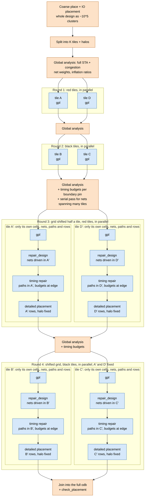

# The place stage as Bazel actions: coarse place, static tile split, rounds, join

Status: **proposed, not built.** The first step is a measurement: how the
place stage's time and peak memory divide between its steps. Those are global
placement, IO placement, `repair_design`, timing repair, detailed placement,
and the timing and congestion analysis inside global placement. The estimates
below are a model; the measurement replaces their inputs one at a time.

## Problem

The place stage runs as one process that holds the whole design. On XSTile it
takes 225 minutes, and remote execution cannot spread that across machines.

Measured peaks (`test/coremark_joule/designs/asap7/xiangshan/resources.json`):

| unit | floorplan | place | grt |
| --- | --- | --- | --- |
| XSTile | 10.5 GB | 47.4 GB | 84.6 GB |
| MemBlock | 10.0 GB | 28.6 GB | 42.2 GB |

Every step of the stage takes time:

- global placement, with the timing analysis it calls for timing-driven
  placement (`timingBase.cpp`, STA and the resizer) and the global route it
  calls for routability-driven placement (`routeBase.cpp:342`);
- IO placement;
- `repair_design`, plus timing repair where a flow enables it;
- detailed placement.

**Splitting only global placement does not scale.** With gpl at a share f of
the stage, tiling gpl alone gives 1.6x at f = 0.5 and 2.9x at f = 0.85 (model
below). The steps left serial set the limit (Amdahl), so every step has to be
split.

The many-body trick is already in gpl, and it is not where the time or the
memory goes. The density term is ePlace's electrostatic analogy, solved with
an FFT on a bin grid (`src/gpl/src/fft.cpp`). Its bins are about 23 MB at
512x512 and its FFT grids about 4 MB (`ideas/mlp.md`). The memory goes to:

- the per-object `GCell`/`GNet`/`GPin` records and about 20 per-cell
  `FloatPoint` vectors (`nesterovBase.h:1470-1496`);
- the whole odb;
- OpenSTA and the resizer;
- global route.

## Idea

Run the whole place stage as an action graph. Take the near-field/far-field
split of many-body methods and do it as domain decomposition:

- **Far field**: a coarse placement of the whole design, with serial global
  analyses between rounds.
- **Near field**: tiles, one action each, running every local step in that
  one action.

Netlist coupling does not decay with distance the way charge does. Placement
*creates* locality, so the coarse phase has to come first.

1. **Coarse place and IO placement** (one action, small): cluster the netlist
   to about 10^5 clusters (TritonPart `par`, or gpl's own clustering), run flat
   gpl on the clusters, and place the IO pins.
2. **Static split** (one action): cut the die into K tiles with a halo of
   bins. For each tile, write a small odb with:
   - the tile's own cells;
   - every outside cell they connect to, fixed at its current position (the
     terminal propagation of min-cut placement).
3. **Rounds**, R = 4 of them: 2 colours (red/black, a checkerboard) on the
   tile grid, then the same 2 colours on a grid shifted by half a tile, so no
   cut line becomes permanent (the Schwarz alternating method). Each round has
   two parts:
   - **Global analysis** (one serial action): a full-design STA at the
     current positions, giving net weights and timing budgets, and a
     congestion map, giving cell inflation ratios. This is everything
     timing-driven and routability-driven placement and timing repair need
     from the whole design: one scalar per net or per cell, or one budget per
     boundary pin, shipped to the tiles as data.
   - **Tile actions** (K/2 per round, one colour, in parallel,
     remote-executable).
4. **Rounds 1 and 2** run gpl refinement in the tiles, with the weights and
   ratios from the analysis.
5. **Rounds 3 and 4**, on the shifted grid, run **every remaining step of the
   place stage inside the tile action**, each scoped to the tile:
   - **gpl refinement**: the tile's cells.
   - **`repair_design`**: the nets whose driver sits in the tile. The few nets
     that span many tiles, like resets and high-fanout enables, get a serial
     pass in the analysis before round 3.
   - **Timing repair**, where the flow enables it: paths inside the tile,
     with `set_max_delay` budgets at the tile boundary, as for a hardened
     macro (`macro-constraints` skill). Hold paths are short and mostly local.
   - **Detailed placement and mirroring**: the tile's rows, with the halo
     fixed. In round 4, the red neighbours from round 3 are already legal and
     fixed, so the black tiles legalise around them and no extra boundary
     pass is needed.

   Every cell gets its repair and legalisation in exactly one tile action:
   the red tiles' cells in round 3, the black tiles' in round 4.
6. **Join** (one action): apply the tiles' outputs to the full odb, then run
   `check_placement`.

**Data between actions.**

- **Tile inputs** are the tile odb from the split, plus the positions of the
  cells in the halo from the neighbours' latest outputs.
- **Tile outputs** are small: positions in rounds 1 and 2, positions plus a
  netlist delta (inserted and resized buffers) in rounds 3 and 4.
- **The global analysis** reads the base odb and every tile output so far.
- **The join** applies them all.

In the diagram, orange marks a serial action on the whole design and blue a
step inside a tile action. A blue box sees only its tile and the halo's fixed
cells. The diagram draws K = 4 tiles; at K = 16, each round has 8 tile
actions side by side. Everything blue in a round runs at once, on as many
remote executors as there are tiles of that colour.

| ORFS step | split as | scope in a tile action |
| --- | --- | --- |
| 3_1 global place, IO skipped | coarse phase (serial, small) | n/a |
| 3_2 IO placement | serial, only the IO nets | n/a |
| 3_3 global place | tile actions, all 4 rounds | the tile's cells |
| timing- and routability-driven placement | global analysis between rounds | n/a; weights and ratios arrive as data |
| 3_4 `repair_design` | tile actions, rounds 3 and 4 | nets whose driver is in the tile |
| timing repair | tile actions, rounds 3 and 4 | paths inside the tile, budgets at the edge |
| 3_5 detailed placement, mirroring | tile actions, rounds 3 and 4 | the tile's rows, halo fixed |
| `check_placement` | after the join | n/a |

**Determinism:** fix the tiling, the colour order and the number of rounds,
and keep each tool's threading deterministic within a tile. Every action is
then a pure function of its inputs, so the result does not depend on how
remote execution schedules the actions. The result differs from a flat run,
which is acceptable, but it is reproducible and cacheable. Changing one tile's
inputs re-runs only that tile.

## Prior art

ePlace, RePlAce, DREAMPlace and Xplace speed up the field solve with FFTs and
GPUs, and stay in one process. Min-cut placement (Capo) is a static split, but
its cuts are made before placement exists, and analytic placers replaced it on
quality. Timing budgeting (the zero-slack algorithm) is how hierarchical timing
closure hands slack to blocks. Searches turned up no recent distributed-memory
placer. The closest work is 1990s partition-based parallel placement, and
deterministic parallel FPGA annealing that lets distant data go stale on
purpose (a UBC thesis). The hierarchical flow bazel-orfs already has, with
hardened macros (`macro-selection`), is the extreme case: cuts along
interfaces that are actually narrow, and fixed for good.

## Impact

Not measured. Every input to the model is stated, so a measurement can
replace one at a time.

### Inputs (XSTile)

- **The place stage takes 225 min.** gpl's share is f; f = 0.7 is assumed
  (158 min), and the remaining 67 min is `repair_design`, detailed placement,
  IO placement and odb I/O.
- **K = 16 tiles, R = 4 rounds.** Every tile is refined twice.
- **h = 0.25**: the halo overhead at K = 16.
- **g = 0.4**: the share of flat gpl's iterations a tile still needs, starting
  from the coarse placement's low overflow instead of from the centre.
- **Coarse place**: about `(C/N) * T_gpl`, about 4 % at C = 10^5 and N of a
  few 10^6, plus the clustering.
- **Global analysis**: a full STA plus a congestion map, about 3 min per
  round.
- **Action start-up**: libraries, LEF and the tile odb through remote
  execution, about 1.5 min per round.
- **Split and join**: one full odb read and write each, about 10 min
  together.

### Only gpl split (why it is not enough)

Tiled gpl comes to about `0.17 * T_gpl` plus 10 min, about 4x on gpl itself.
The rest of the stage stays serial:

| f | flat gpl | tiled gpl | place stage | stage speedup |
| --- | --- | --- | --- | --- |
| 0.5 | 112 min | 29 min | 141 min | 1.6x |
| 0.7 | 158 min | 37 min | 104 min | 2.2x |
| 0.85 | 191 min | 42 min | 77 min | 2.9x |

### The whole place stage split

| step | min |
| --- | --- |
| coarse place + IO placement | 8 |
| split + join | 10 |
| 4 x global analysis + action start-up | 18 |
| 4 x refine wave (`158 * 1.25 * 0.4 / 16`) | 20 |
| `repair_design`, timing repair and detailed placement in the tiles (2 waves x 67 / 16) | 8 |
| check | 2 |
| **total** | **about 66 min, 3.4x** |

The total CPU time stays about what the flat run takes
(`2 * (1 + h) * g = 1.0` for gpl), so the gain is wall time and memory, not
compute.

The floor is coarse place, the join and the four global analyses, about
30 min, so about 7x as K grows. To push past it, make the global analysis
cheaper:

- per-tile congestion (RUDY is local) instead of a central congestion map;
- an incremental STA that re-times only the tiles that moved;
- fewer rounds.

### The flow up to grt, against a GPU

A GPU speeds up gpl alone, so the comparison runs over the whole flow up to
grt, where repair is CPU-bound and serial.

XSTile from floorplan to grt takes 323 min (11 + 225 + 45 + 42). How it
divides is **assumed**:

| bucket | min | what is in it |
| --- | --- | --- |
| gpl | 158 | f = 0.7 of place |
| repair | 102 | `repair_design` at place (40), `repair_timing` at floorplan (5), cts (30) and grt (27) |
| rest | 63 | odb I/O, IO placement, detailed placement, building the clock tree, global route |

The cts and grt stages repair timing the same way as the place stage:

1. a full STA;
2. budgets;
3. K tile repairs;
4. a join.

At R = 3 rounds per stage that is about 24 min of serial work, against 57 min
of flat repair. If repair's full update per pass (`ideas/mlp.md`) scales with
design size, the tile work could shrink faster than K; that is not measured.

| configuration | gpl | split/join | repair | rest | total | speedup |
| --- | --- | --- | --- | --- | --- | --- |
| flat, CPU (today) | 158 | 0 | 102 | 63 | 323 | 1.0x |
| flat, gpl on GPU (40x) | 4 | 0 | 102 | 63 | 169 | 1.9x |
| flat, GPU + repair fixed on one machine (3x) | 4 | 0 | 34 | 63 | 101 | 3.2x |
| tiled, CPU | 20 | 10 | 35 | 45 | 110 | 2.9x |
| tiled, gpl on GPU per tile | 12 | 10 | 35 | 45 | 102 | 3.2x |

Notes on the table:

- A GPU alone is capped by Amdahl at about 2x, because repair and the rest
  stay serial on the CPU.
- Tiling's own limit is the full-design STA it runs in every round.
- In the tiled rows, the rest drops from 63 to 45 because detailed placement
  tiles; global route and building the clock tree do not.
- The "repair fixed on one machine" row is a guess at what a batched,
  cone-local incremental update in `repair_timing` would give; it has not
  been tried.
- Both approaches top out near 3x against the same floor: global route,
  building the clock tree and full-design odb I/O. Going past that means
  tiling global route too.
- **What separates the two is memory.** The flat runs on a single machine,
  GPU or not, keep their peak. Tiling cuts every action's peak to one tile's
  share.

### Gains, and what is unknown

The gains:

- the place stage's wall time spread across remote executors;
- the peak of each action down to one tile's share, plus one join;
- per-tile caching.

The flow's peak only drops when global route is split the same way, because
grt's peak is above place's in every measured unit.

The quality cost of the cut lines and of the timing budgets is unknown. It is
measured as HPWL and WNS after repair, against a flat run of the same design.

**Assumptions most likely to be wrong:**

- g, the share of gpl iterations a tile still needs;
- f, gpl's share of the stage;
- the cost of a full STA per round on XSTile.

## Effort

**Large.** The work, in order:

1. **Gate** (small): measure the time and peak memory of each step of
   XSTile's place stage, separating global placement's own work from the STA,
   resizer and global route it calls. This gives f and the per-round analysis
   cost.
2. **Small trial** (medium): on a toy design of about 10^5 cells, run the
   whole place stage as a 2x2 split by hand in a dirty lane: coarse place,
   split, rounds, repair, detailed placement, join. Compare HPWL, WNS and
   runtime against a flat run.
3. **Engineering** (large):
   - tile odb extraction and the join, buffers included;
   - the global analysis action;
   - net ownership for repair, and timing budgets per tile;
   - the Bazel rule, with K actions per round and the rounds unrolled
     statically.
4. **Then the same treatment for cts repair and global route**, which set the
   flow's peak.
