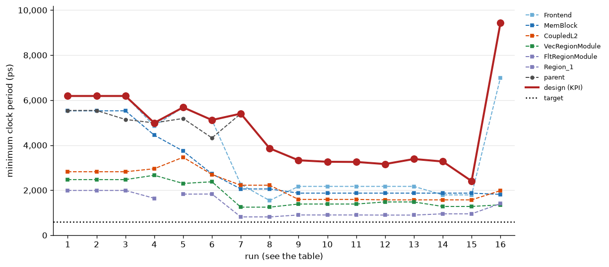
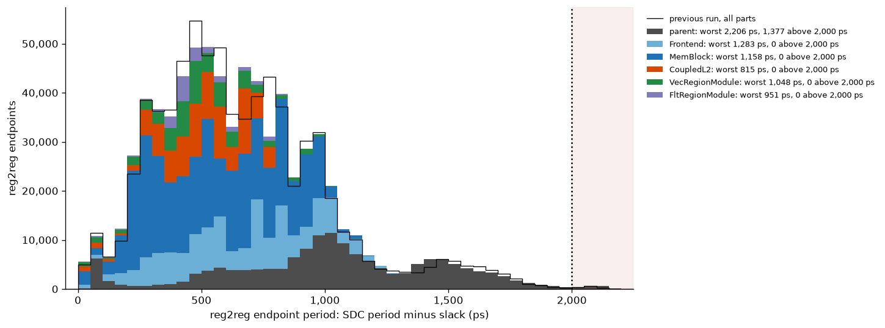

# XiangShan XSTile on asap7

The tile of XiangShan's Kunminghu generation, the core and its L2, as a
reference frame: something that reproduces, that anyone can look at,
and that we improve one concern at a time.

Nothing here runs in CI. Every target is `tags = ["manual"]`.

## TL;DR for OpenROAD maintainers: XiangShan in the dirty lane

How to get a stage of XiangShan in front of a locally built `openroad`,
for example to see what a resizer change does, without Bazel in the
loop once it is set up. The skills named here are in `.claude/skills/`.

**1. Pick the size.** The parent, `XSTile`, is the real case; a block is
the small one, with real repair work in it. Measured per stage at
`25f75524` (`resources.json`), minutes and peak GB:

| flow | place | cts | grt |
|---|---|---|---|
| XSTile, the parent | 225, 47 | 45, 42 | 42, 85 |
| Frontend | 43, 17 | 30, 21 | 43, 31 |
| FltRegionModule | 18, 6 | 2, 5 | 4, 9 |

The parent needs a machine with 128 GB. FltRegionModule builds on a
32 GB machine: measured on 16 cores and 30 GB, from nothing to its CTS
in 1 h 49 min with OpenROAD and Yosys from a remote cache (building
them from source adds 30 to 60 minutes), about 50 of it its register
file `FpRegFile`, a macro of its own; then its global route in the
dirty lane in 5 min 23 s at 9.4 GB, ending with `RSZ-0062 Unable to
repair all setup violations`: repair gave up, so there is something to
study.

**2. Build up to the stage before yours, in Bazel.** Nothing of
XiangShan is in a cache you can reach (`/cache-miss` asks), so the first
build is cold: OpenROAD and Yosys from source, the RTL from XiangShan's
Chisel sources, then the flow.

```sh
git clone https://github.com/The-OpenROAD-Project/bazel-orfs && cd bazel-orfs
# a block:
bazelisk build //test/coremark_joule/designs/asap7/xiangshan:FltRegionModule_cts
# the parent: its blocks first, in waves that fit free memory, then the parent
bazelisk run //test/coremark_joule/designs/asap7/xiangshan:build -- \
    --units CoupledL2,FltRegionModule,Frontend,MemBlock,VecRegionModule
bazelisk build //test/coremark_joule/designs/asap7/xiangshan:XSTile_cts
```

`:build -- ... --plan-only` prints the waves and builds nothing; on a
machine without the memory it says which block is over budget, and when
systemd-oomd would kill it.

**3. Open the stage in the dirty lane** (`dirty-lane`), and run it with
ORFS's make, as often as you like:

```sh
bazelisk run //:dirty -- start //test/coremark_joule/designs/asap7/xiangshan:FltRegionModule grt
tmp/test/coremark_joule/designs/asap7/xiangshan/FltRegionModule/make do-grt
```

`start` builds every stage before `grt` and lays out a plain tree: the
`.odb` and `.sdc` it starts from, ORFS's scripts with bazel-orfs's
carried patches, and the openroad Bazel built. Your own openroad
(`byo-openroad`):

```sh
OPENROAD_EXE=~/OpenROAD/build/bin/openroad \
    tmp/test/coremark_joule/designs/asap7/xiangshan/FltRegionModule/make do-grt
```

**4. Where the resizer runs in this flow**, and what steers it
(`xiangshan.bzl`):

- Floorplan (`2_1_floorplan`): `repair_timing -setup` with the moves
  `unbuffer,sizeup,swap,vt_swap` on yosys's buffers (no
  `SKIP_FLOORPLAN_REPAIR_TIMING`).
- Placement (`3_4_place_resized`): `repair_design`; `repair_timing` only
  with `ENABLE_PLACE_REPAIR_TIMING`, which this flow does not set.
- CTS (`4_1_cts`): `repair_timing`, setup and hold.
- Global route (`5_1_grt`): `repair_design`, then `repair_timing` with
  the route's parasitics (`repair-timing-grt`), setup only: hold is left
  to CTS (`HOLD_SLACK_MARGIN=-1000` at grt). On the parent it took 84 min
  in KPI run 15, 45 in run 17.
- Every flow repairs the worst 1 % of endpoints' TNS (`TNS_END_PERCENT=1`)
  and skips the last-gasp pass (`SKIP_LAST_GASP=1`).

**5. How far repair got, and what is left** (`repair-headroom`): load the
stage in the odb-debug daemon and ask `headroom` for the reg2reg period
against what useful skew, the fastest VT and zero wire would give, and
the one-flop-loop floor no repair can beat.

**6. Share it.** `bazelisk run //:dirty -- archive <flow> <stage>
<file.tar.gz>` packs a stage as an untar-and-run reproducer for an
issue.

## The KPI



`floor` is the parent's one-flop-loop floor at global route
(`tools/headroom/report_floor_cycles.tcl`): the worst path from a register
back to itself, which no clock skew or retiming passes. Run 17's 2,151 ps,
at `core/backend/inner_ctrlBlock/decodeBufValid_3`, is above the 2,000 ps
target: that loop's wire, cells or logic must get faster before any
clocking can reach it.

<!-- kpi-table begin: written by kpi.py -->
| # | date | design | parent | floor | Frontend | MemBlock | CoupledL2 | VecRegionModule | FltRegionModule | Region_1 | change |
|---|---|---|---|---|---|---|---|---|---|---|---|
| not drawn | 2026-09-22 | ≥ 47,401 | 47,401 |  |  |  |  |  |  |  | first clock tree of the planned parent |
| not drawn | 2026-09-23 | ≥ 45,607 | 45,607 |  |  |  |  |  |  |  | blocks' band soft-blocked, density 0.5, M9 at adjustment 0.18 |
| not drawn | 2026-09-24 | 45,985 | 45,985 |  | 14,114 | 4,870 |  | 2,364 |  | 2,186 | the baseline; 43715 ps of it is the clock reaching MemBlock's pin, and each block alone is 3 to 20 times faster |
| not drawn | 2026-09-24 | 14,114 | 13,527 |  | 14,114 | 4,870 |  | 2,364 |  | 2,186 | blocks abstracted at cts; the worst reg2reg path is Frontend's own 12534 ps setup to a falling-edge element, the clock no longer |
| 1 | 2026-09-26 | 6,186 | 5,543 |  | 6,186 | 5,527 | 2,820 | 2,471 |  | 1,990 | XSTile, the tile with its L2, at density 0.2 and layer adjustment 0.1; global route at zero iterations with congestion allowed (total 37180, worst edge 31/42) |
| 2 | 2026-09-26 | 6,186 | 5,543 |  | 6,186 | 5,527 | 2,820 | 2,471 |  | 1,990 | SDC at 473 ps, 333 ps on 7 nm in FO4; the period of the 800 ps run to the picosecond: with timing repair skipped and ABC mapping for area the netlist does not depend on the SDC |
| 3 | 2026-09-27 | 6,186 | 5,143 |  | 6,186 | 5,527 | 2,820 | 2,471 |  | 1,990 | block abstracts carry their ports' max_transition and max_capacitance (OpenSTA patch 0008), so the parent's repair_design buffers the nets between blocks |
| 4 | 2026-09-28 | 4,991 | 4,991 |  | 4,854 | 4,446 | 2,954 | 2,665 |  | 1,642 | synthesis maps with ABC's speed script in every flow instead of the area script |
| 5 | 2026-09-28 | 5,681 | 5,188 |  | 5,681 | 3,741 | 3,464 | 2,301 | 1,826 |  | XiangShan kunminghu-v3 aa6b520, re-planned (Region_1 is now FltRegionModule); a different RTL, not comparable with the rows before |
| 6 | 2026-09-29 | 5,118 | 4,325 |  | 5,118 | 2,725 | 2,698 | 2,375 | 1,831 |  | REMOVE_ABC_BUFFERS dropped (deprecated in ORFS) and the planned blocks' kept modules stated with OpenROAD hierarchical: one repair_design call no longer leaves about 46,000 slew violators on Frontend; measured in the same build by xs_pathology's probe |
| 7 | 2026-10-01 | 5,402 | 5,402 |  | 2,259 | 2,057 | 2,222 | 1,247 | 814 |  | timing- and routability-driven global placement, ORFS's default, and RVT, LVT and SLVT from synthesis: every block faster, the parent slower and now the design's period |
| 8 | 2026-10-02 | 3,860 | 3,860 |  | 1,541 | 2,057 | 2,222 | 1,247 | 814 |  | the parent keeps no global-placement repair (GPL_KEEP_OVERFLOW 0) and repairs timing after CTS; the ORFS bump to ecb3cfdeb1ca between the rows |
| 9 | 2026-10-04 | 3,330 | 3,330 |  | 2,170 | 1,870 | 1,591 | 1,386 | 900 |  | AUTO_MEMORIES reaches every stage (#1157): from floorplan on, the flow times and optimizes against the generated memories' views, which earlier rows' later stages never loaded, so their paths through a memory went untimed; also the parent's CTS balancing the blocks' clock trees (#1150) and the bumps to ORFS d2b74aa79e98 |
| 10 | 2026-10-05 | 3,264 | 3,264 |  | 2,170 | 1,870 | 1,591 | 1,386 | 900 |  | the blocks repair timing after CTS, where their abstracts are cut: the parent 3,330 to 3,264 ps on an identical placement (its stages before CTS unchanged); the blocks' place-stage periods cannot move; Frontend's CTS 46 min |
| 11 | 2026-10-05 | 3,256 | 3,256 |  | 2,170 | 1,870 | 1,591 | 1,386 | 900 |  | the parent planned with each block mocked to density 0.6 (#1170): its die 2025 x 2666 um against 2377 x 3043, a quarter smaller, the period 3,256 against 3,264 ps; global route 81 GB against 93, congestion 21.2 % against 17.9 % |
| 12 | 2026-10-06 | 3,162 | 3,162 |  | 2,170 | 1,870 | 1,572 | 1,479 | 895 |  | the generated register files read as the RTL does (#1181): the false 1,161 ps read path through FltRegionModule is gone; the parent's worst path is now its own CtrlBlock logic; VecRegionModule slower with its real read-address registers |
| 13 | 2026-10-07 | 3,386 | 3,386 |  | 2,170 | 1,870 | 1,572 | 1,479 | 895 |  | in flight, to show where it stands: #1187 builds the register files with OpenROAD's generate_regfile through ORFS's AUTO_MEMORIES_REGFILES (OpenROAD#11669, OpenROAD-flow-scripts#4651) in place of bazel-orfs's structured_gen; the blocks unchanged, the parent 224 ps slower, its worst path CtrlBlock's own (rob/vtypeBuffer state to decodeBufBits ftqOffset), cause not diagnosed; measured at #1187's commit of that day, which has moved since |
| 14 | 2026-10-08 | 3,276 | 3,276 |  | 1,792 | 1,870 | 1,572 | 1,278 | 951 |  | in flight, #1187 a day on: generate_regfile's AOI22/NAND2/NOR2 read tree makes the blocks with register files faster, Frontend 2,170 to 1,792 ps and VecRegionModule 1,479 to 1,278, FltRegionModule 895 to 951 (its worst path ends at the register file's write port); the parent 3,276 ps, 110 below run 13 and 114 above run 12, its worst paths a mass of CtrlBlock control: the same CtrlBlock built alone closes at 1,200 ps, so the parent's gap is its placement and repair; global route 18.7 min, 83 GB, 21.5 % |
| 15 | 2026-10-09 | 2,406 | 2,406 |  | 1,792 | 1,870 | 1,572 | 1,278 | 951 |  | the parent repairs setup at global route with the route's parasitics (SKIP_INCREMENTAL_REPAIR dropped, hold repair off there): 3,276 to 2,406 ps on row 14's build, its worst path now CtrlBlock's flush redirect into Frontend; 1,525 VT swaps, 74 buffers; global route 84 min against 19, 102 GB against 83; the blocks unchanged |
| 16 | 2026-10-14 | 9,431 | 9,431 |  | 6,998 | 1,815 | 1,982 | 1,351 | 1,406 |  | the parent's worst path, intRegion's pipeToBJU2 into Frontend's io_backend_toFtq_resolve_2_bits_mispredict; global route's setup repair 9,628 to 9,431 ps (197 ps, flat after iteration 869 of ~1,000), and 5,835 endpoints violate hold past the flow's -1,000 ps margin, the worst by 6,412 ps; CTS latency balancing inserts 2,502 delay buffers (518 at ffe02d5d) and 6,995 hold buffers. Frontend's worst path is the BPU's meta valid into the Ftq's generate_ram queue (metaQueueResolve.ram/addr_w); Flt's and Vec's end at their generate_ram register files' write address. Global route 209 min, 119.9 GB peak; the parent's placement 7 h. Earlier rows predate OpenSTA #532 and may leave gated-clock paths untimed |
| 17 | 2026-10-16 | 2,504 | 2,504 | 2,151 | 1,355 | 1,449 | 978 | 992 | 1,067 |  | the parent's worst path, intRegion's io_toMemExu_2_0 lqIdx through MemBlock into intRegion's load issue queue wakeup; 5,259 of the parent's 156,690 reg2reg endpoints are above 2,000 ps, none of any block's. Patch 0135 times a global-route abstract with the route's parasitics: MemBlock's lqIdx-to-pdest arc was 6.9 ns with placement parasitics and is 1.84 ns, as MemBlock times itself; the parent was 7,855 ps without it. The register files are macros with their own clock trees (#1257, #1265), and the parent's CTS takes 40 min where run 16's took about 10 h. Every earlier row's block abstracts carry placement parasitics. Parent place 3.9 h, global route 45 min at 98 GB |
| 18 | 2026-10-23 | 2,383 | 2,383 |  | 1,193 | 1,410 | 906 | 1,075 | 1,023 |  | the base flow of #1351's pin plan A/B. The parent's worst path, intRegion's flushCopyRegVec robIdx into vecRegion's gpWbWakeUp; no floor or flat run measured for this row |
| 19 | 2026-10-23 | 2,250 | 2,250 |  | 1,296 | 1,410 | 906 | 1,083 | 922 |  | pins facing away from their logic over the parent's macros 3,407 to 2,959; one run per arm. Frontend rose (1,193 to 1,296 ps): the plan takes a pin net's centre, which after repair is the repeater at the pin, so its worst register-file pin stayed while its flop moved. The parent's worst path, Frontend's cfVec instruction into ctrlBlock's decode buffer |
| 20 | 2026-10-29 | 2,212 | 2,212 |  | 1,283 | 1,236 | 815 | 1,048 | 951 |  | main since run 18: three OpenROAD/ORFS bumps, and MemBlock and the parent on the extracted modules (b33b28ea, da6e9aa5); one run, the causes not separated. The parent's worst path, intRegion's pipeToALU0 fuType into vecRegion's gpWbWakeUp; no floor or flat run measured for this row |
<!-- kpi-table end -->

Periods are in picoseconds; `≥` marks a run that did not measure the
blocks, a lower bound. The chart starts at the first run below the
Frontend block's 14,114 ps, and the runs before it are in the table only.
`kpi.json` is the series, and `kpi.py` draws the chart and writes this
table. When a change moves the number, add a row and re-run it.

### What remains



Every register-to-register endpoint of the latest run, by its period (the
SDC period minus its slack), timed flat: the parent with every block's
real cells and wires in place of the block's abstract
(`XSTile_kpi_flat`, below). Stacked by where the endpoint's worst path
starts and ends: in the parent, inside one block, or across a block's
boundary. The endpoints right of 2,000 ps are what remains.

<!-- kpi-flat begin: written by kpi.py -->
| class | endpoints above 2,000 | worst | logic only | worst path | what it is |
|---|---|---|---|---|---|
| FltRegionModule → parent | 2,982 of 17,335 | 2,238 | 1,356 | `core/backend/inner_fpRegion/issueQueues_1/fastEntries_14_valid$_DFF_PP0_/QN` → `core/backend/inner_ctrlBlock/decodeBufBits_0_instr[24]$_DFFE_PP_/D` | The FP issue queues' entry valids, through out_toDispatch_canAccept, into ctrlBlock's decode buffer: backpressure from the FP region to dispatch, crossing from one hardened block into the parent. 69 stages, 1,026 ps in repeaters. |
| parent | 1,921 of 146,537 | 2,455 | 1,482 | `core/backend/inner_ctrlBlock/decodeBufValid_0$_DFF_PP0_/QN` → `core/backend/inner_ctrlBlock/memCtrl/ssit/io_rdata_7_strict$_DFFE_PP_/D` | Decode into the memory dependence predictor: ctrlBlock's decode-buffer valid bit to a strict bit read from the store-set identifier table (memCtrl.ssit). 60 cell stages, 1,044 ps of them repeaters. |
| parent → VecRegionModule | 1,375 of 3,070 | 2,364 | 1,603 | `core/backend/inner_intRegion/pipeToALU0.io_out_bits_ctrl_fuType[30]$_DFFE_PP_/QN` → `core/backend/inner_vecRegion/issuePipes_1/is0_valid$_DFF_PP0_/D` | The integer region's ALU pipeline register (fuType) into the vector region's issue pipe valid: the parent's dispatch steering into a hardened block. 93 stages, 1,151 ps in repeaters. |
| FltRegionModule → VecRegionModule | 64 of 160 | 2,082 | 1,508 | `core/backend/inner_fpRegion/issueQueues_3/fastEntries_8_valid$_DFF_PP0_/QN` → `core/backend/inner_vecRegion/issueQueues_4.enqEntryOldest_age.age_0_1$_DFFE_PP0P_/D` | An FP issue-queue entry valid into the vector issue queue's age matrix: block to block through the parent. 52 stages, 832 ps in repeaters. |
| parent → MemBlock | 46 of 4,434 | 2,113 | 1,388 | `core/backend/inner_ctrlBlock/s1_robFlushRedirect_valid_last_REG$_DFF_PP0_/QN` → `core/memBlock/inner_frontendBridge.icache.nodeOut_a_q.enq_ptr_value$_DFFE_PP0P_/D` | ctrlBlock's ROB flush redirect into MemBlock's instruction-fetch bridge queue pointer. 52 stages, 1,361 ps in repeaters. |
| MemBlock → parent | 9 of 10,831 | 2,065 | 582 | `core/memBlock/inner_LoadUnit_1.s1.io_pipeOut_valid$_DFF_PP0_/QN` → `core/backend/inner_intRegion/issueQueueSTD0_StdMoud/io_deqDelay_0_bits_rfBankRen_0_3$_DFF_P_/D` | A load unit's stage-1 valid out of MemBlock into an integer store-data issue queue's dequeue. 81 stages, 1,709 ps in repeaters: almost all distance. |
| parent → FltRegionModule | 1 of 1,638 | 2,030 | 862 | `core/backend/inner_ctrlBlock/s1_robFlushRedirect_valid_last_REG$_DFF_PP0_/QN` → `core/backend/inner_fpRegion/fpRegFile/io_readPorts_13_addr[7]` | ctrlBlock's ROB flush redirect into the FP register file's read address. 70 stages, 1,722 ps in repeaters. |
<!-- kpi-flat end -->

*Logic only* is the same path timed without wires (`XSTile_kpi_flat_nowire`):
the cells and the repeaters already placed, at their pin loads. No
endpoint of any class is above 2,000 ps without wires, so what remains is
distance: on each worst path 40 to 80 percent of the delay is in
repeaters. It is a placement and floorplan problem, not logic too deep for
the period.

**Timed flat.** `<parent>_kpi_flat` times the design as one netlist. Each
part's pieces come from its own global route (`<part>_sta_part`,
`sta_part.tcl`): its netlist written hierarchically, so its names are the
SPEF's, the route's parasitics as SPEF, and its liberty files. A block
contributes its interface logic only: the cells from its data inputs to the
first flops and from the last flops to its outputs, every load of a net
those cells drive, and the clock tree of the flops it keeps, walked in the
database. A path that crosses a block's boundary times as in the whole
block; a path inside a block is the block's own KPI. Each block's modules
are renamed `<block>__<module>` (`sta_prefix.py`) so the same RTL module
synthesised in two blocks does not collide, and a net repair made inside a
submodule gets back its local name (the hierarchical writer declares it
with the submodule's path in front, where the SPEF does not), so every net
in the SPEF is found. OpenSTA reads it all
(`sta_flat.tcl`), with parasitics reduced as read, in about ten minutes.
Paths are selected from every register's clock pin to every
register's data pin: the parent's SDC names its own registers in its
reg2reg group, so a block's flop is in no group.

Each part alone, at its own global route with its abstracts (`<part>_kpi`):

<!-- kpi-worst begin: written by kpi.py -->
| part | period | worst reg2reg path | what it is |
|---|---|---|---|
| parent | 2,212 | `core/backend/inner_intRegion/pipeToALU0.io_out_bits_ctrl_fuType[27]$_DFFE_PP_/QN` → `core/backend/inner_vecRegion/in_fromIntRegion_gpWbWakeUp_0_wen` | From the ALU0 issue pipe's function-unit type in intRegion into vecRegion's write-back wake-up enable: a parent register to a block's input pin. |
| Frontend | 1,283 | `inner_bpu/csrCtrl_delay.io_out_abtbEnable$_DFF_P_/QN` → `inner_bpu/tage/tables_2.tage_useful_sram_bank0_way1.array.array_0_0_0.array.array_ext/RW0_addr[2]` | The BPU's delayed abtbEnable control register to the address pin of a TAGE table's useful-bit SRAM: a CSR setting gating a memory address. |
| MemBlock | 1,236 | `inner_dcache/dcache.mainPipe/s1_req_vaddr[34]$_DFFE_PP_/QN` → `inner_dcache/dcache.cacheCtrlOpt.counterRegs_0[30]$_DFFE_PP0P_/D` | The DCache main pipe's stage-1 virtual address into a cache-control counter register: an address compared and counted in one cycle. |
| CoupledL2 | 815 | `slices_0/directory/req_s3_tag[6]$_DFFE_PP0P_/QN` → `slices_0/dataStorage.array.array_0_0_0.array.array_ext/RW0_addr[11]` | The directory's stage-3 request tag to the address pin of the L2 data SRAM: a tag travelling to a memory. |
| VecRegionModule | 1,048 | `issuePipes_1/exu.ex_0_bits_ctrl_uopIdx[0]$_DFFE_PP_/QN` → `issuePipes_1/exu.Vfmac.a0_0_fpB[59]$_DFFE_PP_/D` | An issue pipe's micro-op index into the vector FMA's operand register: operand selection by uop index. |
| FltRegionModule | 951 | `fpWbDataPath.out_wb0_1_pdest[0]$_DFFE_PP_/QN` → `fpRegFile/io_writePorts_1_addr[0]` | The FP write-back path's destination register number to the FP register file's write address: a register index travelling to a macro. |
<!-- kpi-worst end -->

`kpi_run.tcl` writes each part's histogram in 10 ps bins, and
`kpi.py --histograms parent=XSTile_kpi.txt Frontend=Frontend_kpi.txt ...`
records them and the worst paths in the latest row; `kpi.py --flat
XSTile_kpi_flat.txt XSTile_kpi_flat_nowire.txt` records the flat timing's
classes; `kpi.py --hist-only --bin 20 --log` redraws the chart alone, from
the json.

The KPI is the design's minimum clock period, the red line: the largest
of the parent's period and each block's, since the design is only as
fast as its slowest part. On main it is **3,162 ps**, the parent's (run
12); runs 13 to 15 are #1187, in flight and not on main, there to show
where it stands, run 15 with the parent's setup repair at global route
that the flow now runs. The parent is one of those parts, like any block, and each of
them is drawn dashed beneath the red line, a period that has to be at or
below it.

Each part's period is its SDC period minus the worst slack of its
`reg2reg` group, which is the only group that can fail timing closure.
Ask a checkout for it with `.claude/skills/odb-debug/SKILL.md`, and read
`.claude/skills/macro-constraints` before quoting any other group. Ask
for the group by name and not for the worst slack: on VecRegionModule the
overall worst slack is -2,006 ps and belongs to another group, while
`reg2reg` is -1,564 ps, and only the second one is a period.

The parent, XSTile with its clock tree, is **3,860 ps** at global route
with the route's own parasitics; its `reg2reg` group does not see the
paths inside a block's abstract. Each block is measured alone, likewise
at its global route with its clock tree (`<block>_kpi`); the table below
is an earlier run's, at each block's place stage against an ideal clock:

| block | minimum period | worst `reg2reg` path |
|---|---|---|
| Frontend | 1,541 ps | a TAGE table SRAM's reset state into the predictor's `sramResetDone` |
| CoupledL2 | 2,222 ps | a slice's directory state at stage 3 into SinkC's buffer |
| MemBlock | 2,057 ps | load unit 0's stage-1 exception vector into stage 2's fast-replay grant |
| VecRegionModule | 1,247 ps | the vector divider's FP format into the FMA's operand |
| FltRegionModule | 814 ps | an FP adder's operand into its stage-1 round-up overflow |

XiangShan's `ClockGate` is mapped onto ASAP7's ICG cell (`xs_icg.ys`) in
every flow, the parent's and every block's.

Synthesis maps with ABC's speed script, ORFS's default, in every flow;
`synth_config_test` checks each flow's synthesis configuration once it
is built. ABC gets no delay target: ORFS passes the SDC period as `-D`
with a script file, and Yosys hands `-D` to ABC only through the `{D}`
placeholder of its built-in and inline scripts (ORFS #4585).

The blocks are implemented through a route-0 global route and abstracted
there, as a macro is: the parent's paths through a block are timed
against the block's clock tree and its timing as repaired with the
route's parasitics. Abstracted at `cts`, as they were before, Frontend's
period was 28 percent pessimistic against its route-0 global route and
`repair_design` on the same checkpoint, with the same worst paths
(`ideas/xiangshan-timing.md`, entry 25).

## The 333 ps goal

XiangShan's published goal for Kunminghu is 3 GHz on an advanced node,
7 nm: a 333 ps cycle. It is a target, not a silicon result. The team's
HPCA'25 tutorial lists Kunminghu as "Advanced-node, 3GHz, 1.5x IPC of
NH" ([slides](https://tutorial.xiangshan.cc/hpca25/slides/20250302-HPCA25-1-Introduction-XiangShan.pdf)),
Hot Chips 2024 reported 7 nm and 3 GHz
([report](https://riscv.org/ecosystem-news/2024/08/xiangshan-high-performance-risc-v-processors-at-hot-chips-2024/)),
and at RISC-V Summit Europe 2025 "KMHv2" was "ready to tape-out" with
SPEC scores estimated at 3 GHz
([keynote](https://riscv-europe.org/summit/2025/media/proceedings/2025-05-14-RISC-V-Summit-Europe-09h30-BAO-slides.pdf),
[poster](https://riscv-europe.org/summit/2025/media/proceedings/2025-05-13-RISC-V-Summit-Europe-P2.1.06-TANG-poster.pdf)).
No measured frequency is published and no corner is stated for the core;
the same keynote quotes XiangShan's NoC at "7nm_SS". The previous
generation came close to its goal: Nanhu targeted 2 GHz on 14 nm, its
GDSII was delivered at 2 GHz, and the keynote lists its second tape-out
at 2.5 GHz. What we build is kunminghu-v3 at aa6b520, integer-only with
a small last-level cache.

In fanouts of four, 333 ps is 41.1 FO4 at the published ASAP7 RVT FO4 of
8.1 ps, which the ASAP7 authors call realistic for industrial 7 nm. On
the library this flow times with (RVT at the FF corner, FO4 14.37 ps)
that is 591 ps at global route, and the SDC synthesises at 0.8 of it,
473 ps (`period_fo4_test`). A cycle leaves about 38 FO4 of logic: the
flops on the paths below take 31 ps clock-to-output and 6 to 13 ps setup.

Is the Chisel RTL congruent with that? Read at the source, the worst path
of each block and of the top level is 6 to 30 gate levels, which at about
1.5 FO4 per level (logical effort for fanout-of-four stages) is 9 to 45
FO4. Measured, the same paths are 138 to 430 FO4:

| worst `reg2reg` path | construct in the RTL | gate levels, read | FO4, estimated | FO4, measured |
|---|---|---|---|---|
| Frontend: `mbtb.t1_startPcVec` to a bank's write `setIdx` | 8-bit equality and 16-bit zero detect into a flop enable, one bit fanning out to 4 banks of 4 ways | 6 to 8 | 9 to 12, plus the fanout tree | 430 |
| MemBlock: redirect `robIdx` to `loadQueueReplay` vaddr | 10-bit age compare, pop count, free-slot mux, 7-to-120 decode, write mux into a 120 by 50-bit flop array | about 15 | about 22, plus the array's fanout | 385 |
| CoupledL2: directory state to the L1 hint queue | 8-way hit and one-hot mux, main-pipe control, an arbiter, a queue write | 15 to 20 | 23 to 30 | 196 |
| VecRegionModule: `Vfma` widen flag to its CSA stage | operand muxes, radix-4 Booth encoding, a 27-to-4 carry-save tree | 16 to 20 | 24 to 30 | 172 |
| Region_1: the FMA's fp64 flag to its shift mask | a 107-bit add with carry select, a 110-bit invert and AND-reduce compare | about 20 | about 30 | 138 |
| XSTile: vector issue queue's accept to the decode buffer | a ready chain back through six modules, a priority encode, an adder and an 8-to-1 index mux | 20 to 30 | 30 to 45 | 358, with clock trees |

The measured column is each block alone at its place stage against an
ideal clock, and for XSTile the parent's period; the read and estimated columns are
source reading, with files and lines in `ideas/xiangshan-timing.md`,
entry 27. The paths and the measured column are the area-mapped netlist's
of the RTL before aa6b520 (Region_1 is now FltRegionModule); with ABC's
speed script and the new RTL every block's worst path moved (the table in
"The KPI"), and those have not been read at the source yet.

By logic depth the RTL is congruent with the goal: every one of these
paths fits in 41 FO4, the deepest two, the FMA's wide add and the top
level's ready chain, at the edge of it, and XiangShan's own comments mark
the ready chain as a timing concern. The measured paths are 4 to 45 times
their logic, and the difference is ours to explain, not the RTL's. The
shallowest paths are the furthest off, which points at fanout and
buffering (Frontend's startPc, MemBlock's 120-entry array) before logic,
and at synthesis mapping for area (`ABC_AREA=1`). None of the six runs
through a memory XiangShan builds as SRAM: the replay queue, the write
buffer and the hint queue are flops in its RTL too.

What would make the RTL incongruent is a path whose logic alone exceeds
41 FO4 however it is mapped. None of the six does by reading; the
best-effort mapping of each cone, and the logic-only period of each
block with the wires taken out, are the measurements that would show one.

## The arrays

The Rob, the load and store queues and the load TLB are arrays the RTL
never wrote as arrays: one entry's registers and logic repeated, each
entry selected by comparing a broadcast index with its own. `arrays/`
finds them in the surgered core, writes each block as one entry cell
instanced per entry with the index comparisons decoded once in the
block, and proves the result equal to the block (`arrays/README.md`).

MemBlock and the parent read `arrays:xiangshan_extracted`, the surgered
core with those blocks swapped for their extractions (`XS_EXTRACTED` in
`xiangshan.bzl`); every other part reads the surgered core. Slang
elaborates one module per instance, so `fold_entries.tcl`, run before the
canonical checkpoint, folds the copies of each entry cell back onto one
module, which synthesis then maps once. TLBFA, the instruction TLB, is
extracted too but is Frontend's, which reads the surgered core.

## Running it

```
bazelisk run //test/coremark_joule/designs/asap7/xiangshan:XSTile_grt gui_grt
```

Needs 64 GB. About six hours cold, a download when the cache is warm.
Earlier stages are their own targets (`XSTile_synth`, `_floorplan`,
`_place`, `_cts`), each with `gui_` and `open_` forms and a `//:dirty`
tree (`bazelisk run //:dirty -- start //test/coremark_joule/designs/asap7/xiangshan:XSTile <stage>`), and
`XSTile_cts_odb_debug` and `XSTile_grt_odb_debug` open a checkpoint for
questions.

`XSTile_flat_grt` is the same tile as one flow, with no hardened blocks:
ORFS's own hierarchical synthesis of the whole tile (its keep rule, not
the plan's), then macro and global placement over all of it, through
global route, the kept modules in the ODB (`OPENROAD_HIERARCHICAL`). The
register files are the planned flow's macros, the same targets. No
number from it is in the KPI.

```
bazelisk run //test/coremark_joule/designs/asap7/xiangshan:XSTile_flat_grt gui_grt
```

`/cache-miss` asks whether a target is cached without building it: a
capture never executes a flow action, a miss is killed as it appears and
the build carries on, so a laptop can ask in minutes.

## Where the period is

Parked at 2,504 ps at global route: 5,259 reg2reg endpoints over 2,000
ps, 733 ns of excess over it (2,473.5 ps timed flat with the blocks'
own cells). The one-flop-loop floor, 2,151 ps at `decodeBufValid_3`,
does not set it.

The worst path launches in `Frontend` (its 876 ps there are mostly the
block's clock insertion, which the capture side cancels) and spends
2,284 ps in the parent, through decode and `uopBufferCtrlDecoder` to
`SSIT`: 1,332 ps of logic, 952 ps of buffers. The mass sits in one
corridor, the floating-point region's pins and `CtrlBlock`'s decode,
dispatch and rename.

What was tried, what is known and what is open:
`ideas/xiangshan-timing.md`, entry 58. Each open question is a
global-route arm of about six hours, run only with a reason why it is
new (`.claude/skills/dogfooding`, rule 14).

## What is deliberately broken

Global route is skipped past pin access (OpenROAD DRT-0073) and does not
converge: it runs with congestion allowed, and the period is the number
tracked; the register files are generated rather than synthesised,
because yosys does not finish them at this size; the configuration is
integer-only with a small last-level cache. The carried patches in
`patches/` make it run at all.

`ideas/xiangshan-timing.md` has the inventory: each entry a
measurement and what it implies. That is where a question about this
design is usually already answered.

## The loop

Run the baseline. Find one measured thing wrong. Reproduce that thing in
the battery next door, which runs in seconds to minutes:
`test/structured_netlist`, `test/planned_parent`, `test/macro_select`.
Fix it where it belongs. Re-run, and add a row to `kpi.json`.

A day of this design costs what a minute of the small one does, so
nobody should be debugging against XSTile when a two-minute case
reproduces the same thing.

## Later

When the period approaches the 591 ps target, `kpi.json` gains the
CoreMark and power columns and the study reconnects to the simulation.
Until then the design does not depend on it.
