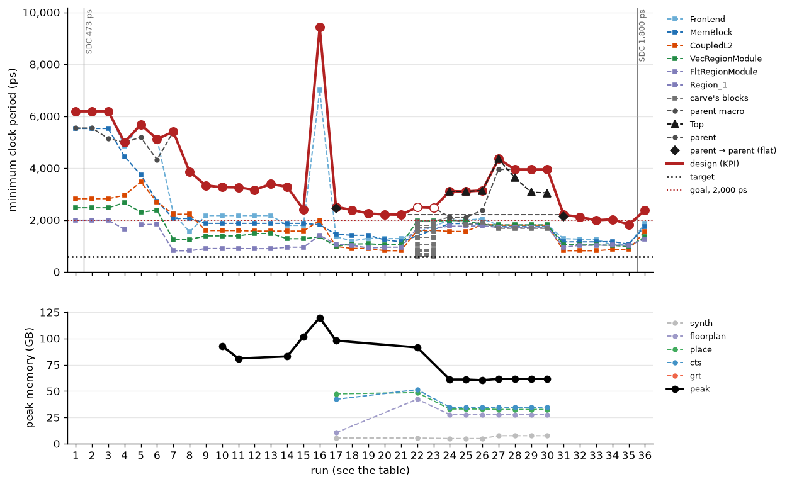
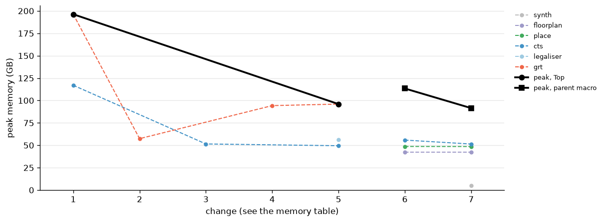
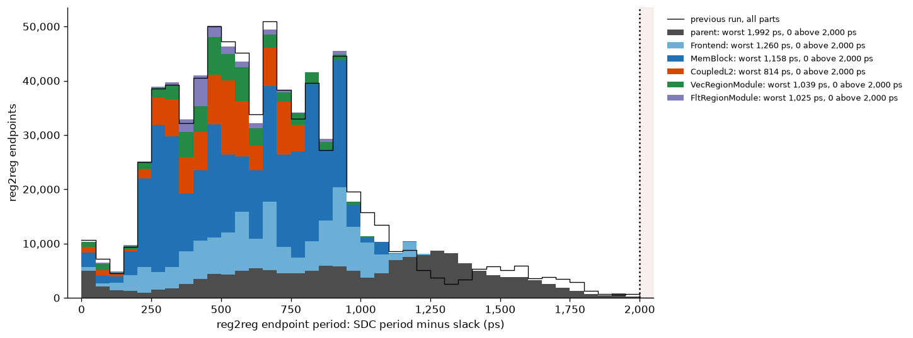

# XiangShan XSTile on asap7

The tile of XiangShan's Kunminghu generation, the core and its L2, as a
reference frame: something that reproduces, that anyone can look at,
and that we improve one concern at a time.

The flows are `tags = ["manual"]` and run by hand. CI runs the unit
tests beside them: `kpi_test`, `gpl_driven_test`, the kit's and the
arrays' tests.

## TL;DR for OpenROAD maintainers: XiangShan in the dirty lane

How to get a stage of XiangShan in front of a locally built `openroad`,
for example to see what a resizer change does, without Bazel in the
loop once it is set up. The skills named here are in `.claude/skills/`.

**1. Pick the size.** The parent, `XSTile`, is the real case; a block is
the small one, with real repair work in it. Measured per stage at
`25f75524` (`resources.json`), minutes and peak GB:

| flow | place | cts | grt |
|---|---|---|---|
| XSTile, the parent | 225, 47 | 45, 42 | 42, 85 |
| Frontend | 43, 17 | 30, 21 | 43, 31 |
| FltRegionModule | 18, 6 | 2, 5 | 4, 9 |

The parent needs a machine with 128 GB. FltRegionModule builds on a
32 GB machine: measured on 16 cores and 30 GB, from nothing to its CTS
in 1 h 49 min with OpenROAD and Yosys from a remote cache (building
them from source adds 30 to 60 minutes), about 50 of it its register
file `FpRegFile`, a macro of its own; then its global route in the
dirty lane in 5 min 23 s at 9.4 GB, ending with `RSZ-0062 Unable to
repair all setup violations`: repair gave up, so there is something to
study.

**2. Build up to the stage before yours, in Bazel.** Nothing of
XiangShan is in a cache you can reach (`/cache-miss` asks), so the first
build is cold: OpenROAD and Yosys from source, the RTL from XiangShan's
Chisel sources, then the flow.

```sh
git clone https://github.com/The-OpenROAD-Project/bazel-orfs && cd bazel-orfs
# a block:
bazelisk build //test/coremark_joule/designs/asap7/xiangshan:FltRegionModule_cts
# the parent: its blocks first, in waves that fit free memory, then the parent
bazelisk run //test/coremark_joule/designs/asap7/xiangshan:build -- \
    --units CoupledL2,FltRegionModule,Frontend,MemBlock,VecRegionModule
bazelisk build //test/coremark_joule/designs/asap7/xiangshan:XSTile_cts
```

`:build -- ... --plan-only` prints the waves and builds nothing; on a
machine without the memory it says which block is over budget, and when
systemd-oomd would kill it.

**3. Open the stage in the dirty lane** (`dirty-lane`), and run it with
ORFS's make, as often as you like:

```sh
bazelisk run //:dirty -- start //test/coremark_joule/designs/asap7/xiangshan:FltRegionModule grt
tmp/test/coremark_joule/designs/asap7/xiangshan/FltRegionModule/make do-grt
```

`start` builds every stage before `grt` and lays out a plain tree: the
`.odb` and `.sdc` it starts from, ORFS's scripts with bazel-orfs's
carried patches, and the openroad Bazel built. Your own openroad
(`byo-openroad`):

```sh
OPENROAD_EXE=~/OpenROAD/build/bin/openroad \
    tmp/test/coremark_joule/designs/asap7/xiangshan/FltRegionModule/make do-grt
```

**4. Where the resizer runs in this flow**, and what steers it
(`xiangshan.bzl`):

- Floorplan (`2_1_floorplan`): `repair_timing -setup` with the moves
  `unbuffer,sizeup,swap,vt_swap` on yosys's buffers (no
  `SKIP_FLOORPLAN_REPAIR_TIMING`).
- Placement (`3_4_place_resized`): `repair_design`; `repair_timing` only
  with `ENABLE_PLACE_REPAIR_TIMING`, which this flow does not set.
- CTS (`4_1_cts`): `repair_timing`, setup and hold.
- Global route (`5_1_grt`): `repair_design`, then `repair_timing` with
  the route's parasitics (`repair-timing-grt`), setup only: hold is left
  to CTS (`HOLD_SLACK_MARGIN=-1000` at grt). On the parent it took 84 min
  in KPI run 15, 45 in run 17.
- Every flow repairs the worst 1 % of endpoints' TNS (`TNS_END_PERCENT=1`)
  and skips the last-gasp pass (`SKIP_LAST_GASP=1`).

**5. How far repair got, and what is left** (`repair-headroom`): load the
stage in the odb-debug daemon and ask `headroom` for the reg2reg period
against what useful skew, the fastest VT and zero wire would give, and
the one-flop-loop floor no repair can beat.

**6. Share it.** `bazelisk run //:dirty -- archive <flow> <stage>
<file.tar.gz>` packs a stage as an untar-and-run reproducer for an
issue.

## The KPI



`floor` is the parent's one-flop-loop floor at global route
(`tools/headroom/report_floor_cycles.tcl`): the worst path from a register
back to itself, which no clock skew or retiming passes. Run 17's 2,151 ps,
at `core/backend/inner_ctrlBlock/decodeBufValid_3`, is above the 2,000 ps
target: that loop's wire, cells or logic must get faster before any
clocking can reach it.

<!-- kpi-table begin: written by kpi.py -->
| # | date | design | Top | parent | floor | Frontend | MemBlock | CoupledL2 | VecRegionModule | FltRegionModule | Region_1 | Bpu | DCacheWrapper | Ftq | ICache | L2TLBWrapper | LoadQueueRAR | LoadQueueRAW | LoadQueueReplay | MemCtrl | PhysicalStoreQueue | PrefetcherWrapper | Rob | Sbuffer | Uncache | VirtualLoadQueue | VirtualStoreQueue | XSTile_parent | peak GB | change |
|---|---|---|---|---|---|---|---|---|---|---|---|---|---|---|---|---|---|---|---|---|---|---|---|---|---|---|---|---|---|---|
| not drawn | 2026-09-22 | ≥ 47,401 |  | 47,401 |  |  |  |  |  |  |  |  |  |  |  |  |  |  |  |  |  |  |  |  |  |  |  |  |  | first clock tree of the planned parent |
| not drawn | 2026-09-23 | ≥ 45,607 |  | 45,607 |  |  |  |  |  |  |  |  |  |  |  |  |  |  |  |  |  |  |  |  |  |  |  |  |  | blocks' band soft-blocked, density 0.5, M9 at adjustment 0.18 |
| not drawn | 2026-09-24 | 45,985 |  | 45,985 |  | 14,114 | 4,870 |  | 2,364 |  | 2,186 |  |  |  |  |  |  |  |  |  |  |  |  |  |  |  |  |  |  | the baseline; 43715 ps of it is the clock reaching MemBlock's pin, and each block alone is 3 to 20 times faster |
| not drawn | 2026-09-24 | 14,114 |  | 13,527 |  | 14,114 | 4,870 |  | 2,364 |  | 2,186 |  |  |  |  |  |  |  |  |  |  |  |  |  |  |  |  |  |  | blocks abstracted at cts; the worst reg2reg path is Frontend's own 12534 ps setup to a falling-edge element, the clock no longer |
| 1 | 2026-09-26 | 6,186 |  | 5,543 |  | 6,186 | 5,527 | 2,820 | 2,471 |  | 1,990 |  |  |  |  |  |  |  |  |  |  |  |  |  |  |  |  |  |  | XSTile, the tile with its L2, at density 0.2 and layer adjustment 0.1; global route at zero iterations with congestion allowed (total 37180, worst edge 31/42) |
| 2 | 2026-09-26 | 6,186 |  | 5,543 |  | 6,186 | 5,527 | 2,820 | 2,471 |  | 1,990 |  |  |  |  |  |  |  |  |  |  |  |  |  |  |  |  |  |  | SDC at 473 ps, 333 ps on 7 nm in FO4; the period of the 800 ps run to the picosecond: with timing repair skipped and ABC mapping for area the netlist does not depend on the SDC |
| 3 | 2026-09-27 | 6,186 |  | 5,143 |  | 6,186 | 5,527 | 2,820 | 2,471 |  | 1,990 |  |  |  |  |  |  |  |  |  |  |  |  |  |  |  |  |  |  | block abstracts carry their ports' max_transition and max_capacitance (OpenSTA patch 0008), so the parent's repair_design buffers the nets between blocks |
| 4 | 2026-09-28 | 4,991 |  | 4,991 |  | 4,854 | 4,446 | 2,954 | 2,665 |  | 1,642 |  |  |  |  |  |  |  |  |  |  |  |  |  |  |  |  |  |  | synthesis maps with ABC's speed script in every flow instead of the area script |
| 5 | 2026-09-28 | 5,681 |  | 5,188 |  | 5,681 | 3,741 | 3,464 | 2,301 | 1,826 |  |  |  |  |  |  |  |  |  |  |  |  |  |  |  |  |  |  |  | XiangShan kunminghu-v3 aa6b520, re-planned (Region_1 is now FltRegionModule); a different RTL, not comparable with the rows before |
| 6 | 2026-09-29 | 5,118 |  | 4,325 |  | 5,118 | 2,725 | 2,698 | 2,375 | 1,831 |  |  |  |  |  |  |  |  |  |  |  |  |  |  |  |  |  |  |  | REMOVE_ABC_BUFFERS dropped (deprecated in ORFS) and the planned blocks' kept modules stated with OpenROAD hierarchical: one repair_design call no longer leaves about 46,000 slew violators on Frontend; measured in the same build by xs_pathology's probe |
| 7 | 2026-10-01 | 5,402 |  | 5,402 |  | 2,259 | 2,057 | 2,222 | 1,247 | 814 |  |  |  |  |  |  |  |  |  |  |  |  |  |  |  |  |  |  |  | timing- and routability-driven global placement, ORFS's default, and RVT, LVT and SLVT from synthesis: every block faster, the parent slower and now the design's period |
| 8 | 2026-10-02 | 3,860 |  | 3,860 |  | 1,541 | 2,057 | 2,222 | 1,247 | 814 |  |  |  |  |  |  |  |  |  |  |  |  |  |  |  |  |  |  |  | the parent keeps no global-placement repair (GPL_KEEP_OVERFLOW 0) and repairs timing after CTS; the ORFS bump to ecb3cfdeb1ca between the rows |
| 9 | 2026-10-04 | 3,330 |  | 3,330 |  | 2,170 | 1,870 | 1,591 | 1,386 | 900 |  |  |  |  |  |  |  |  |  |  |  |  |  |  |  |  |  |  |  | AUTO_MEMORIES reaches every stage (#1157): from floorplan on, the flow times and optimizes against the generated memories' views, which earlier rows' later stages never loaded, so their paths through a memory went untimed; also the parent's CTS balancing the blocks' clock trees (#1150) and the bumps to ORFS d2b74aa79e98 |
| 10 | 2026-10-05 | 3,264 |  | 3,264 |  | 2,170 | 1,870 | 1,591 | 1,386 | 900 |  |  |  |  |  |  |  |  |  |  |  |  |  |  |  |  |  |  | 93 | the blocks repair timing after CTS, where their abstracts are cut: the parent 3,330 to 3,264 ps on an identical placement (its stages before CTS unchanged); the blocks' place-stage periods cannot move; Frontend's CTS 46 min |
| 11 | 2026-10-05 | 3,256 |  | 3,256 |  | 2,170 | 1,870 | 1,591 | 1,386 | 900 |  |  |  |  |  |  |  |  |  |  |  |  |  |  |  |  |  |  | 81 | the parent planned with each block mocked to density 0.6 (#1170): its die 2025 x 2666 um against 2377 x 3043, a quarter smaller, the period 3,256 against 3,264 ps; global route 81 GB against 93, congestion 21.2 % against 17.9 % |
| 12 | 2026-10-06 | 3,162 |  | 3,162 |  | 2,170 | 1,870 | 1,572 | 1,479 | 895 |  |  |  |  |  |  |  |  |  |  |  |  |  |  |  |  |  |  |  | the generated register files read as the RTL does (#1181): the false 1,161 ps read path through FltRegionModule is gone; the parent's worst path is now its own CtrlBlock logic; VecRegionModule slower with its real read-address registers |
| 13 | 2026-10-07 | 3,386 |  | 3,386 |  | 2,170 | 1,870 | 1,572 | 1,479 | 895 |  |  |  |  |  |  |  |  |  |  |  |  |  |  |  |  |  |  |  | in flight, to show where it stands: #1187 builds the register files with OpenROAD's generate_regfile through ORFS's AUTO_MEMORIES_REGFILES (OpenROAD#11669, OpenROAD-flow-scripts#4651) in place of bazel-orfs's structured_gen; the blocks unchanged, the parent 224 ps slower, its worst path CtrlBlock's own (rob/vtypeBuffer state to decodeBufBits ftqOffset), cause not diagnosed; measured at #1187's commit of that day, which has moved since |
| 14 | 2026-10-08 | 3,276 |  | 3,276 |  | 1,792 | 1,870 | 1,572 | 1,278 | 951 |  |  |  |  |  |  |  |  |  |  |  |  |  |  |  |  |  |  | 83 | in flight, #1187 a day on: generate_regfile's AOI22/NAND2/NOR2 read tree makes the blocks with register files faster, Frontend 2,170 to 1,792 ps and VecRegionModule 1,479 to 1,278, FltRegionModule 895 to 951 (its worst path ends at the register file's write port); the parent 3,276 ps, 110 below run 13 and 114 above run 12, its worst paths a mass of CtrlBlock control: the same CtrlBlock built alone closes at 1,200 ps, so the parent's gap is its placement and repair; global route 18.7 min, 83 GB, 21.5 % |
| 15 | 2026-10-09 | 2,406 |  | 2,406 |  | 1,792 | 1,870 | 1,572 | 1,278 | 951 |  |  |  |  |  |  |  |  |  |  |  |  |  |  |  |  |  |  | 102 | the parent repairs setup at global route with the route's parasitics (SKIP_INCREMENTAL_REPAIR dropped, hold repair off there): 3,276 to 2,406 ps on row 14's build, its worst path now CtrlBlock's flush redirect into Frontend; 1,525 VT swaps, 74 buffers; global route 84 min against 19, 102 GB against 83; the blocks unchanged |
| 16 | 2026-10-14 | 9,431 |  | 9,431 |  | 6,998 | 1,815 | 1,982 | 1,351 | 1,406 |  |  |  |  |  |  |  |  |  |  |  |  |  |  |  |  |  |  | 119.9 | the parent's worst path, intRegion's pipeToBJU2 into Frontend's io_backend_toFtq_resolve_2_bits_mispredict; global route's setup repair 9,628 to 9,431 ps (197 ps, flat after iteration 869 of ~1,000), and 5,835 endpoints violate hold past the flow's -1,000 ps margin, the worst by 6,412 ps; CTS latency balancing inserts 2,502 delay buffers (518 at ffe02d5d) and 6,995 hold buffers. Frontend's worst path is the BPU's meta valid into the Ftq's generate_ram queue (metaQueueResolve.ram/addr_w); Flt's and Vec's end at their generate_ram register files' write address. Global route 209 min, 119.9 GB peak; the parent's placement 7 h. Earlier rows predate OpenSTA #532 and may leave gated-clock paths untimed |
| 17 | 2026-10-16 | 2,504 |  | 2,504 | 2,151 | 1,355 | 1,449 | 978 | 992 | 1,067 |  |  |  |  |  |  |  |  |  |  |  |  |  |  |  |  |  |  | 98 | the parent's worst path, intRegion's io_toMemExu_2_0 lqIdx through MemBlock into intRegion's load issue queue wakeup; 5,259 of the parent's 156,690 reg2reg endpoints are above 2,000 ps, none of any block's. Patch 0135 times a global-route abstract with the route's parasitics: MemBlock's lqIdx-to-pdest arc was 6.9 ns with placement parasitics and is 1.84 ns, as MemBlock times itself; the parent was 7,855 ps without it. The register files are macros with their own clock trees (#1257, #1265), and the parent's CTS takes 40 min where run 16's took about 10 h. Every earlier row's block abstracts carry placement parasitics. Parent place 3.9 h, global route 45 min at 98 GB |
| 18 | 2026-10-23 | 2,383 |  | 2,383 |  | 1,193 | 1,410 | 906 | 1,075 | 1,023 |  |  |  |  |  |  |  |  |  |  |  |  |  |  |  |  |  |  |  | the base flow of #1351's pin plan A/B. The parent's worst path, intRegion's flushCopyRegVec robIdx into vecRegion's gpWbWakeUp; no floor or flat run measured for this row |
| 19 | 2026-10-23 | 2,250 |  | 2,250 |  | 1,296 | 1,410 | 906 | 1,083 | 922 |  |  |  |  |  |  |  |  |  |  |  |  |  |  |  |  |  |  |  | pins facing away from their logic over the parent's macros 3,407 to 2,959; one run per arm. Frontend rose (1,193 to 1,296 ps): the plan takes a pin net's centre, which after repair is the repeater at the pin, so its worst register-file pin stayed while its flop moved. The parent's worst path, Frontend's cfVec instruction into ctrlBlock's decode buffer |
| 20 | 2026-10-29 | 2,212 |  | 2,212 | 1,984 | 1,283 | 1,236 | 815 | 1,048 | 951 |  |  |  |  |  |  |  |  |  |  |  |  |  |  |  |  |  |  |  | main since run 18: three OpenROAD/ORFS bumps, and MemBlock and the parent on the extracted modules (b33b28ea, da6e9aa5); one run, the causes not separated. The parent's worst path, intRegion's pipeToALU0 fuType into vecRegion's gpWbWakeUp; the one-flop-loop floor 1,984 ps (2,151 at run 17), on the same decode-buffer valid register, below the target; no flat run measured for this row |
| 21 | 2026-10-31 | 2,206 |  | 2,206 |  | 1,283 | 1,158 | 815 | 1,048 | 951 |  |  |  |  |  |  |  |  |  |  |  |  |  |  |  |  |  |  |  | main since run 20: OpenROAD 9ddb60d to bf0feec (two bumps) and ORFS 0fcc418 to 75cd896b; one run, the causes not separated, and 6 ps on the parent is within reach of noise. MemBlock 1,236 to 1,158 ps. The parent's worst path as in run 20, intRegion's pipeToALU0 fuType into vecRegion's gpWbWakeUp; no floor or flat run measured for this row |
| 22 | 2026-11-01 | ≥ 2,488 |  |  |  |  |  | 1,601 | 1,960 | 1,687 |  | 1,791 | 1,801 | 1,553 | 1,072 | 1,699 | 643 | 778 | 1,327 | 656 | 1,330 | 698 | 1,939 | 846 | 778 | 600 | 813 | 2,488 | 91.5 | the carve as a baseline: the parent macro (XSTile_parent, IntRegFile at its readers, ctrlBlock and the load TLB in placement regions) sets the period at 2,488 ps; every block at or under 1,960 ps. The Top's crossings were not measured (28 sets, about 22 h; stopped). A false minimum of this partitioning: the parent's logic is a 533 um strip between two rows of blocks. |
| 23 | 2026-11-02 | ≥ 2,470 |  |  |  |  |  | 1,601 | 1,960 | 1,687 |  | 1,791 | 1,801 | 1,553 | 1,072 | 1,699 | 643 | 778 | 1,327 | 656 | 1,330 | 698 | 1,939 | 846 | 778 | 600 | 813 | 2,470 |  | #1501: the three load units in placement regions beside the uncache buffer and the parent macro placed at density 0.8 instead of 0.6. The parent macro 2,488 to 2,470 ps, its endpoints over 2,000 ps 9,766 to 6,832 and their excess 1,689 to 1,148 ns; every block as in run 22. No memory per stage for this row: the build's logs were overwritten by later builds in the same tree before they were read |
| 24 | 2026-11-03 | 3,108 | 3,108 |  |  | 1,997 | 1,861 | 1,559 | 1,978 | 1,760 |  |  |  |  |  |  |  |  |  |  |  |  | 2,117 |  |  |  |  | 2,111 | 61 | XSTile carved along XiangShan's hierarchy into six blocks, pins on the edge facing each neighbour; the first run with the Top measured. XSTile 3,108 ps, set by the Top: 42,962 crossing paths over 2,000 ps, nearly all from a handful of broadcast registers: ctrlBlock's flush redirect valid into all of VecRegion (3,108 ps), FltRegion and Rob, the redirect valid and BJU1's redirect data into all of Frontend (2,750 ps, 20,808 paths), Rob's state into the parent (2,542 ps). The Top skips timing repair. Inside the parts: Rob 2,117 and the parent macro 2,111 ps (its endpoints over 2,000 ps 6,832 to 117, excess 1,148 to 3 ns), both a broadcast net's critical sink at the end of a long buffer tree; Frontend 1,997, VecRegion 1,978, MemBlock 1,861, FltRegion 1,760, CoupledL2 1,559 ps |
| 25 | 2026-11-04 | 3,099 | 3,099 |  |  | 1,997 | 1,861 | 1,559 | 1,978 | 1,760 |  |  |  |  |  |  |  |  |  |  |  |  | 1,810 |  |  |  |  | 2,111 | 61 | Rob's two register files 20 um apart instead of 4.7 (#1510): its clock tree had run up and down the slit between them (445 ps of skew, 11,271 hold buffers); Rob 2,117 to 1,810 ps and Rob into the parent's crossings 2,542 to 2,461 ps. XSTile 3,108 to 3,099 ps, still set by ctrlBlock's flush redirect valid into all of VecRegion, a broadcast across a macro boundary; the parent macro, Frontend, VecRegion, MemBlock, FltRegion and CoupledL2 as in run 24 |
| 26 | 2026-11-05 | 3,136 | 3,136 |  |  | 2,041 | 1,842 | 1,827 | 1,813 | 1,775 |  |  |  |  |  |  |  |  |  |  |  |  | 1,910 |  |  |  |  | 2,370 | 60.4 | First run on main after the OpenROAD/ORFS bump, with #1522's seed search choosing every annealed block's memory placement. XSTile 3,099 to 3,136 ps, still the flush redirect valid into all of VecRegion; Rob into the parent 2,461 to 2,962 ps. The parent macro 2,111 to 2,370 ps: its issue-queue wakeup paths gained about 260 ps of cell delay at equal or shorter wire, and the flush register is now its own worst path too. CoupledL2 1,559 to 1,827 and Vec 1,978 to 1,813 ps moved most, both with annealed memory banks: the bump and the seed search are not separated in this row |
| 27 | 2026-11-11 | 4,356 | 4,356 |  |  | 1,800 | 1,742 | 1,799 | 1,809 | 1,714 |  |  |  |  |  |  |  |  |  |  |  |  | 1,680 |  |  |  |  | 3,949 | 61.6 | First run with timing- and routability-driven global placement on in every part, and with the broadcast registers copied into the blocks that read them (ten copies, surgery/sinks.txt). XSTile 3,136 to 4,356 ps, set by the Top: the parent into Frontend (9,800 paths, the worst from BJU1's pipe register); 35,097 crossing paths over 2,000 ps (run 26: 47,033), Rob into the parent 2,962 to 3,849 ps. The six blocks are all under 2,000 ps: Frontend 2,041 to 1,800, MemBlock 1,842 to 1,742, CoupledL2 1,827 to 1,799, Vec 1,813 to 1,809, Flt 1,775 to 1,714, Rob 1,910 to 1,680 ps. The parent macro 2,370 to 3,949 ps, its worst path from a copied floating-point issue-queue entry valid, now inside the parent, into ctrlBlock's decode buffer. The drivers and the copies are not separated in this row |
| 28 | 2026-11-12 | 3,949 | 3,627 |  |  | 1,800 | 1,742 | 1,799 | 1,809 | 1,714 |  |  |  |  |  |  |  |  |  |  |  |  | 1,680 |  |  |  |  | 3,949 | 61.6 | The Top in two passes, from a dirty lane, not a clean build, the second pass's stages run by hand. The second pass unfirms, in the Top's floorplan, the cells of every crossing path into the 39,103 end pins of the first pass's crossing paths over 2,000 ps, failing or not, an upper bound on those paths' cells (550,721 of 8,347,575 cells: 57,678 registers, 493,043 logic; no register deeper), places them with both placement drivers on and repairs them with repair_design, then tree, legaliser and global route as the first; no timing repair after CTS in either pass. Crossing paths over 2,000 ps 35,097 to 27,895 (-20.5 %; pairs by name, a floor; the histogram's 27,896 counts one at exactly 2,000.0 ps), the worst 4,356 to 3,627 ps, now Rob's state into ctrlBlock's decode buffer in the parent. XSTile 4,356 to 3,949 ps, now set by XSTile_parent, whose period and the blocks' are run 27's, measured before the second pass moved their cells. Left: the parent into Frontend 9,771 paths, 3,200 ps (9,800, 4,356); the parent into CoupledL2 8,166, 2,314 ps, more and worse than the first pass's 6,708, 2,201; Rob into the parent 6,863, 3,627 ps (11,746, 3,849). Global placement took 103 minutes; its seven routability passes took the weighted congestion from 3.63 to 2.09, 2.00 final, against a target of 1.01; the place step's 60-minute timer was removed by hand at 56 minutes and it ended by itself at 1 h 59 min 25 s; global route left no net unrouted |
| 29 | 2026-11-13 | 3,949 | 3,070 |  |  | 1,800 | 1,742 | 1,799 | 1,809 | 1,714 |  |  |  |  |  |  |  |  |  |  |  |  | 1,680 |  |  |  |  | 3,949 | 61.6 | Row 28's second pass with global placement's timing-driven pin pull and CTS's coincident-sink fix, from a dirty lane, not a clean build, the second pass's stages run by hand. The same 550,721 of 8,347,575 cells as row 28 (57,678 registers, 493,043 logic; no register deeper), placed with both placement drivers and the pull on and repaired with repair_design; no timing repair after CTS. Crossing paths over 2,000 ps 27,895 to 26,157 (-6.2 %; pairs by name, a floor; the histogram's 26,163 counts six at exactly 2,000.0 ps), the worst 3,627 to 3,070 ps, now the parent's BJU operand register (pipeToBJU0) into a branch target in Frontend. XSTile stays 3,949 ps, set by XSTile_parent, whose period and the blocks' are run 27's, measured before either second pass moved their cells. By group: the parent into Frontend 9,771 paths, 3,200 to 3,070 ps; the parent into CoupledL2 8,166 to 7,221, 2,314 to 2,248 ps; Rob into the parent 6,863 to 5,747, 3,627 to 2,798 ps; the parent into VecRegionModule 1,268 to 468, 2,892 to 2,276 ps; MemBlock into the parent through FltRegionModule 1,527 to 1,560, 2,554 to 2,683 ps; 736 in three groups that had none, MemBlock into the parent (255), FltRegionModule into VecRegionModule through the parent (249) and MemBlock into VecRegionModule through the parent (232). Global placement took 144 minutes (row 28: 103); its seven routability passes took the weighted congestion from 5.51 to 2.54, 2.05 final (row 28: 3.63, 2.09, 2.00), against a target of 1.01; repair_design inserted 18,070 buffers (row 28: 12,007); global route left no net unrouted |
| 30 | 2026-11-14 | 3,949 | 3,043 |  |  | 1,800 | 1,742 | 1,799 | 1,809 | 1,714 |  |  |  |  |  |  |  |  |  |  |  |  | 1,680 |  |  |  |  | 3,949 | 61.6 | Run 29 with a crossing repair, from a dirty lane, not a clean build: repair_timing on the crossing paths whose end needs 1,900 to 2,300 ps, scoped to the 17,858 registers that reach those ends from another block, resized 1,008 cells (780 VT swaps, 228 upsized) and inserted 36 buffers; then the legaliser, global route and the crossing judge as run 29. Crossing paths over 2,000 ps 26,157 to 21,268 (-18.7 %; pairs by name, a floor; the histogram's 21,270 counts two at exactly 2,000.0 ps), the worst 3,070 to 3,043 ps, still the parent's BJU operand register (pipeToBJU0) into a branch target in Frontend. XSTile stays 3,949 ps, set by XSTile_parent, whose period and the blocks' are run 27's. By group: Rob into the parent 5,747 to 1,586 paths, 2,798 to 2,592 ps; MemBlock into the parent through FltRegionModule 1,560 to 1,315, 2,683 to 2,394 ps; the parent into VecRegionModule 468 to 293, 2,276 to 2,161 ps; MemBlock into the parent 255 to none; the parent into Frontend 9,771 to 9,768, 3,070 to 3,043 ps; the parent into CoupledL2 7,221 to 7,610, 2,248 to 2,259 ps, which the repair, spending its iterations on the worst ends first, did not reach |
| 31 | 2026-11-15 | 2,206 |  | 2,206 |  | 1,283 | 1,158 | 815 | 1,048 | 951 |  |  |  |  |  |  |  |  |  |  |  |  |  |  |  |  |  |  |  | The single top again, after the carve (runs 22 to 30): run 21 rebuilt, every block and the parent to the picosecond, the parent's worst path as run 21's, intRegion's pipeToALU0 fuType into vecRegion's gpWbWakeUp, with CTS's coincident-sink fix added. XSTile 3,949 ps in run 30 (its parent; the Top's crossings 3,043) to 2,206 ps. Timed flat, the tile's worst is 2,223 ps, the parent into VecRegionModule; the crossings have 1,282 endpoints over 2,000 ps (70.0 ns over), the parent's own paths 1,028 (95.9 ns, worst 2,143 ps); with no wire the tile's worst is 1,415 ps |
| 32 | 2026-11-17 | 2,113 |  | 2,113 |  | 1,260 | 1,158 | 814 | 1,039 | 1,025 |  |  |  |  |  |  |  |  |  |  |  |  |  |  |  |  |  |  |  | The parent at 2,113 ps, from a dirty lane, not a clean build (the parent's place, CTS and global route run by hand on main's cached floorplan and blocks), from 2,575 on main and 2,206 in run 31: 31 endpoints over 2,000 ps (1.0 ns over), from 5,074 (861 ns) and 1,377 (122.8 ns). Global placement no longer ends in a wirelength burst: the momentum restarts where the HPWL rises near the end (0227) and placement ends on its iterate (0226); the parent's global placement ends at 32.3 M um against main's 60.3 M, global route overflow 231,541 against 462,384. VecRegionModule's clock reaches its pin on time: its abstract had max_clock_tree_path 216 ps below a min of 501 ps (OpenSTA wrote a nested register file's pin arrival without its own tree), and the parent's CTS clocked the block 245 ps late. The worst path is run 31's, intRegion's pipeToALU0 into vecRegion's wake-up |
<!-- kpi-table end -->

Periods are in picoseconds; `≥` marks a run that did not measure the
blocks, a lower bound. The chart starts at the first run below the
Frontend block's 14,114 ps, and the runs before it are in the table only.
`kpi.json` is the series, and `kpi.py` (`bazelisk run :kpi`) draws the
chart and writes this table. When a change moves the number, add a row and re-run it.

### Memory

The lower panel of the chart is each run's memory: every stage's peak
in its heaviest part, and the peak over all of them, black, the memory a
machine needs to build it (`kpi.py --memory resources.json`, from what
`orfs_schedule` measured). Below, the same for the changes that moved it
between KPI runs: the Top's steps as the patches that cut them landed,
and the parent macro. A step measured alone, in its own process, has no
peak.



<!-- kpi-memory begin: written by kpi.py -->
| # | date | part | synth | floorplan | place | cts | legaliser | grt | peak | change |
|---|---|---|---|---|---|---|---|---|---|---|
| 1 | 2026-10-30 | Top |  |  |  | 117 |  | 196.3 | 196.3 | XSTile's Top in one process, floorplan through global route, RAM plus swap: the 'before' of #1474 and #1494 |
| 2 | 2026-10-31 | Top |  |  |  |  |  | 57.4 |  | global route alone, its grid in a backing file, the same routes (#1474) |
| 3 | 2026-10-31 | Top |  |  |  | 51.5 |  |  |  | CTS alone: latency balancing times the clock network without CRPR (#1494) |
| 4 | 2026-10-31 | Top |  |  |  |  |  | 94.3 |  | the legaliser through global route in one process: detailed placement frees its pixel grid (#1495) |
| 5 | 2026-11-01 | Top |  |  |  | 49.5 | 56.5 | 96 | 96 | one process again, read with a backing file, CTS's timing data freed, global route -no_incremental (measured on #1425, open) |
| 6 | 2026-11-01 | parent macro |  | 42.3 | 48.7 | 55.8 |  | 113.4 | 113.4 | XSTile_parent through global route with the reg2reg repair (#1497's clean build): resident, global route about 34 GB more in swap |
| 7 | 2026-11-01 | parent macro | 5.2 | 42.3 | 48.6 | 51.4 |  | 91.5 | 91.5 | the same on origin/main with #1425, #1469 and #1497: main's CTS, legaliser and global route memory patches, swap about 6 GB |
| 8 | 2026-11-03 | parent macro | 4.9 | 27.7 | 33 | 34.7 |  | 61 | 61 | the six-block carve: MemBlock's and Frontend's logic left the parent with their blocks |
<!-- kpi-memory end -->

### What remains



Every register-to-register endpoint of the latest run, by its period (the
SDC period minus its slack), timed flat: the parent with every block's
interface logic in place of the block's abstract (`XSTile_ilm_sta`,
below). Stacked by where the endpoint's worst path
starts and ends: in the parent, inside one block, or across a block's
boundary. The endpoints right of 2,000 ps are what remains.

<!-- kpi-flat begin: written by kpi.py -->
| class | endpoints above 2,000 | worst | logic only | worst path | what it is |
|---|---|---|---|---|---|
| parent | 1,028 of 145,527 | 2,143 | 1,255 | `core/backend/inner_ctrlBlock/rob/vtypeBuffer/state[0]$_DFF_PP0_/QN` → `core/backend/inner_ctrlBlock/decodeBufBits_1_specvtype_vsew[0]$_DFFE_PP_/D` |  |
| FltRegionModule → parent | 697 of 14,464 | 2,082 | 1,089 | `core/backend/inner_fpRegion/issueQueues_1/fastEntries_16_valid$_DFF_PP0_/QN` → `core/backend/inner_ctrlBlock/decodeBufBits_0_foldpc[2]$_DFFE_PP_/D` |  |
| parent → Frontend | 396 of 7,840 | 2,097 | 1,363 | `core/backend/inner_intRegion/pipeToBJU1.io_out_bits_data_src_0[61]$_DFFE_PP_/QN` → `core/frontend/inner_ftq/io_toBpu_train_bits_meta_sc_tagePredValid_5$_DFFE_PP0N_/D` |  |
| parent → VecRegionModule | 184 of 3,195 | 2,223 | 1,415 | `core/backend/inner_intRegion/pipeToALU0.io_out_bits_ctrl_fuType[27]$_DFFE_PP_/QN` → `core/backend/inner_vecRegion/issuePipes/is0_valid$_DFF_PP0_/D` |  |
| MemBlock → via:FltRegionModule → parent | 5 of 1,641 | 2,017 | 810 | `core/memBlock/inner_LoadUnit_0.s3.io_pipeOut_valid$_DFF_PP0_/QN` → `core/backend/inner_intRegion/issueQueueSTD1_StdMoud/entries/othersEntriesComp_9.io_commonOut_issued$_DFF_P_/D` |  |
<!-- kpi-flat end -->

*Logic only* is the same path timed without wires (`XSTile_ilm_sta_nowire`):
the cells and the repeaters already placed, at their pin loads. No
endpoint of any class is above 2,000 ps without wires, so what remains is
distance: on each worst path 40 to 80 percent of the delay is in
repeaters. It is a placement and floorplan problem, not logic too deep for
the period.

**Timed flat.** `XSTile_ilm_sta` is `orfs_flow`'s `<parent>_ilm_sta`
(docs/customize.md, "Time a parent with its blocks' interface logic"): the
parent's netlist and parasitics at global route, with each block's
interface logic model, read at the block's global route, in place of its
abstract, linked and timed in OpenSTA. A path that crosses a block's
boundary times as in the whole block; a path inside a block is the block's
own KPI.

Each part alone, at its own global route with its abstracts (`<part>_kpi`):

<!-- kpi-worst begin: written by kpi.py -->
| part | period | worst reg2reg path | what it is |
|---|---|---|---|
| parent | 2,113 | `core/backend/inner_intRegion/pipeToALU0.io_out_bits_ctrl_fuType[27]$_DFFE_PP_/QN` → `core/backend/inner_vecRegion/in_fromIntRegion_gpWbWakeUp_0_wen` | From the ALU0 issue pipe's function-unit type in intRegion into vecRegion's write-back wake-up enable: a parent register to a block's input pin. |
| Frontend | 1,260 | `inner_bpu/abtb/s2_valid$_DFF_PP0_/QN` → `inner_bpu/tage/tables_4.tage_entry_sram_bank1_way1.array.array_ext/RW0_addr[1]` | The BPU's ahead-BTB stage-2 valid to the address pin of a TAGE table's entry SRAM: a valid bit steering a memory address. |
| MemBlock | 1,158 | `inner_dcache/dcache.mainPipe/s1_req_vaddr[28]$_DFFE_PP_/QN` → `inner_dcache/dcache.bankedDataArray/data_banks_0_0.data_bank.array.array_ext/RW0_addr[6]` | The DCache main pipe's stage-1 virtual address to the address pin of a data bank's SRAM. |
| CoupledL2 | 814 | `slices_0/mainPipe/task_s3_bits_useProbeData$_DFFE_PP0P_/QN` → `slices_0/dataStorage.array.array_0_0_0.array.array_ext/RW0_wdata[136]` | The main pipe's stage-3 probe-data select to the write data of the L2 data SRAM: a select travelling to a memory. |
| VecRegionModule | 1,039 | `issuePipes_1/exu.ex_0_bits_ctrl_uopIdx[0]$_DFFE_PP_/QN` → `issuePipes/exu.Vfmac/a0_0_fpB[60]$_DFFE_PP_/D` | An issue pipe's micro-op index into the vector FMA's operand register: operand selection by uop index. |
| FltRegionModule | 1,025 | `fpWbDataPath.out_wb0_6_pdest[0]$_DFFE_PP_/QN` → `fpRegFile/io_writePorts_6_addr[0]` | The FP write-back path's destination register number to the FP register file's write address: a register index travelling to a macro. |
<!-- kpi-worst end -->

`kpi_run.tcl` writes each part's histogram in 10 ps bins, and
`kpi.py --histograms parent=XSTile_kpi.txt Frontend=Frontend_kpi.txt ...`
records them and the worst paths in the latest row; `kpi.py --flat
XSTile_ilm_sta.txt XSTile_ilm_sta_nowire.txt` records the flat timing's
classes; `kpi.py --hist-only --bin 20 --log` redraws the chart alone, from
the json.

The KPI is the design's minimum clock period, the red line: the largest
of the parent's period and each block's, since the design is only as
fast as its slowest part. The parent is one of those parts, like any
block, and each of them is drawn dashed beneath the red line, a period
that has to be at or below it. Runs 22 to 30 carved the tile into a
parent macro under a top level, whose crossings are the Top column; the
flow here is the single top of runs 1 to 21 again, five blocks and the
parent, last built as run 21: **2,206 ps**, the parent's.

Each part's period is its SDC period minus the worst slack of its
`reg2reg` group, which is the only group that can fail timing closure.
Ask a checkout for it with `.claude/skills/odb-debug/SKILL.md`, and read
`.claude/skills/macro-constraints` before quoting any other group. Ask
for the group by name and not for the worst slack: on VecRegionModule the
overall worst slack is -2,006 ps and belongs to another group, while
`reg2reg` is -1,564 ps, and only the second one is a period.

The parent, XSTile with its clock tree, is timed at global route with
the route's own parasitics; its `reg2reg` group does not see the paths
inside a block's abstract. Each block is measured alone, likewise at its
global route with its clock tree (`<block>_kpi`, the table above).

XiangShan's `ClockGate` is mapped onto ASAP7's ICG cell (`xs_icg.ys`) in
every flow, the parent's and every block's.

Synthesis maps with ABC's speed script, ORFS's default, in every flow;
`synth_config_test` checks each flow's synthesis configuration once it
is built. ABC gets no delay target: ORFS passes the SDC period as `-D`
with a script file, and Yosys hands `-D` to ABC only through the `{D}`
placeholder of its built-in and inline scripts (ORFS #4585).

The blocks are implemented through a route-0 global route and abstracted
there, as a macro is: the parent's paths through a block are timed
against the block's clock tree and its timing as repaired with the
route's parasitics. Abstracted at `cts`, as they were before, Frontend's
period was 28 percent pessimistic against its route-0 global route and
`repair_design` on the same checkpoint, with the same worst paths
(`ideas/xiangshan-timing.md`, entry 25).

## The 333 ps goal

XiangShan's published goal for Kunminghu is 3 GHz on an advanced node,
7 nm: a 333 ps cycle. It is a target, not a silicon result. The team's
HPCA'25 tutorial lists Kunminghu as "Advanced-node, 3GHz, 1.5x IPC of
NH" ([slides](https://tutorial.xiangshan.cc/hpca25/slides/20250302-HPCA25-1-Introduction-XiangShan.pdf)),
Hot Chips 2024 reported 7 nm and 3 GHz
([report](https://riscv.org/ecosystem-news/2024/08/xiangshan-high-performance-risc-v-processors-at-hot-chips-2024/)),
and at RISC-V Summit Europe 2025 "KMHv2" was "ready to tape-out" with
SPEC scores estimated at 3 GHz
([keynote](https://riscv-europe.org/summit/2025/media/proceedings/2025-05-14-RISC-V-Summit-Europe-09h30-BAO-slides.pdf),
[poster](https://riscv-europe.org/summit/2025/media/proceedings/2025-05-13-RISC-V-Summit-Europe-P2.1.06-TANG-poster.pdf)).
No measured frequency is published and no corner is stated for the core;
the same keynote quotes XiangShan's NoC at "7nm_SS". The previous
generation came close to its goal: Nanhu targeted 2 GHz on 14 nm, its
GDSII was delivered at 2 GHz, and the keynote lists its second tape-out
at 2.5 GHz. What we build is kunminghu-v3 at aa6b520, integer-only with
a small last-level cache.

In fanouts of four, 333 ps is 41.1 FO4 at the published ASAP7 RVT FO4 of
8.1 ps, which the ASAP7 authors call realistic for industrial 7 nm. On
the library this flow times with (RVT at the FF corner, FO4 14.37 ps)
that is 591 ps at global route, and the SDC synthesises at 0.8 of it,
473 ps (`period_fo4_test`). A cycle leaves about 38 FO4 of logic: the
flops on the paths below take 31 ps clock-to-output and 6 to 13 ps setup.

The next goal at global route is 2,000 ps (`kpi.py`'s `GOAL_PS`, the
headroom target), on the way to `kpi.json`'s `target_ps`, the 591 ps
above; the SDC is 473 ps. A block times its half of every path across its boundary
against 0.8 of the SDC's period (`set_max_delay`, `.claude/skills/macro-constraints`),
378 ps, so it repairs it; at a 2,000 ps SDC that budget is 1,600 ps and
a block leaves its half of a crossing slack where the parent cannot
repair it. The parent's repair at global route works worst-first
through everything above 473 ps.

Is the Chisel RTL congruent with that? Read at the source, the worst path
of each block and of the top level is 6 to 30 gate levels, which at about
1.5 FO4 per level (logical effort for fanout-of-four stages) is 9 to 45
FO4. Measured, the same paths are 138 to 430 FO4:

| worst `reg2reg` path | construct in the RTL | gate levels, read | FO4, estimated | FO4, measured |
|---|---|---|---|---|
| Frontend: `mbtb.t1_startPcVec` to a bank's write `setIdx` | 8-bit equality and 16-bit zero detect into a flop enable, one bit fanning out to 4 banks of 4 ways | 6 to 8 | 9 to 12, plus the fanout tree | 430 |
| MemBlock: redirect `robIdx` to `loadQueueReplay` vaddr | 10-bit age compare, pop count, free-slot mux, 7-to-120 decode, write mux into a 120 by 50-bit flop array | about 15 | about 22, plus the array's fanout | 385 |
| CoupledL2: directory state to the L1 hint queue | 8-way hit and one-hot mux, main-pipe control, an arbiter, a queue write | 15 to 20 | 23 to 30 | 196 |
| VecRegionModule: `Vfma` widen flag to its CSA stage | operand muxes, radix-4 Booth encoding, a 27-to-4 carry-save tree | 16 to 20 | 24 to 30 | 172 |
| Region_1: the FMA's fp64 flag to its shift mask | a 107-bit add with carry select, a 110-bit invert and AND-reduce compare | about 20 | about 30 | 138 |
| XSTile: vector issue queue's accept to the decode buffer | a ready chain back through six modules, a priority encode, an adder and an 8-to-1 index mux | 20 to 30 | 30 to 45 | 358, with clock trees |

The measured column is each block alone at its place stage against an
ideal clock, and for XSTile the parent's period; the read and estimated columns are
source reading, with files and lines in `ideas/xiangshan-timing.md`,
entry 27. The paths and the measured column are the area-mapped netlist's
of the RTL before aa6b520 (Region_1 is now FltRegionModule); with ABC's
speed script and the new RTL every block's worst path moved (the table in
"The KPI"), and those have not been read at the source yet.

By logic depth the RTL is congruent with the goal: every one of these
paths fits in 41 FO4, the deepest two, the FMA's wide add and the top
level's ready chain, at the edge of it, and XiangShan's own comments mark
the ready chain as a timing concern. The measured paths are 4 to 45 times
their logic, and the difference is ours to explain, not the RTL's. The
shallowest paths are the furthest off, which points at fanout and
buffering (Frontend's startPc, MemBlock's 120-entry array) before logic,
and at synthesis mapping for area (`ABC_AREA=1`). None of the six runs
through a memory XiangShan builds as SRAM: the replay queue, the write
buffer and the hint queue are flops in its RTL too.

What would make the RTL incongruent is a path whose logic alone exceeds
41 FO4 however it is mapped. None of the six does by reading; the
best-effort mapping of each cone, and the logic-only period of each
block with the wires taken out, are the measurements that would show one.

## The arrays

The Rob, the load and store queues and the load TLB are arrays the RTL
never wrote as arrays: one entry's registers and logic repeated, each
entry selected by comparing a broadcast index with its own. `arrays/`
finds them in the surgered core, writes each block as one entry cell
instanced per entry with the index comparisons decoded once in the
block, and proves the result equal to the block (`arrays/README.md`).

`arrays:xiangshan_extracted` is the surgered core with those blocks
swapped for their extractions. MemBlock and the parent, which holds the
Rob, read it (`XS_EXTRACTED` in `xiangshan.bzl`) and keep the entry
cells through synthesis: slang elaborates one module per instance, so
`fold_entries.tcl`, run before the canonical checkpoint, folds the
copies of each entry cell back onto one module, which synthesis then
maps once. Every other part reads the surgered core. TLBFA, the
instruction TLB, Uncache and VirtualLoadQueue are extracted too but stay
out of `xiangshan_extracted`.

## The branch units' compares

BranchUnit's mispredict and JumpUnit's target check compare the low 50
bits of a sum with the predicted target: pc + imm in BranchUnit, (jalr's
src_0 or the pc) + imm in JumpUnit. `surgery/xs_bju_surgery.py` writes
both compares without the adder, per bit the carry the sum needs against
the carry the bit makes (class 9 of the `surgery` skill); the adders
stay for the targets the units send on. It is the first edit of the
elaborated core (`surgery:xiangshan_bju`), so every part reads it,
whichever holds ExuBlock: here the parent. `surgery:bju_lec_tests`
proves each unit equal to firtool's at module size with kepler-formal,
and its negative control different. Post-synthesis, in ResolveQueue's
kit context, it takes the worst path from the parent into Frontend from
1,461.6 to 1,372.3 ps, and ResolveQueue's family from 1,135.7 to
908.4 ps, on a synthesis against a 2,000 ps SDC; against this flow's
473 ps, ABC may map the compare faster already.

## Running it

```
bazelisk run //test/coremark_joule/designs/asap7/xiangshan:XSTile_grt gui_grt
```

The parent's global route peaks at 85 GB, its placement takes about
four hours (`resources.json`); a machine with 128 GB builds it. The
blocks first, in waves that fit free memory, then the parent alone:

```
bazelisk run //test/coremark_joule/designs/asap7/xiangshan:build
bazelisk run //test/coremark_joule/designs/asap7/xiangshan:build -- --plan-only
```

Global placement is timing- and routability-driven in every block and
in the parent, and neither driver says so in the exit status when it
does not run. `<part>_gpl_driven`, a target in each part's unit of the
schedule, fails a part whose global placement log (`3_3_place_gp.log`)
shows no timing-driven iteration (GPL-0100) or no routability-mode
iteration (GPL-1017), in the wave that placed it (`gpl_driven.sh`,
`gpl_driven_test`). GPL-0040 is not counted: the routability pass prints
it only when it inflates cells, and run 21's parent ran 62
routability-mode iterations without inflating any.

Two carried OpenROAD patches concern this flow. 0220 makes CTS clock
every register when two share a location, which its H-tree builder used
to drop silently. 0221, global placement's timing-driven pin pull, is
carried but off: no flow here sets `-timing_driven_pin_pull`, and with
it off placement is byte-identical.

Earlier stages are their own targets (`XSTile_synth`, `_floorplan`,
`_place`, `_cts`), each with `gui_` and `open_` forms and a `//:dirty`
tree (`bazelisk run //:dirty -- start //test/coremark_joule/designs/asap7/xiangshan:XSTile <stage>`), and
`XSTile_cts_odb_debug` and `XSTile_grt_odb_debug` open a checkpoint for
questions.

`XSTile_flat_grt` is the same tile as one flow, with no hardened blocks:
ORFS's own hierarchical synthesis of the whole tile (its keep rule, not
the plan's), then macro and global placement over all of it, through
global route, the kept modules in the ODB (`OPENROAD_HIERARCHICAL`). The
register files are the planned flow's macros, the same targets. No
number from it is in the KPI.

```
bazelisk run //test/coremark_joule/designs/asap7/xiangshan:XSTile_flat_grt gui_grt
```

`/cache-miss` asks whether a target is cached without building it: a
capture never executes a flow action, a miss is killed as it appears and
the build carries on, so a laptop can ask in minutes.

## Where the period is

Run 21, the single top's last build, is 2,206 ps at global route, set by
the parent. Its worst path runs from the integer region's ALU0 pipeline
register (its function-unit type) in the parent into the vector region's
write-back wake-up enable, a pin of VecRegionModule. Every block is
below 1,300 ps.

Timed flat (the table in "What remains", from the latest run that timed
it), every class above 2,000 ps is the parent's own logic or a path
across a block's boundary, and none is above 2,000 ps without wires:
what remains is distance. The one-flop-loop floor, 1,984 ps on run 20 at
`core/backend/inner_ctrlBlock/decodeBufValid_3`, does not set it.

What was tried, what is known and what is open:
`ideas/xiangshan-timing.md`. Each open question is a global-route arm
of about six hours, run only with a reason why it is new
(`.claude/skills/dogfooding`, rule 14).

## What is deliberately broken

Global route is skipped past pin access (OpenROAD DRT-0073) and does not
converge: it runs with congestion allowed, and the period is the number
tracked; the register files are generated rather than synthesised,
because yosys does not finish them at this size; the configuration is
integer-only with a small last-level cache. The carried patches in
`patches/` make it run at all.

`ideas/xiangshan-timing.md` has the inventory: each entry a
measurement and what it implies. That is where a question about this
design is usually already answered.

## The loop

Run the baseline. Find one measured thing wrong. Reproduce that thing in
the battery next door, which runs in seconds to minutes:
`test/structured_netlist`, `test/planned_parent`, `test/macro_select`.
Fix it where it belongs. Re-run, and add a row to `kpi.json`.

A day of this design costs what a minute of the small one does, so
nobody should be debugging against XSTile when a two-minute case
reproduces the same thing.

## Later

When the period approaches the 591 ps target, `kpi.json` gains the
CoreMark and power columns and the study reconnects to the simulation.
Until then the design does not depend on it.
