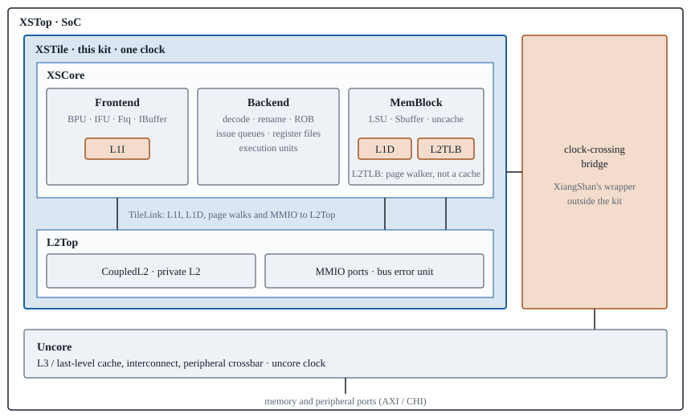
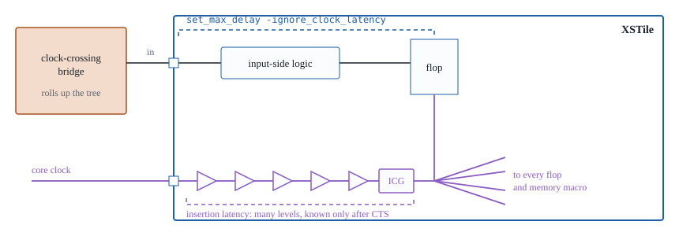

# XiangShan XSTile on ASAP7

*xiangshan-xstile-asap7, implementation kit. Built {{build_date}} from
bazel-orfs commit {{commit}}. The netlist figures were computed on
{{pin_date}} from the netlist whose SHA-256 is {{pin_netlist}}: when
`sha256sum netlist/XSTile.v` prints the same, they describe this kit's
netlist.*

XSTile is one tile of XiangShan, an open-source out-of-order RISC-V core:
the Kunminghu v3 core with its private L2 cache, in an integer-only
configuration. XSTile is not a top. It is the idiomatic macro in XiangShan
for hardening, the block that is implemented once and instanced in the
larger SoC, XSTop. Here it is synthesised to ASAP7, the open 7 nm
predictive PDK, and this kit holds what a place-and-route tool needs to
implement it: a gate-level netlist, timing constraints, abstracts and
timing libraries for the standard cells and the memories, and an
interconnect technology file.

| Figure | What it is |
|---|---|
| **333 ps** | clock period target on an industrial 7 nm process, 3 GHz |
| **{{std_area_mm2}} mm²** | standard-cell area as synthesised to ASAP7 |
| **{{cells}} cells** | standard-cell instances, of them {{flops}} flip-flops and {{clock_gates}} clock gates |
| **{{sram_instances}} SRAMs** | SRAM macros of {{sram_shapes}} shapes, as FakeRAM `.lib`/`.lef` views |
| **{{regfile_instances}} register files** | multi-ported register files, as generated macros; {{macro_instances}} macros in all |
| **{{best_period}} ps** | best minimum register-to-register period at global route with OpenROAD on ASAP7 ({{kpi_date}}), against the SDC's 2,000 ps |
| **{{die}} µm** | die of the OpenROAD reference run, {{die_mm2}} mm², about {{fill_pct}} % filled by cells |
| **{{parent_hours}} h, {{parent_peak_gb}} GB** | largest single OpenROAD run in the reference partition, to global route at peak memory |

The kit is built by OpenROAD using
[bazel-orfs](https://github.com/The-OpenROAD-Project/bazel-orfs). The
OpenROAD reference hardens parts of the tile as separate blocks to keep
each run within a few hours and about 100 GB of memory. Any partition, or
none, is equally valid for another tool. The reference is an anchor for
what to expect, not a recommendation.

## Quick start

1. **Implement** the kit unchanged through **global route**, with the
   tool's default flow. Detailed route is not needed. *Running it* lists
   the inputs.
2. **Write the outputs** into `results/` in the kit's directory: netlist,
   SPEF, the SDC as used, and liberty for anything new. *Desired results*
   lists them.
3. **Test** the result in OpenSTA:
   `bazelisk run @openroad//src/sta:opensta -- -exit "$KIT/check/sta.tcl"`,
   from a bazel-orfs clone. *Checking with OpenSTA* shows how.

The minimum clock period is register to register only. In2reg, reg2out
and in2out paths are left out. See *The minimum clock period*.

## From 2,000 ps to 333 ps

XiangShan's published target for this core is 333 ps, 3 GHz, on a
industrial 7 nm process. The kit's SDC asks for 2,000 ps on ASAP7, six
times slower. Three things make up the difference.

| What | What it means here |
|---|---|
| A better PDK | Industrial 7 nm standard cells, wires and memory compilers in place of ASAP7's predictive ones. Measured in FO4 (fanout of four) delays, 333 ps there corresponds to {{target_ps}} ps on this library. |
| Other tools | Another synthesis and place-and-route flow in place of the open-source one. |
| A large backend effort | Many engineers over many months: CAMs and register files laid out by hand, global placement regions, the tile carved into macros, custom clock trees, and RTL changed with the layout until timing is met. |

### What to expect

When setting up and running this kit through another place-and-route tool, the large
engineering effort is excluded from this equation. The result measures
the tools on the kit as it is: the same netlist, libraries, ITF and SDC as
the OpenROAD reference, with the tool's default flow. The distance that
remains from that result to {{target_ps}} ps is the share of the large
backend effort.

## Where XSTile fits

XSTop is XiangShan's SoC. It instances XSTile once per core. Inside the
tile, XSCore holds the front end, the back end and the memory block, with
the L1 caches and the page-table walker. L2Top holds the private L2 and
the ports to the rest of the SoC. XSTile runs on a single clock. The
clock crossings sit outside it, in XiangShan's wrapper, which connects
the tile to the uncore: the L3 cache, the interconnect and the memory and
peripheral ports.



*Simplified, after XiangShan's sources; module names are XiangShan's. The
wrapper around the tile holds the clock-crossing bridge and the interrupt
and reset synchronisers (XSTileWrap), and in the flavour built for chips,
the network-on-chip side (XSNoCTop), where the L3 lives in the
interconnect. None of it is in the kit's netlist.*

## Running it

The kit unpacks into one directory. Every path below is relative to it.

```
xiangshan-xstile-asap7/
  README.pdf                 this document
  netlist/XSTile.v           gate-level Verilog, hierarchy kept, top module XSTile
  constraints/XSTile.sdc     one clock, port clock, 2,000 ps; self-contained
  tech/asap7_tech.lef        technology LEF: layers M1 to M9, vias, site
  tech/asap7.itf             interconnect technology file, for RC extraction
  cells/lef/                 standard cells, RVT, LVT and SLVT
  cells/lib/                 standard cells, NLDM, FF corner
  macros/lef/                SRAMs and register files
  macros/lib/                SRAMs and register files, FF corner
  macros/verilog/            register files as gate-level Verilog, for flattening
  check/sta.tcl              the OpenSTA test of the result
  results/                   empty: the tool's outputs go here
```

1. **Technology.** Load `tech/asap7_tech.lef`, then every LEF in
   `cells/lef/` and `macros/lef/`. The LEFs are ASAP7's 1x views, in true
   7 nm dimensions, not the 4x-scaled variant. The standard-cell site is
   `asap7sc7p5t`, 0.054 µm wide with 0.27 µm rows.
2. **Timing.** Load every `.lib` in `cells/lib/` and `macros/lib/` as one
   corner. It is the FF corner, the one the OpenROAD flow times with.
   Time is in picoseconds. Voltage and temperature are in each library's
   header.
3. **Extraction.** Use `tech/asap7.itf` as the interconnect technology
   file. See *About the ITF* for where its numbers come from.
4. **Netlist.** Read `netlist/XSTile.v` with top module `XSTile` and link
   it. Every instance resolves to a cell in `cells/` or a macro in
   `macros/`, so nothing is left as a black box: the kit's build links it
   against exactly these files. Power and ground are `VDD` and `VSS`.
   Constants are tie cells (`TIEHIx1_ASAP7_75t_R`, `TIELOx1_ASAP7_75t_R`).
5. **Constraints.** Read `constraints/XSTile.sdc`. It defines one clock
   on port `clock` at 2,000 ps and times the boundary with
   `set_max_delay`, not input and output delays. *Constraints* explains
   why.
6. **Floorplan.** Any floorplan is valid. The OpenROAD reference run used
   a die of {{die_exact}} µm with a 10 µm core margin and all {{ports}}
   signal ports on the {{port_side}} edge, routing signals on M2 to M9.
   The tap cell is `TAPCELL_ASAP7_75t_R`.
7. **Implement** with the tool's default flow: place, clock tree, global
   route. XiangShan's clock gates are already mapped to ASAP7's
   integrated clock-gating cell `ICGx1_ASAP7_75t_R`, so the clock tree
   goes through them.
8. **Write** the outputs listed under *Desired results* into `results/`.
9. **Test** them with `check/sta.tcl`, as in *Checking with OpenSTA*.

## Constraints: constraints/XSTile.sdc

The SDC follows the OpenROAD-flow-scripts platform file for ASAP7 macros
(`flow/platforms/asap7/constraints.sdc`). The reasons for its shape are
recorded in OpenROAD issue
[#12017](https://github.com/The-OpenROAD-Project/OpenROAD/issues/12017).

- One clock on port `clock`, 2,000 ps, 50 % duty cycle.
- Inputs to registers and registers to outputs:
  `set_max_delay ... -ignore_clock_latency` at 0.8 of the period.
- Inputs to outputs: `set_max_delay` at 0.6 of the period.
- No `set_input_delay` or `set_output_delay`. Reset is a false path. The
  L2 data-array reads are two-cycle paths, as the RTL designs them.
- `group_path` puts in2reg, reg2out, reg2reg and in2out in groups of
  their own, so they report separately. Only reg2reg decides the minimum
  clock period. The boundary budgets steer optimisation.

### A deep clock tree behind a clock-crossing bridge

XSTile is a CPU core macro, and it will have a very deep clock tree, as
is idiomatic for CPU cores. One clock pin fans out through many levels of
buffers and clock gates to every flip-flop and memory macro in the tile.
Its insertion latency is large, can exceed a clock period at 333 ps, and
is known only after clock-tree synthesis of the macro itself.

The tile's boundary connects to a clock-crossing bridge, which rolls up
the clock tree. The bridge's tile side is driven early by XSTop's clock
tree, by the tile's insertion latency, so that it lines up with the
tile's flip-flops. The tile's latency is absorbed at the bridge instead
of being balanced against the rest of XSTop. Timing across the boundary
is therefore referenced to the tile's internal flip-flops, not to its
clock pin.



*Outputs mirror the input side: from a flip-flop through logic to a
port, under the same kind of budget.*

### Why set_max_delay for OpenROAD

Port timing usually lives in `set_input_delay` and `set_output_delay`.
For this macro, a correct input or output delay would have to include
the tile's insertion latency, which exists only after the tile's own
clock-tree synthesis. Before CTS and after it the budget would shift. A
single delay used for both min and max could also create a boundary hold
check that the parent never sees. Deriving the delays from XSTop and the
tile together means iterating two flows against each other, hours per
pass, with no guarantee of converging.

`set_max_delay -ignore_clock_latency` removes the clock latency at both
ends of a boundary path. Its target is the same before and after CTS,
and it needs no result from any other flow. The cost: OpenSTA's
`check_setup` reports the ports as unconstrained, the value is absolute
rather than a fraction of the clock period, there is no boundary hold
check, and the skew inside the tile is hidden on boundary paths.

The choice follows from what OpenROAD lacks today. Issue #12017 lists the
features that would change it: updating I/O latency after CTS from each
block's measured insertion delay, per-corner minimum and maximum latency
matching the abstract's clock-tree values, a boundary hold policy, and a
parent-level timing-budgeting pass that derives block I/O delays.
Other place-and-route tools may have some or all of these. Where a
tool can propagate the tile's insertion latency into its I/O constraints
or budget the boundary from XSTop, converting the SDC to input and output
delays is equally valid. The kit's SDC records only what the OpenROAD
flow uses.

## The minimum clock period

The minimum clock period is register to register: the SDC's period minus
the worst slack of any path from a register's clock pin to a register's
data pin. It is the number the tool reports, the number `check/sta.tcl`
reports and the number the OpenROAD reference reports in this document.

The in2reg, reg2out and in2out paths are left out when measuring it.
Their real budgets depend on what surrounds the tile in XSTop, the bridge
and the tile's clock-tree insertion latency, and are known only in the
XSTop context. That is beyond the scope of this measurement. The
`set_max_delay` budgets on those paths still steer optimisation, and
their slack is reported for information only.

## Desired results

The goal is all of the timing information of the implemented tile in a
form OpenSTA can time on its own: a netlist and its parasitics. Write
these into `results/`:

- **Netlist.** `*.v`: the gate-level Verilog of `XSTile` at global route,
  with every cell the tool added: clock-tree buffers, repeaters, resized
  and hold cells. Hierarchical or flat, with the same names as the SPEF.
- **Parasitics.** `*.spef`: one SPEF for that netlist, the tool's
  estimate after global route, extracted with `tech/asap7.itf`.
- **Constraints as used.** `XSTile.sdc`: the final SDC, with any change
  from `constraints/XSTile.sdc` marked, including propagated clocks or any
  conversion to input and output delays.
- **Libraries for anything new.** `lib/*.lib` for any cell or macro that
  is not in the kit, so that OpenSTA links the netlist without black
  boxes.
- **Hardened blocks, if any.** Each block's netlist and SPEF, with
  `blocks.txt` naming where each SPEF goes, one line per block:
  `<instance path in XSTile> <SPEF file>`. Or the tool's timing model for
  the block, as a `.lib` in `lib/`.
- **The OpenSTA test.** `sta.log`, the output of `check/sta.tcl`.
- **The tool's own numbers.** Minimum register-to-register clock period,
  the worst register-to-register paths, clock-tree insertion latency and
  skew, cell area and utilisation, global-route overflow.
- **Record of the run.** Tool and version, settings changed from the
  default flow, the partition if any, die size, runtime and peak memory
  per step, and the machine.

If the tool cannot export a netlist and parasitics, write the slack of
every register-to-register endpoint instead, one line per endpoint,
endpoint and slack in ps, together with whatever native reports it can
export.

## Checking with OpenSTA

`check/sta.tcl` times the result in OpenSTA and prints its minimum clock
period beside the tool's. This confirms two things: that the run
produced a complete, timeable tile, and whether OpenSTA's period matches
the tool's.

### Building OpenSTA and OpenROAD

Both are built with Bazel from a bazel-orfs clone, at the versions this
kit was made with: OpenSTA from `{{opensta_repo}}` at commit
`{{opensta_commit}}`, inside OpenROAD. Bazelisk is the only thing to
install; Bazel fetches the compilers and every library. OpenROAD's own
instructions, Bazel among them, are in its build guide,
<https://openroad.readthedocs.io/en/latest/user/Build.html>, and
<https://github.com/The-OpenROAD-Project/OpenROAD/blob/master/docs/user/Bazel.md>.

```
git clone https://github.com/The-OpenROAD-Project/bazel-orfs
cd bazel-orfs
git checkout --detach {{checkout}}
bazelisk build @openroad//src/sta:opensta @openroad//:openroad
```

The first build compiles both from source. Later builds, and the run
below, reuse it.

### Running the test

From the bazel-orfs clone, with `KIT` the kit's directory as an absolute
path and the tool's minimum register-to-register period in picoseconds:

```
KIT=/path/to/xiangshan-xstile-asap7
TOOL_PERIOD_PS=<period> bazelisk run @openroad//src/sta:opensta -- \
  -exit "$KIT/check/sta.tcl" | tee "$KIT/results/sta.log"
```

The script reads what OpenSTA needs to time the tile, and nothing else.
LEF and DEF are not needed.

| Step | What it reads or does |
|---|---|
| Liberty | `cells/lib/`, `macros/lib/` and `results/lib/` |
| Netlist | every `results/*.v`, then `link_design XSTile` |
| Constraints | `results/XSTile.sdc`, or `constraints/XSTile.sdc` if there is none |
| Parasitics | the top's SPEF, then each block's at its instance from `blocks.txt`, reduced as read |
| Clocks | propagated, so the clock tree's real latency and skew count |
| Checks | nets without parasitics, which should be none but constants |
| Prints | the worst register-to-register path, clock skew, OpenSTA's minimum period and its difference from `TOOL_PERIOD_PS` |

### The script: check/sta.tcl

The kit ships this file. It is printed here in full so that the test can
be read, or recreated, without the kit.

```
{{sta_tcl}}
```

### If the periods differ

Record both numbers and keep `sta.log` and the tool's own report. Do not
tune either tool or the run to make them agree. A difference is a finding
about the tools in its own right, not a fault in the run.

## Getting a fresh copy

This kit was built on {{build_date}} from bazel-orfs commit {{commit}}.
The design changes often. Making a current kit needs Linux on x86-64,
git and [bazelisk](https://github.com/bazelbuild/bazelisk). Bazel fetches
and builds everything else.

```
git clone https://github.com/The-OpenROAD-Project/bazel-orfs
cd bazel-orfs
git fetch origin
git checkout --detach origin/main
bazelisk run //test/coremark_joule/designs/asap7/xiangshan:export -- ~/Desktop
```

The last line writes `~/Desktop/xiangshan-xstile-asap7.tar.gz` and
unpacks it beside the archive. Any directory works in place of
`~/Desktop`, `.` included. To update an existing clone later, run the
last three lines again from inside it. `git checkout --detach
origin/main` checks out the latest published commit without a local
branch to keep in sync.

The first run is cold: it builds the open-source tools from source,
elaborates XiangShan from its Chisel sources and synthesises the tile.
Later runs rebuild only what changed.

## What is in the design

The top module of the kit is `XSTile`: the core (`core`, an `XSCore`
with its frontend, backend and memory block) and the L2 (`l2top`, a
`CoupledL2`). Module names are XiangShan's own, from its Chisel sources,
so a path in a timing report can be read against the RTL.

### Netlist checks

Counted when the kit was made, on the netlist linked against the kit's
own LEF and liberty with its SDC read, in OpenROAD:

{{check_table}}

### Ports

`XSTile` has {{rtl_ports}} ports, {{rtl_bits}} bits, all functional: one
clock, one asynchronous reset (a false path in the SDC), the CHI link to
the interconnect, interrupts and the timer, the trace interface, and the
strap inputs the SoC sets (hart ID, reset vector, node ID). There
is no scan, BIST or DFT port to tie off: MBIST is disabled when XiangShan
is elaborated, and the kit's build stops if a test-mode port ever
appears at the tile's boundary. Grouped by bus:

{{rtl_port_table}}

### Memory macros

Every memory XiangShan builds as SRAM is a macro: single-port arrays with
a LEF abstract and a `.lib`, the same shapes the OpenROAD flow generates,
{{sram_instances}} instances of {{sram_shapes}} shapes, counted in the
kit's netlist. *Where* is the hierarchy every instance of the shape sits
under.

{{sram_table}}

*The macros' views come from an SRAM model that is not characterised
silicon. Their area and timing are realistic in scale, not exact.*

### Register files

The core's register files have many ports, up to {{regfile_max_read}}
reads and {{regfile_max_write}} writes, and no single-port SRAM can stand
in for them. In an industrial core they would come from a register-file
compiler. Here they are generated as placed standard-cell structures
(OpenROAD's `generate_ram`): flip-flops in a word-by-bit grid with their
read multiplexers and write decode beside them. They come as macros with
a LEF and a `.lib`, and as a gate netlist in `macros/verilog/` for tools
that flatten them.

{{regfile_table}}

### Regular structures

Synthesis of the RTL as written is slow on two kinds of regular
structure, and the netlist in this kit has both already resolved.

**Register files**, above. Synthesised as flip-flops and multiplexer
trees, a register file took yosys up to 20 minutes, and the placement of
the block around it could not be legalised. `generate_ram` builds each in
seconds to minutes, legal by construction.

**Entry arrays and CAMs.** The queues and the fully associative TLBs
repeat one entry's registers and logic per entry, each entry written
where a broadcast index equals its own number. Synthesis saw every
comparison once per entry. `generate_array` finds the entries, writes the
block as one entry cell instanced per entry, decodes each index
comparison once in the block, and proves the result equal to the
original. In the netlist each appears as a `<Block>Entry` module,
instanced once per entry.

{{ab_table}}

*Minutes for the block's whole OpenROAD flow through global route, and
its minimum period there, single runs side by side.*

## OpenROAD reference floorplan

*The floorplan and the tables in this section and the next are a
snapshot of the {{block_count}}-block experiment in bazel-orfs, where the
measurements below come from. XiangShan is under active development
there, so a fresh kit has the latest.*

Each of the {{block_count}} hardened blocks is implemented through global
route at its own outline with its pins on one side. The rest of the tile
is implemented as one macro around them. Placement regions (dashed) keep
logic near its partners; the integer register file is placed beside its
readers.


{{block_table}}

The period is each part's minimum register-to-register clock period at
global route ({{kpi_date}}), as defined in *The minimum clock period*.
The tile is only as fast as its slowest part, in this experiment the
rest of the tile at {{parent_period}} ps.

## OpenROAD build times and memory

For calibration, each part of the experiment through global route, in
minutes and peak GB per pass, measured at bazel-orfs {{resources_commit}}
({{resources_date}}). The blocks run in parallel in waves that fit the
machine's memory. The slowest block, `{{slowest_block}}`, takes
{{slowest_block_min}} minutes.

{{times_table}}

*Synthesis here is the per-part step after a shared front end, which
elaborates the RTL, applies the register-file and array generators and
writes the netlist. Global route on the rest of the tile includes timing
repair with the route's parasitics.*

## Where it stands

- Every part reaches global route. Detailed route is not run yet: some
  macro pins have no legal access point in OpenROAD's router, which is a
  tool limitation, not the design's.
- Global route runs with congestion allowed. The minimum
  register-to-register period is the number tracked.
- The next target in ASAP7 is 2,000 ps. *From 2,000 ps to 333 ps*
  describes the rest of the way.

## About the ITF

ASAP7 is a predictive PDK and ships no interconnect technology file.
`tech/asap7.itf` is written for this kit by a script from the files the
OpenROAD flow uses: widths, spacings and via cuts from the technology LEF,
and resistance per unit length of each layer and via from the platform's
`setRC.tcl`. Every metal is taken at an aspect ratio of 2, each
dielectric as thick as the metal below it, and each level's permittivity
is fitted so that a minimum-width wire between two neighbours at minimum
spacing has `setRC.tcl`'s capacitance under a closed-form model (Sakurai
and Tamaru). M8 and M9 come out at a permittivity near 1.5: `setRC.tcl`
gives them less capacitance than oxide would. It is not a foundry deck.
It is close enough that both tools see the same wires as long, short,
slow or fast.
