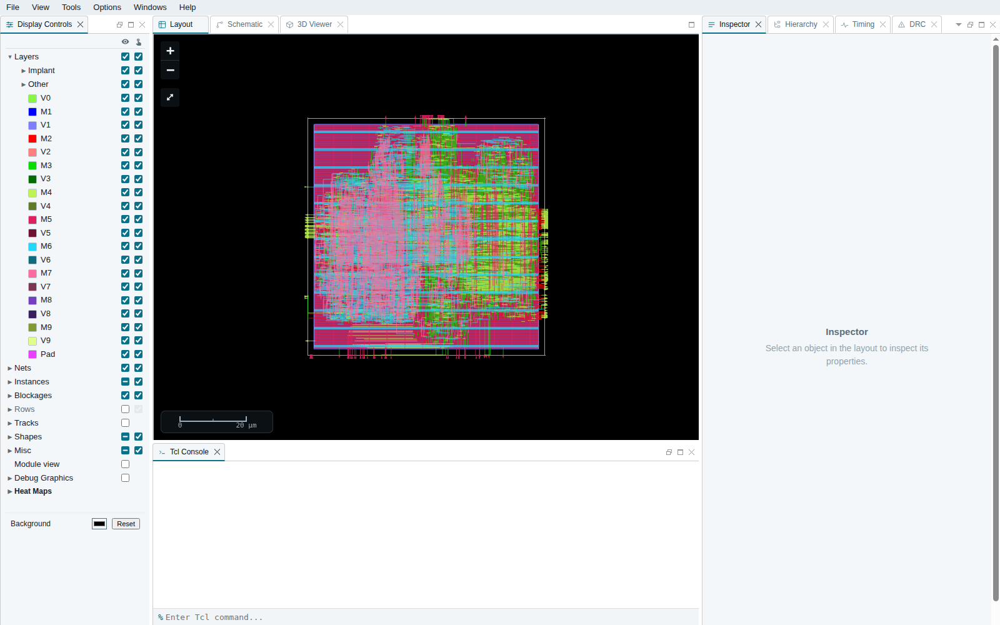

# ORFS's designs with generated register files

Each design's register file as flip-flops (the design as ORFS has it)
against the register file generated by `generate_ram` (OpenROAD #11723)
in several shapes, each through detailed route on asap7:

| shape | spec lines added | what it is |
|---|---|---|
| flops | | the design as ORFS has it |
| inline | | the spec as the variant has it: standard cells inlined in place |
| netlist | `mode netlist`, `bit_folds 2` (riscv32i: unfolded) | a placed macro, dissolved into the parent |
| verilog | `periphery verilog` | the array generated, its periphery synthesised from Verilog |
| mux | `write_style mux` | a mux per word instead of a clock gate |

riscv32i also runs shapes its register file does not need (banks, bit
folds, service columns), so each option is exercised on a real design.
They are reported as negative results.

The register file reaches the flow by one of these routes:
- picorv32: the RTL's own seam, `PICORV32_REGS`.
- ibex: a spec naming its module.
- tinyRocket, swerv and cva6: Verilog surgery
  (`SYNTH_VERILOG_SURGERY`) moves the storage into a module of its own.

Surgery is either a change the RTL might make for a tapeout, or a
stand-in for a feature yosys does not have. It is checked, and it never
changes function. The patches are carried here: ORFS 0095–0099.

## Method

- Each arm runs twice: first at the design's ORFS clock, then at one
  calibrated clock for all of the design's arms, 3 % under the best
  period any arm reached in the first run.
- The second run is the one reported.
- `measure.tcl` extracts RCX parasitics from the routed design. It
  reports the minimum period (clock period − WNS), the same for
  register-to-register paths alone, standard-cell area, cells and
  `report_power`.

One run per arm, with no seed sweep. Perturbing names and hierarchy
alone moves results by more than 7 % (Kahng and Mantik, ISQED 2002),
and routed wirelength by more than 10 % (Chan, Kahng and Woo, SLIP
2020). A difference of a few percent is within noise.

## Results

| design | shape | min period (ps) | Δ period | reg→reg (ps) | Δ reg→reg | std-cell µm² | Δ area | power (mW) | Δ power |
|---|---|---|---|---|---|---|---|---|---|
| ibex | flops | 1217 |  | 1217 |  | 2329 |  | 19.70 |  |
| ibex | inline | 1219 | +0.1 % | 1219 | +0.1 % | 2060 | -11.6 % | 14.60 | -25.9 % |
| ibex | mux | 1212 | -0.4 % | 1212 | -0.4 % | 2204 | -5.4 % | 14.90 | -24.4 % |
| ibex | netlist | 1190 | -2.2 % | 1190 | -2.2 % | 2018 | -13.4 % | 15.10 | -23.4 % |
| ibex | verilog | 1212 | -0.4 % | 1212 | -0.4 % | 2047 | -12.1 % | 13.50 | -31.5 % |
| picorv32 | flops | 484 |  | 440 |  | 2309 |  | 35.30 |  |
| picorv32 | inline | 526 | +8.6 % | 441 | +0.2 % | 2082 | -9.9 % | 18.80 | -46.7 % |
| picorv32 | mux | 529 | +9.1 % | 438 | -0.4 % | 2220 | -3.9 % | 28.70 | -18.7 % |
| picorv32 | netlist | 531 | +9.6 % | 438 | -0.5 % | 2044 | -11.5 % | 23.90 | -32.3 % |
| picorv32 | verilog | 503 | +3.8 % | 443 | +0.8 % | 2055 | -11.0 % | 19.90 | -43.6 % |
| riscv32i | flops | 957 |  | 930 |  | 1307 |  | 32.50 |  |
| riscv32i | banks | 934 | -2.4 % | 919 | -1.1 % | 977 | -25.2 % | 34.00 | +4.6 % |
| riscv32i | folds | 959 | +0.2 % | 933 | +0.4 % | 1001 | -23.4 % | 33.70 | +3.7 % |
| riscv32i | inline | 948 | -1.0 % | 931 | +0.1 % | 957 | -26.8 % | 33.40 | +2.8 % |
| riscv32i | mux | 980 | +2.4 % | 949 | +2.1 % | 1158 | -11.5 % | 38.30 | +17.8 % |
| riscv32i | netlist | 927 | -3.1 % | 911 | -2.0 % | 945 | -27.7 % | 32.40 | -0.3 % |
| riscv32i | service | 948 | -1.0 % | 931 | +0.1 % | 957 | -26.8 % | 33.40 | +2.8 % |
| riscv32i | verilog | 952 | -0.5 % | 915 | -1.5 % | 959 | -26.6 % | 32.90 | +1.2 % |
| tinyRocket | flops | 684 |  | 684 |  | 3916 |  | 123.00 |  |
| tinyRocket | inline | 656 | -4.2 % | 656 | -4.2 % | 3709 | -5.3 % | 96.60 | -21.5 % |
| tinyRocket | mux | 649 | -5.1 % | 649 | -5.1 % | 3797 | -3.1 % | 98.50 | -19.9 % |
| tinyRocket | netlist | 658 | -3.8 % | 658 | -3.8 % | 3654 | -6.7 % | 108.00 | -12.2 % |
| tinyRocket | verilog | 645 | -5.8 % | 645 | -5.8 % | 3643 | -7.0 % | 104.00 | -15.4 % |

### What each design shows

- **tinyRocket.** Rocket's register file is the plain array generate_ram
  builds: 31 × 32, two combinational reads, one write, no reset, and x0
  handled outside it. Every shape is faster, smaller and lower in power
  than flip-flops.
- **ibex.** The register file is 32 × 32 with x0 reading zero and every
  word reset asynchronously. That fits `zero_word` and `async_reset`
  directly. The netlist shape gives −2.2 % period, −13 % area and −23 %
  power. The other shapes keep the period within noise, with similar
  area and power savings.
- **riscv32i.** The register file zeroes x0 inside its module, which
  `zero_word` covers. The netlist shape gives −3.1 % period and −28 %
  area, with power unchanged within noise.
- **riscv32i's coverage shapes.** Banks, folds and service columns give
  the same area savings as the plain shapes, with period and power
  within noise. The write mux gives up the clock gate per word, and
  with it the power saving.
- **picorv32.** Register-to-register paths are within noise in every
  shape (±0.8 %). Area falls 4–12 % and power 19–47 %. The full minimum
  period is set by flop-to-output paths to `mem_la_addr`, which do not
  pass through the register file. In the routed verilog arm, 13 of the
  14.5 ps gap on the worst of them is the launching flop's clock
  arriving later.

### Stage times

`bazelisk build //test/regfile/designs:report_small_tables` writes
`report_small_tables.md`, which has the full table: seconds per stage,
for both runs of every arm. The arms ran eight at a time beside other
work, so times are indicative only.

- The netlist and verilog shapes roughly halve the flow time against
  flip-flops at the ORFS clock (riscv32i: 791 s against 315 s and
  334 s).
- At the calibrated clock, run time depends mostly on how hard repair
  works.

## Open it

To open a routed design with its register file generated:

    bazelisk run @orfs//flow/designs/asap7/ibex-regfile:ibex_core_route web_route

This builds ibex-regfile through detailed route, then opens it in
OpenROAD's web viewer.

## Not run yet: swerv, cva6

swerv_wrapper and cva6 are prepared but not measured:
- their carried patches (0097, 0098);
- their arms, listed in `ARMS_5` and `ARMS_6`.

coralnpu generates both its register files in ORFS's own asap7/coralnpu
(0155), so it has no flip-flop arm here.

Each flow needs about 10 GB at detailed route. To finish them:

1. Build the tools first, so the compile runs wide and only one flow
   step runs:

       bazelisk build --jobs 16 //test/regfile/designs:swerv_wrapper_swerv_flops_1300_floorplan

2. Run the first pass, two flows at a time:

       bazelisk build --jobs 2 --keep_going //test/regfile/designs:report_tables

3. For each design, take the best minimum period any arm reached in
   `report_tables.md`. Add a second period 3 % under it to that
   design's `periods` in `BUILD.bazel`, as the small designs have
   (`[1468, 1240]` for ibex). The last period listed is the one
   reported.
4. Rerun step 2.
