# generate_ram blocks, routed

One routed `generate_ram` block per line of `combos.txt`, at most 16 a
PDK, each turning on several options so that every option shows in at
least one picture. The option space has more dimensions than pictures
can cover; these are a sample, not a sweep.

| PDK | Picture | Options |
|---|---|---|
| asap7 | 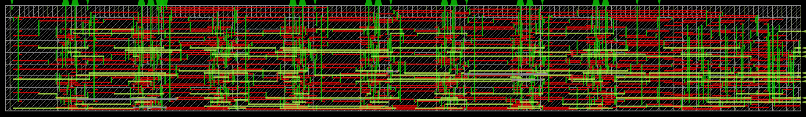 | two reads and a write, AND-OR read (asap7 has no tristate cell) |
| asap7 | 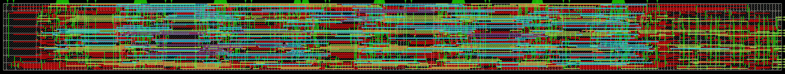 | two write ports, `-write_priority or`, `-write_style mux`, `-zero_word 0` |
| asap7 | 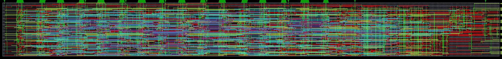 | `-banks 4 -bank_columns 2 -bank_order interleaved`, `-rb_ports 1`, `-register_read_address 1` |
| asap7 | 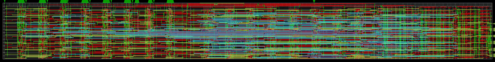 | banks, `-bank_column_layout contiguous`, `-decoder word` |
| asap7 | 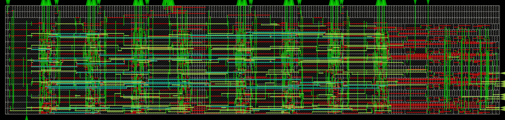 | `-bit_folds 2`, `-service_columns {4 10}`, `-reset_value 0` |
| asap7 | 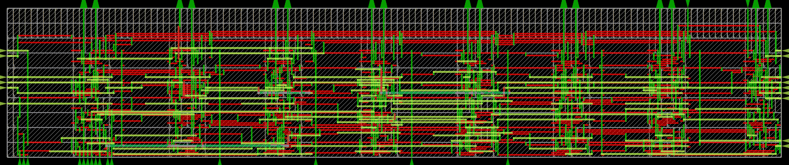 | `-periphery verilog`, `-name`: the routed core |
| Nangate45 | 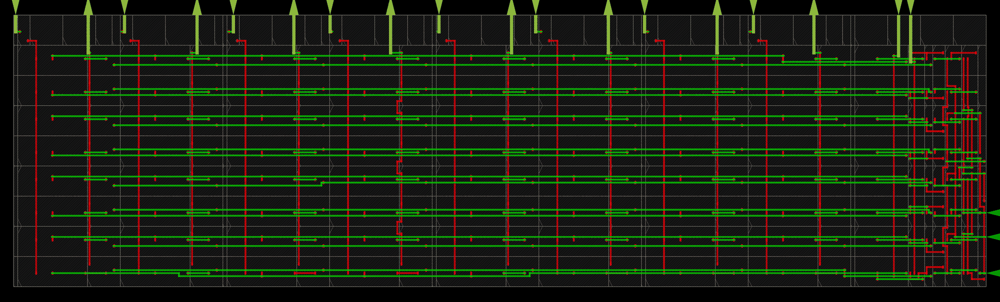 | one read/write port, tristate read |
| Nangate45 | 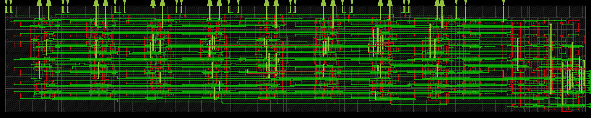 | two write ports, `-read_style and_or`, `-zero_word 0` |
| Nangate45 | 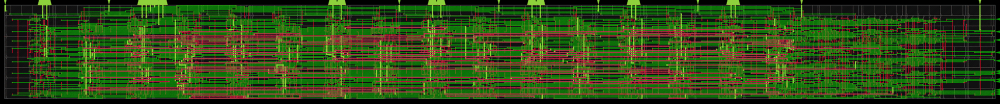 | banks, `-register_read_address 1`, `-write_style mux` |
| Nangate45 | 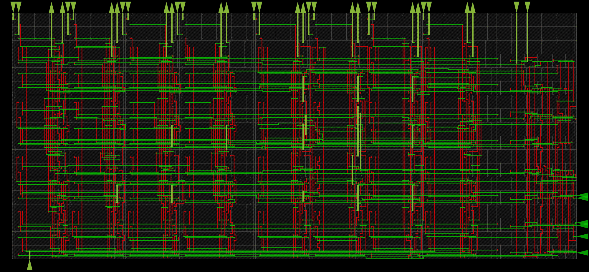 | `-bit_folds 2`, `-service_columns`, `-reset_value 0`, `-decoder word` |
| sky130hd | 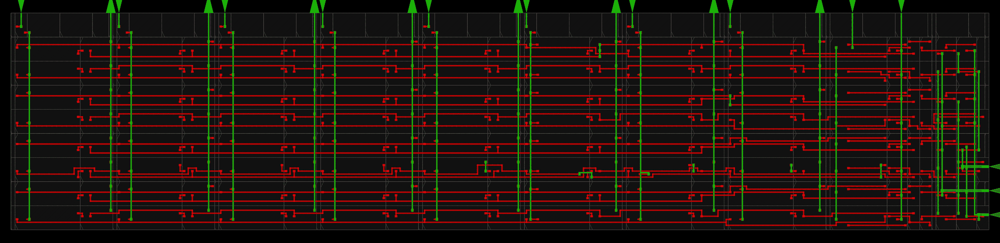 | one read/write port, tristate read |
| sky130hd | 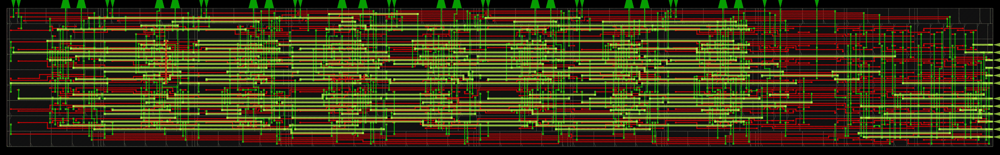 | two write ports, `-write_priority or`, `-read_style and_or`, `-zero_word 0` |
| sky130hd | 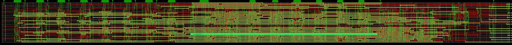 | banks, `-rb_ports 1`, `-bank_column_layout contiguous`, `-register_read_address 1` |
| sky130hd | 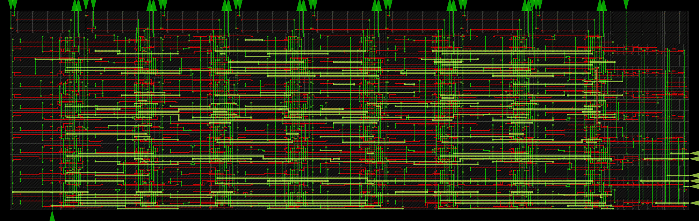 | `-bit_folds 2`, `-write_style mux`, `-reset_value 0`, `-decoder word`, `-cells {tie ...}` |

In no picture: `-column_mux_ratio` and `-use_latch`, which predate the
register-file options, and `-periphery unplaced`, which only
`generate_ram_netlist` takes.

To redraw them, with a GUI build of OpenROAD on the patches this
repository carries, from its `src/ram/test` (where `routed.tcl` and the
PDKs' files are), for each line of `combos.txt`:

    PDK=<pdk> ARGS="<arguments>" OUT=<abs>/<pdk>_<name>.png \
      QT_QPA_PLATFORM=offscreen openroad -exit -no_init -no_splash render.tcl

then scale each to at most 2000 pixels wide. A `-wrapper_verilog` file
name is relative to that directory.
