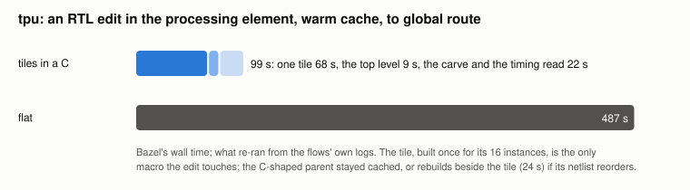
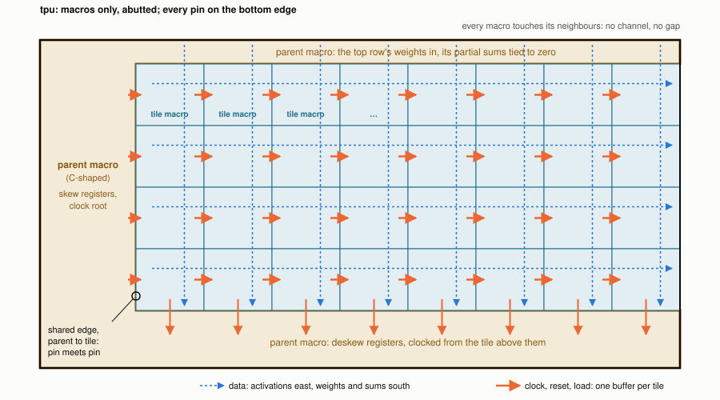

# tpu: abutted tiles, the parent a macro too

ORFS's tpu, a systolic array of 8 x 8 processing elements on asap7, built
as 17 macros and no standard cell at the top:

- **16 identical tiles** of 2 x 2 elements, carved out of the flat design
  by yosys (`//tools/carve`): the design's own cells regrouped, the RTL
  untouched, the result proven equivalent by kepler-formal with a
  negative control that must be refuted.
- **the parent as a macro**: everything else of tpu (the skew and deskew
  registers, the clock root, the weights in) is one C-shaped macro whose
  notch holds the tiles (`//test/abutment:io_notch.tcl`).
- **abutment**: every tile meets its neighbours and the C pin on pin;
  every pin is placed by rule before anything is built
  (`//tools/carve:pin_plan`), so no macro waits for another.

Or the tiles **dissolved**: built through CTS only to be placed, then
FIRM cells of one flat flow, the clock skewed along the array by a chain
of buffers. The same period, a die 1.09 x flat's instead of 1.39 x, and
the round trip of a flat build ("Dissolved", below).


Placement density at global route, each tile's own cells drawn in place:
the tiles are 80 % full, the C's arms around them hold its 676 um2 of
skew and deskew registers in a sparse 5.6 %.

## Why

QoR is the best result within a build budget, and no budget is infinite.
In a hierarchical flow the parent places, repairs and routes around its
macros' abstracts: it waits for every macro, and every macro change
re-places it. Here the parent is a macro like the tiles, built from the
same pin plan, so

- every macro, the parent included, builds side by side;
- the top level is placement and a timing read: seconds;
- an RTL edit in a tile rebuilds that tile, nothing else.

Faster round trips buy more exploration within the same budget, and
exploration is what QoR is made of.

## Results

At global route; the period is the reg2reg minimum period stitched
across the C and its 16 tiles, each with its own cells and wires
(`tpu_stitched`), against flat built the same way from ORFS's RTL
(`tpu_flat_stitched`). Both arms' settings are their best from the same
search (ORFS AutoTuner's knobs, flat given five times the CPU); the
periods are means of three placement seeds (the flows here are the
first seed: 665.2 ps and 724.0 ps).

| | tiles in a C | flat |
|---|---|---|
| reg2reg minimum period | **672.6 ps (92 %)** | 729.3 ps |
| a fresh build, critical path | **76 s**: the tile 66 s beside the C's 23 s, then the top level 10 s | 436 s |
| an RTL edit in the processing element | **99 s** | 487 s |
| search CPU until it beat flat's best | **about 300 s**, its first trial | never, in 80,545 s |
| die | 1.39 x | 1 x |


The carve's first sensible floorplan already beats everything flat
reaches; tuning either arm moves its period by less than a seed does.



## The rules of the game

tpu is **mesochronous** with its surroundings: the same clock frequency,
a fixed but unknown phase. The clock reaches each tile through the tiles
before it (below), so the phase at tpu's registers is not the clock
root's, and nothing outside should depend on it. Data crosses tpu's
boundary through mesochronous FIFOs, one on its inputs and one on its
outputs, which are assumed to exist outside tpu and are not part of this
design. So:

- **Only reg2reg paths are judged.** The quality of results is the
  reg2reg minimum period, stitched across every macro: the clock period
  minus the worst reg2reg slack.
- **The boundary is a budget, not a constraint**: inputs to registers
  and registers to outputs are `set_max_delay` targets for repair
  (`flow/platforms/asap7/constraints.sdc`), with no input or output
  delay, since the phase they would be measured against is unknown.
- **tpu has every pin on its bottom edge**: it is itself a macro that
  abuts its parent, where the FIFOs are. Inside, each macro has its pins
  on the sides its neighbours are on.
- **Every macro routes on M2-M8**; M9 carries power from the level above.

## How it is clocked

The clock, reset and load enable enter each row of tiles from the C at
its west end and run east through the tiles with the activations, one
buffer per tile; north-south neighbours enter at the same time. Only
neighbours' skew matters, as Fisher and Kung showed for pipelined
clocks in systolic arrays. The bottom row passes its clock down to the
deskew registers in the C.



Measured on the stitched design (`tpu_stitched_clock`, drawn by
`clock_plot.py`): each tile sees the clock 77 ps after its west
neighbour, so data flowing east is captured later than it is launched,
which setup gains and hold pays for; rows enter together, so data
flowing south sees a few ps either way. No clock tree is balanced across
the array: the skew follows the data instead. tpu's worst path starts
and ends inside one tile, so this does not shorten its period; it is
what lets the clock run through the tiles without a tree over them.


## The clock balanced at a top level of its own

Routing the clock through the tiles fails hold where the chain meets the
parent (Limits). One way to solve the clock problem of a parent hardened
as a macro, and the obvious one for ORFS's clock tree synthesis: take
the clock out of the macros' wiring and balance it at a top level of its
own, which holds no logic, only a strip of rows for the clock tree. The
parent stays a macro and still builds side by side with the tiles; the
top level assembles them and is where cross-macro timing is read.

```
 +--------------------------------------+
 | the C, top side                      |
 +----+---------------------------------+
 | C  |  4 x 4 tiles, each with its     |
 |west|  clock pin on M8 over its centre|
 +----+---------------------------------+
 | the C, bottom side: deskew   (clk)   |
 +=========== top level's rows =========+  4 rows, 1.08 um, 112 um2
```

- **The carve** (`make_spec.py --clock-at-top`, `wrap_parent.py --at-top
  clk`): no `clk_out` or `clk_south`, the deskew registers on the
  parent's clock, every macro's clock pin on tpu's clock net at the top
  (`tpu_2x2_balanced`, proven equivalent with its negative control).
- **The tile** (`tpu_block_balanced_*`): its clock an M8 pin over its
  centre (`pin_plan.py`'s side `over`), its signals on M2-M7, so M8 over
  it holds its straps and that pin only.
- **The top level** (`tpu_balanced_*`): the macros lifted onto the strip
  with the routing tracks (`place_notch.tcl`), the core the strip's rows
  from detailed placement on (`core_rows.tcl`), rails for them
  (`pdn_top.tcl`), real tap cells, and ORFS's clock tree synthesis over
  the 17 macros' clock pins, crossing the tiles on M8-M9 with M2-M7
  there left to the tiles (`grt_notch.tcl`). Exact abstracts
  (`abstract_exact.tcl`) state neither the parent's notch obstructions
  nor supply straps that are also pins: global routing blocks its top
  layer wherever a macro obstructs the layer below, and the tiles' M8
  straps cut every M9 track over them.

Stitched, one placement seed (`tpu_balanced_stitched`, `_clock`,
`_clock_check`):

| | clock through the tiles | clock balanced at the top | flat |
|---|---|---|---|
| reg2reg minimum period | 665.2 ps | **754.0 ps** | 724.0 ps |
| derated 5 %, CPPR on | 668.3 ps | 763.2 ps | |
| hold failing, tile to parent | 143, worst -417.4 ps | **0** | |
| hold failing, inside the parent | 75, worst -130.0 ps | **0** | |
| clock at the tiles' registers | +77 ps a column east | 105-122 ps, every tile | |
| clock at the parent's registers | 65 ps | 123-180 ps | |

Hold closes; the period is 13 % longer. The chain gave every path
flowing east 77 ps of skew for free, and balanced, those paths fail:
960 endpoints from a tile into its east neighbour, worst -255 ps, a
floor near 705 ps for any balanced clock. The parent's own tree is
deeper than the tiles', so its skew registers launch late into column 0,
worst -304 ps: that sets 754 ps. The next step is a planned latency per
macro, the column's offset east and the parent matched to it, inserted
at the top: the skew the chain gave, kept on purpose, with every
macro's clock known.

## The worst path at the top level

At the balanced top level the worst slack of all is not reg2reg but
in2reg: tpu's `a_valid` and `a_data` into the top-left tile.

```
   die, 103.68 x 122.04 um
  +----+-------------------------------------------+
  |    |  C, top side                              |
  |    +-------------+-------------+-------- ...   |
  |    | u_b0_0      | u_b0_1      |               |
  |    |  PE(0,0)    |             |               |   row 0
  |  +----> a_in     |             |               |
  |  ^ | (6.3, 94.0) |             |               |
  |  | +-------------+-------------+-------- ...   |
  |  | |            the other 14 tiles             |
  |  | |                                           |
  |  | +-------------------------------------------+
  |  | |  C, bottom side                           |
  +==^=+============ top level's rows =============+
     a_valid, a_data[7:0]: tpu's ports, bottom edge, (10.8, 0)

   0.0 ps    port a_valid
  92.3 ps    u_b0_0/a_in[2]: up the C's west side, through the mux
             a_valid ? a_data : 0; row 0 has no skew register
 663.9 ps    PE(0,0)'s multiply-add into its partial-sum register
             (the tile's timing model: 571.6 ps setup at a_in)
 300.0 ps    the in2reg budget: slack -363.9 ps
```

The RTL delays row i of the activations i cycles so partial sums meet
down each column: row 0 gets none, and the minimum latency, 2N-1
cycles, with it. The zeros on idle cycles are injected where the rows
enter, so no PE needs a valid bit. The PE multiplies its west input as
it arrives and registers only its outputs. So from tpu's inputs to its
first partial sum is one multiply-add, half of a reg2reg path whose
other half is a register outside tpu: no in2reg budget under one
multiply-add holds it, wherever the pins are. The trip up the C costs
92 ps of it.

### The context that makes it go away

tpu is mesochronous with its surroundings, and the rules of the game
put its FIFOs outside it. The read side of the input FIFO is a register
on tpu's clock. Put the FIFOs in the top level, where the macros are
assembled and the clock is balanced, and that register sits in the
top level's rows under the C, on the balanced clock: FIFO register,
mux, multiply-add, partial-sum register is a reg2reg path like any
other, about the tile's own period, judged in the stitched period. The
in2reg budget has nothing left to judge. The outputs alike: the deskew
registers into the output FIFO.

tpu's module keeps its ports. It has no flow control: it takes a row
every cycle, `a_valid` low injecting zeros, `w_valid` freezing the
array while weights load, and its results leave 2N-1 cycles later with
`c_valid`, with no way to stall them. A mesochronous FIFO needs none:
both sides run at the same rate, so after it fills it passes one word
a cycle, valid bits included, and its pointers need no synchronizers.
Back-pressure toward the host, if a system needs it, is the wrapper's:
an output FIFO at least as deep as the 2N-1 rows in flight and a credit
counter that drops a ready to the host when it has none.

### tpu in its rig

The rules of the game build enough of tpu's surroundings to solve it
realistically without cheating, so the FIFO is part of the rig, and
tpu's interface is its flow control: `tpu_meso.sv` puts a mesochronous
FIFO (`meso_fifo.sv`, the shape of `chi_async_bridge`'s async queue
without its synchronisers) on each side of tpu, on its one clock, and
leaves tpu's module as it is. No back-pressure: the FIFOs pass a word
whenever they hold one, and `sim/tpu_meso_test` shows that tpu takes the
bubbles that makes, 96 result rows equal to tpu alone's with bubbles in
weight loads and activations, and that no FIFO holds more than one word
waiting: a depth of 2 is the maximum case. The test's first run caught
the input FIFO reset by the registered reset, which drops a word that
comes the cycle reset falls.

The rig's top level (`tpu_meso_balanced_*`) is the balanced one with
the FIFOs in its strip, 45 rows (12.15 um, 1,260 um2) for 1,169 flops
and their muxes (652 um2). The strip is a placement region during
global placement (`place_notch.tcl`), whose count of the macros' area
otherwise takes the C's box over its tiles twice and diverges, and is
dropped for detailed placement, which has the strip as its core.
Flat gets the same rig (`tpu_meso_flat_*`). Stitched, one seed:

| | balanced | balanced, in the rig | flat | flat, in the rig |
|---|---|---|---|---|
| reg2reg minimum period | 754.0 ps | **771.3 ps** | 724.0 ps | **753.8 ps** |
| derated 5 %, CPPR on | 763.2 ps | 787.9 ps | | |
| hold failing, as timed | 0 | **0** | | |
| hold failing, derated | 0 | 69, worst -7.3 ps, C to rig | | |

Every path of tpu is now reg2reg and judged, the one from tpu's inputs
to the first multiply-add included: in the rig it is the worst, FIFO
register, up the C's west side, multiply-add, worst -321.3 ps. Flat
pays for it too, 754 ps where 724 ps left it out.

The clock at the registers, stitched: the tiles' 144-168 ps, the C's
174-231 ps, the rig's 219-227 ps, both its sides alike. The top level's
clock tree synthesis builds one tree for the macros' clock pins and one
for the rig's flops, and does not balance one against the other with
the macros' own trees inside: the rig launches about 60 ps after the
tiles capture. Neither side of the FIFOs got a short branch.

### Mysteries

Explained:

- **`a_valid` in a reg2reg path.** Clicking a bar of the web viewer's
  slack histogram, which is drawn per path group, asks for the paths in
  the bar's slack range with no group: the reg2reg bar's range also
  holds the in2reg paths above, the worst in it, and they are listed
  under it. STA puts no port in reg2reg.

Not explained yet:

- **The macros' own trees and the top level's clock tree.** At the
  balanced top level the C's registers see the clock at 123-180 ps
  against the tiles' 105-122 ps, and in the rig the rig's flops at
  219-227 ps against the tiles' 144-168 ps: whether the clock tree
  synthesis sees a macro's insertion delay in its timing model, and
  why it balances the macros' clock pins and the flops as two trees,
  is not checked.
- **Only the east column's clock pins** leave global route over
  capacity, four gcell edges one track over; the edge-pin model
  explains an over-capacity edge beside a pin over a tile's centre, not
  why only that column.
- **ORFS's top-level report** reads setup slack -368 ps through the
  macros' liberty models, against a stitched period of 665 ps.

## Dissolved: the tiles built only to be placed

The tile is built through CTS and then dissolved into the parent: its
cells, its rows and its own clock tree become the parent's, FIRM where
the tile put them, and tpu is one flow again, its whole netlist timed
and repaired together, its clock tree an ordinary one. Nothing moves or
resizes a tile's cells; the tile is a placement, not a macro.

```
 +--------------------------------------+
 | the parent's cells: weights in       |
 +----+---------------------------------+
 |skew|  4 x 4 tiles, dissolved: FIRM   |
 |regs|  cells on the tiles' own rows   |
 +----+---------------------------------+
 | the parent's cells: deskew, pins     |
 +--------------------------------------+  94.82 x 103.68 um
```

- **The tile** (`tpu_block_dissolve_*`): the balanced carve's tile, its
  core its die (no ring), its ports unbuffered (`DONT_BUFFER_PORTS`):
  once dissolved a port is a net of the parent's, and a buffer each side
  of every seam would be in every path across it.
- **The dissolve** (`//test/abutment:dissolve.tcl`, `POST_TAPCELL_TCL`):
  the tiles are placed abutted on the parent's site and row grid
  (`place_grid.tcl`), tapcell cuts the parent's rows around them with no
  halo, and each tile becomes the cells, nets and rows of its CTS
  database at its location; the two feedthroughs (`rst_out = rst`,
  `w_valid_out = w_valid`) merge the parent's nets on both sides.
- **The parent** (`tpu_dissolve_*`): the rest of tpu, synthesised as it
  is, in bands around the array; ORFS's flow from there on, CTS
  included.
- **Useful skew at home** (`clock_chain.tcl`, `PRE_CTS_TCL`): OpenROAD's
  CTS has no useful skew, and a balanced clock fails the paths flowing
  east (above). So each tile keeps the tree it was built with, and the
  tiles' clock entries leave tpu's clock net for a chain of buffers
  along the array, one tap a column, tuned at placement to the buffer
  count closest to 77 ps a column, the chain's skew of the clock through
  the tiles. CTS builds the parent's tree with the chain's head as one
  sink, and skips the chain and the tiles' trees. After CTS, and before
  repair, column 0 is put 30 ps behind the parent's registers
  (`CHAIN_COL0_PS`), which launch into it.

One placement seed (`tpu_dissolve_stitched`, `_clock`, `_clock_check`):

| | clock through the tiles | balanced at the top | **dissolved** | flat |
|---|---|---|---|---|
| reg2reg minimum period | 665.2 ps | 754.0 ps | **665.7 ps** | 724.0 ps |
| derated 5 %, CPPR on | 668.3 ps | 763.2 ps | **679.5 ps** | |
| hold failing, as timed and derated | 218 | 0 | **0**, no hold buffer | |
| die | 1.39 x | 1.39 x | **1.09 x** | 1 x (9,045 um2) |
| a fresh build, critical path | 76 s | | **471 s** | 436 s |

The dissolved tiles keep the period of the clock through the tiles, hold
closes without a hold buffer, and the die is 22 % smaller than the C's;
the fast round trip goes. tpu's worst path is inside a tile, as it was:
the tile's own 667 ps, timed in the parent.

The clock at the registers: the parent's 227-262 ps, column 0's
278-283 ps, then 73, 73 and 70 ps more a column east; the four rows of
a column within 2 ps of each other on average.

What was learned on the way:

- **Area was never halos.** The tiles abutted with no halo already; the
  C's arms around them were 5.6 % full. Dissolved, the parent's cells
  fill bands 66 % full, and the die is 1.09 x flat's. The bands cannot
  shrink into the tiles: the tiles are 78 % full of FIRM cells.
- **CTS runs as normal**, and does not know the chain's head is a whole
  array: it hangs the head on a shallow branch, its input at 42 ps
  against the parent's registers' 253 ps, so with the head alone
  column 0 took the clock 89 ps before the parent's skew registers that
  launch into it. That path, one multiply-add from a register in the
  parent, set 773.7 ps; aligning column 0 after CTS
  (`clock_chain.tcl`'s wrapper of `clock_tree_synthesis`) brought it to
  665.7 ps, and the 262 hold buffers repair had needed went with it.
  Whether this is the same behaviour as the macros' clock pins balanced
  as a tree of their own (Mysteries) is not checked.
- **A dissolved cell is `u_b0_0.<cell>`, not `u_b0_0/<cell>`.** The
  parent is read hierarchically (`read_db -hier`), where STA takes a `/`
  in a flat name for a hierarchy divider and keeps only what follows:
  the 16 tiles' copies of a cell had one name in reports, written
  netlists and parasitics, and a first stitched read gave 754 ps where
  the design had 773.7 ps.
- **The negotiation legaliser stalls** with a few dozen cells left
  among 61,088 FIRM ones, 39 still illegal from its 20th iteration to
  its 400th; the diamond
  search (`DETAIL_PLACEMENT_ARGS=-use_diamond_legalizer`) places them.
- **Global route is the whole design's again**: 205 s of the 471 s,
  1,965 CPU seconds. An RTL edit in a processing element rebuilds the
  tile and then the parent from synthesis, about the fresh build.

Not done: a proof that the dissolve keeps the function. The carve is
proven equivalent; the dissolve is checked by STA seeing all 4,207
registers clocked, the tiles' paths timing at the tile's own 667 ps, and
a fresh build reproducing the period to the femtosecond, not by LEC.

## Build

```sh
bazelisk build //test/tpu:tpu_stitched       # the period across every macro
bazelisk build //test/tpu:tpu_flat_stitched  # flat, read the same way
bazelisk test //test/tpu:tpu_2x2_lec_test    # the carve, proven equivalent
bazelisk build //test/tpu:tpu_balanced_stitched_clock_check  # balanced
bazelisk build //test/tpu:tpu_meso_balanced_stitched_clock_check  # in the rig
bazelisk build //test/tpu:tpu_meso_flat_stitched  # flat, in the rig
bazelisk test //test/tpu/sim:tpu_meso_test  # the rig against tpu alone
bazelisk build //test/tpu:tpu_dissolve_stitched_clock_check  # dissolved
```

`tpu_block_grt`, `tpu_rest_grt` and `tpu_grt` are the tile, the C and the
top level; `tpu_2x2_negative_control_test` checks that the proof refutes
a tile with one port broken (it takes the better part of an hour).

## Limits

- **Hold fails across macros.** Timed stitched (`tpu_stitched_clock_check`),
  143 endpoints from a tile into the parent fail hold, worst -417.4 ps,
  and 75 inside the parent, worst -130.0 ps. The parent's deskew
  registers take their clock from the bottom row's `clk_south` through the
  parent's own tree, about 250 ps after the tile registers that feed
  them, and the parent mixes those clocks with its own; no flow repairs
  hold across macros, each sees only its side; the clock balanced at a
  top level closes it (above). The period above is setup only. With the clock paths derated 5 % either way and common path
  pessimism removed it is 668.3 ps.

- **Row 0's activations are half a path** (below, "The worst path at
  the top level").
- **Global route of the balanced top level allows congestion**: global
  routing takes every macro pin as reached from the macro's nearest
  edge, and a tile's clock pin is over its centre; four gcell edges
  beside the east column's pins end one track over.
- **Area**: 1.39 x flat's die; small macros keep margins and will not
  place as densely as flat. Dissolved, 1.09 x.
- **The parent's repair does not see inside the tiles**: it times the
  tile pins as ports with budgets. On tpu that costs nothing, its worst
  path is inside a tile; where critical paths cross the parent, it is
  untested.
- **Global route**: the flows stop there. The top level's power reaches
  the C only: pdngen takes the C's whole box as occupied and draws
  nothing over the tiles.
- **One buffer a hop** is optional (`BUFFER_PORTS_ARGS=-outputs` on the
  tiles and the C): on tpu the worst path never crosses a boundary, so it
  does not move the period.
