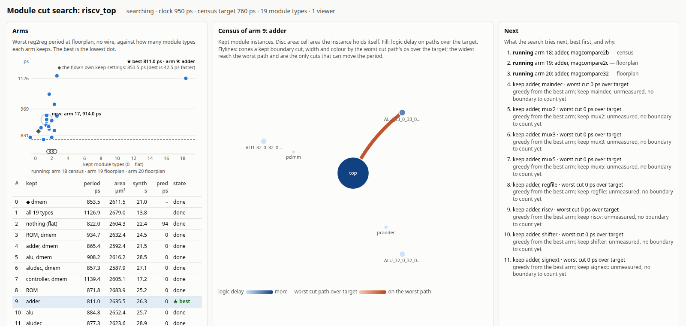

# Module-cut search

Which modules should synthesis keep (`SYNTH_KEEP_MODULES`)? Try the keep
sets, measure each one, keep the best.

## Run it

    bazelisk run //tools/macro_select/cut:generate_cut -- //pkg:flow out.json

- A link with a token is printed first. It's reachable over the VPN you
  ssh'd in on (the address in `SSH_CONNECTION`). Open it to watch the search.
- Bazel builds the flow's synthesis and floorplan once, as dirty-lane trees
  (`.claude/skills/dirty-lane`). After that, each keep set is synthesised by
  yosys and floorplanned by ORFS's make outside Bazel, in seconds to minutes.
- `out.json` holds the best keep list and every keep set measured.
- The page stays up until no browser has been connected for `--idle`
  seconds (300) after the search; `--max-arms` (40) caps the search.

## How it decides

- **Score:** the worst register-to-register period, measured on the
  floorplan after `repair_design -pre_placement` and with no wire, then
  area, then synthesis time. Input and output constraints are often guesses, so they
  don't count (ORFS #4583).
- **Control:** the flow's own keep settings run as an arm of their own, so
  every number reads against what the flow does today.
- **What to try next:** a *census* (`../keep_census.tcl`) on each floorplan
  finds where a kept module's boundary cut through a path. Dropping a keep
  is worth trying when its boundary cuts the worst path.
- **Search:** every keep set when there are at most 16, otherwise one
  module type flipped at a time from the best so far. A type is kept or
  flattened with all its instances.

## Reading the page

| Panel | Shows |
|---|---|
| Arms | each arm's period against how many module types it keeps; the lowest dot is the best, ◆ is the control, running arms sit on the axis and the newest pulses |
| Census | kept instances: disc size is the cell area each holds itself, fill is logic delay. Flylines are boundaries that cut a path: the wider and darker, the closer that path is to the worst one. |
| Next | what it tries next and why |

## On riscv32i

The search on asap7 riscv32i (the picture above) and its confirmation
in a clean build, `test/cut_riscv32i`:

- The census pointed at one boundary: `dmem`, kept by riscv32i's
  `SYNTH_MINIMUM_KEEP_SIZE` for its four SRAMs' area, cut the worst path
  between the address adder and the SRAMs' enable decode. It was the only
  keep with a predicted gain.
- Through global route at 780 ps under ORFS's own settings, flat
  synthesis gives a 5.2 % shorter reg2reg period than the keep (791.8
  against 835.6 ps); of the endpoints within 10 % of the period, 995 are
  faster and 3 slower. `SWAP_ARITH_OPERATORS` is worth 11 % on top,
  independently.
- At floorplan the search ranked keeping the comparator cells first;
  global route did not confirm it. Confirm a winner through global
  route, at a clock repair cannot meet: at riscv32i's own 950 ps every
  keep set closed at the clock.

## Caveats

- Numbers are from floorplan, with no wire and outside Bazel's cache. Put
  the winner in the flow's BUILD and confirm it with a clean build to
  global route.
- A flow that Bazel synthesises in partitions (`SYNTH_NUM_PARTITIONS`) is
  synthesised serially here, the control too.
- Small structural changes move ABC's result, so a keep set can move the
  period with no cut path near the worst: read a difference of a few
  percent as noise until a clean build repeats it.

## Developing the page

`bazelisk test //test/cut_page:page_test` loads the page on a recorded
state in Chrome for Testing's headless shell, a dev-only download, and
fails on a console error. `bazelisk run //test/cut_page:record -- //pkg:flow
out.json frames/` records a search, a PNG every 10 s; the server reads
`page.html` on each load, so an edit shows in the next frame.
